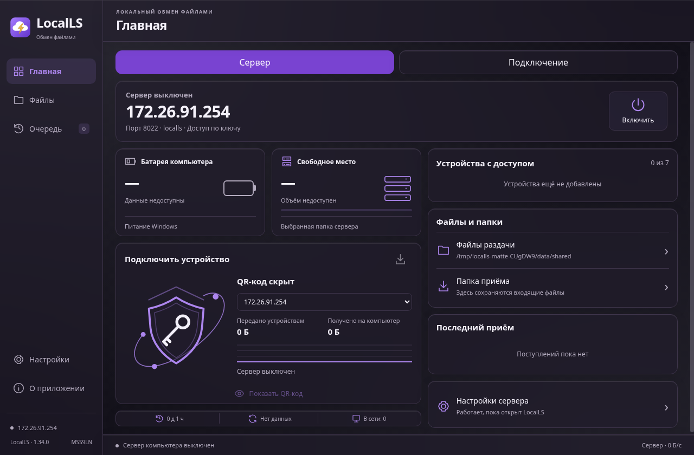
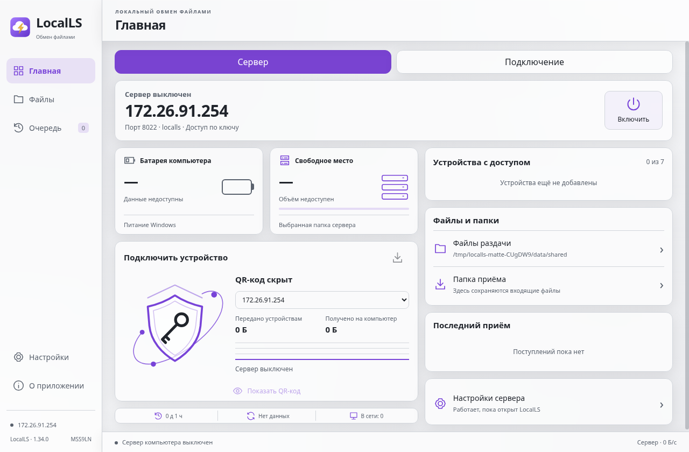

# LocalLS Windows 1.34 — MSS9LN

[Скачать установщик](../downloads/LocalLS-1.34-Windows-x64-Setup.exe?raw=true) · [Короткая инструкция](README.md)

Исправлено: отклонённый пароль больше не меняет профиль в памяти; смена профиля во время SSH-проверки отменяет прежнюю попытку до отправки пароля/ключа. Обе ошибки сначала воспроизведены, затем пройдены регрессии с двумя реальными SSH/SFTP fixture.

Добавлены матовые полупрозрачные панели, включая файловый менеджер, и системный Acrylic для Windows11 22H2+. Текст/значки остаются непрозрачными, светлая/тёмная тема согласована с окном. Включение: «Оформление → Эффект стекла → Сохранить». На других ОС — матовые панели.

Проверки: 50 Node +2 проверки сборки,4 проверки версий,GUI клиента/сервера/QR,32 комбинации оформления и3 размера окна,перезапуск,реальные SFTP-файлы/вложенные и пустые папки. Окончательный app.asar прошёл сервер/QR/оформление и2 новые регрессии. NSIS Unicode,содержимое извлечено и сверено,PE/версия/иконки проверены. Исправлен4-минутный тайм-аут упаковщика: отдельный NSIS с пределом15минут,предупреждения запрещены,пакет проверяется на совпадение исходников до повторной упаковки.

Тестовая сборка: проверки GUI и loopback выполнены на Linux Electron; системный Acrylic/DWM,DPAPI,установка/удаление/брандмауэр на физической Windows не проверены. Windows-вызовы Acrylic покрыты модульными тестами. Authenticode-подписи нет. Android1.36/code58,Fedora,ключи,настройки и старые артефакты сохранены.

SHA-256: `4c51b83d8b45bacd0338629375124268acf0335beeceda974597b0875c17e7e8`.

