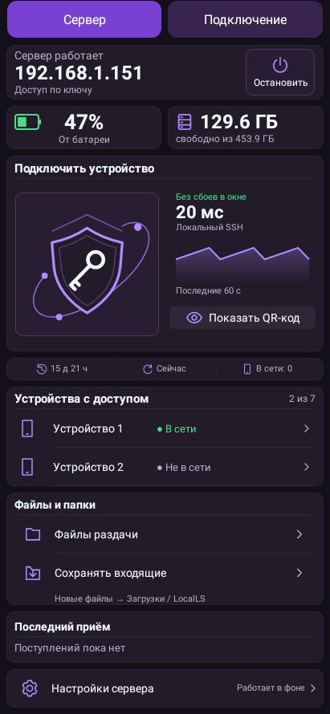
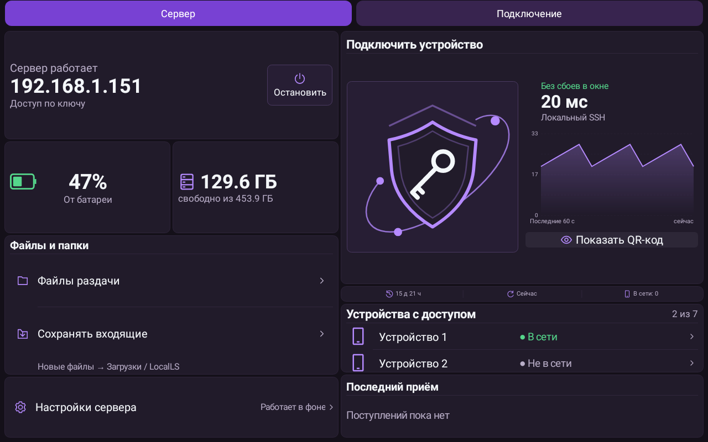

# LocalLS 1.36 — выравнивание SSH

Убран заголовок «Стабильность». Правая колонка начинается на уровне квадрата щита/QR-кода; строки выровнены по левому краю области графика. Тема, обводка и полоса показа QR-кода сохранены.

Проверки: 13 JVM-тестов интерфейса/QR-кода, 19 Python-тестов, lint Debug/Release без Error/Fatal, BUILD SUCCESSFUL. Матрица вёрстки: 8 тем, 6 размеров экрана, 2 плотности, обычный/крупный шрифт, 0/1/2/3/7 устройств. Сохранена прежняя подпись; совместимость обновления с 1.35 и ZIP alignment проверены.

Превью содержит демонстрационные данные. Проверки — native Robolectric и loopback, без физических устройств; полный набор 462 JVM-тестов повторно не запускался.

SHA-256 APK: `8821c82b55e3b21c31857b609a154df51289661f20cf8c9f35a8bd1dd0afd245`.
