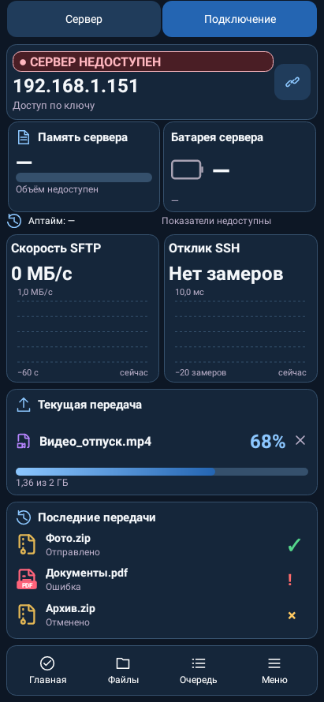
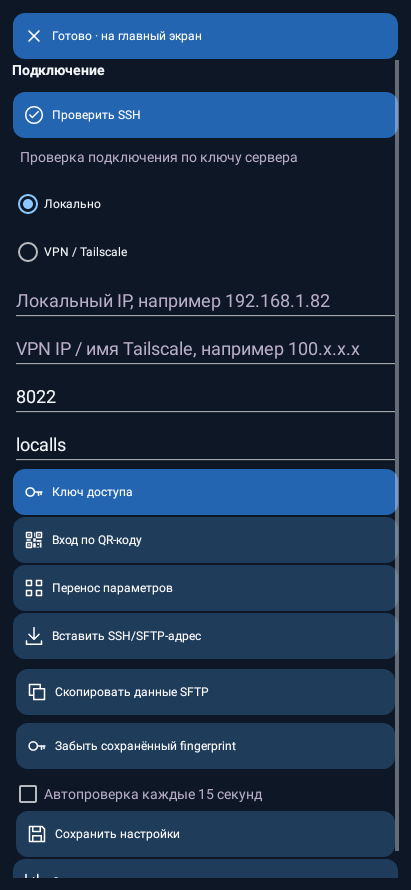
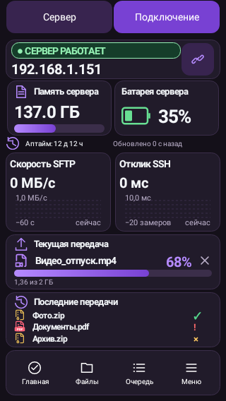

# LocalLS — выравнивание главной и вход по QR-коду

Нативные Android renders Robolectric с явно заданными данными стенда; не фотографии физических устройств.

## Главная телефона: выравнивание и подпись

## Главная без метрик: заголовки и центр кнопки

## Планшет: выравнивание

## Подключение: Вход по QR-коду под ключом

## Маленький телефон320×568

