# LocalLS — компактные кнопки во всех основных окнах

Нативные отрисовки Android views в Robolectric с демонстрационными данными. Это не генеративный макет и не фотографии физических телефонов.

## Мой сервер: запуск и доступ

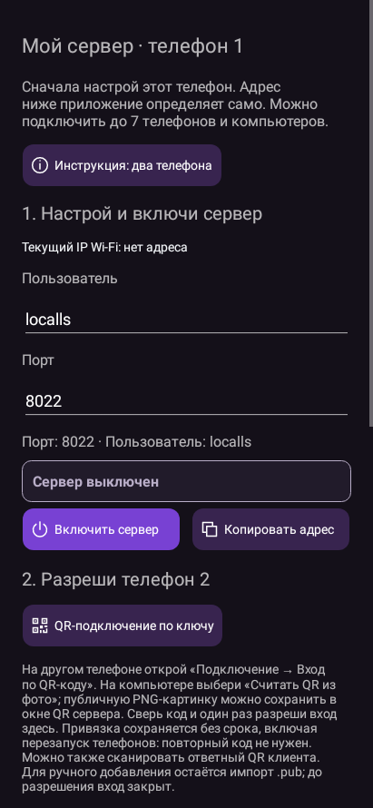

## Мой сервер: приём файлов и отчёт

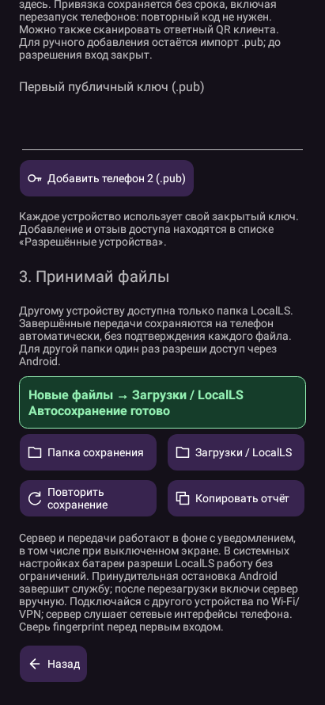

## Подключение

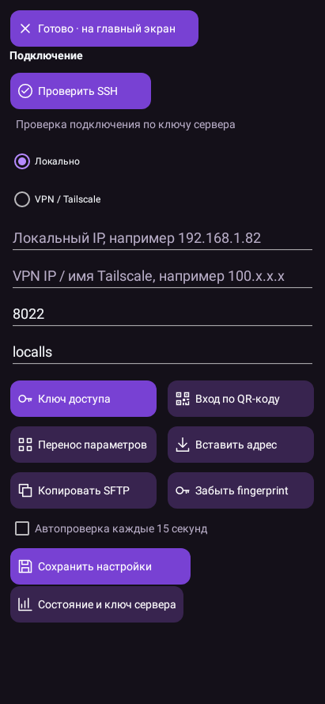

## Ключ доступа

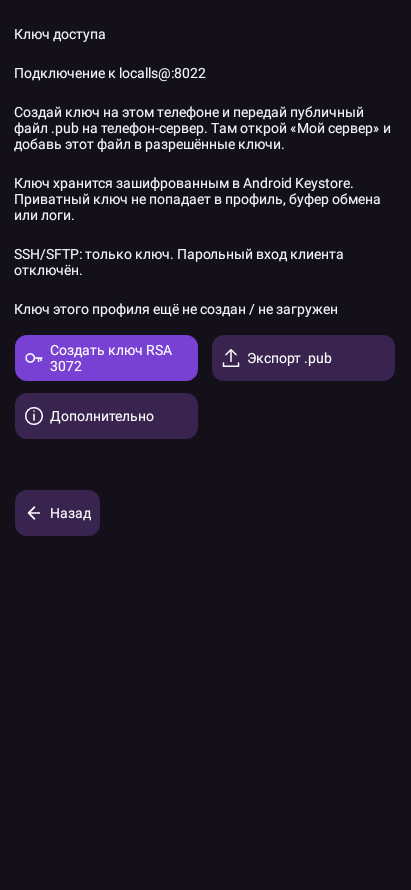

## Настройки приложения

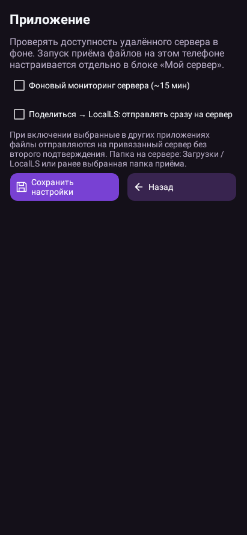

## Сеть

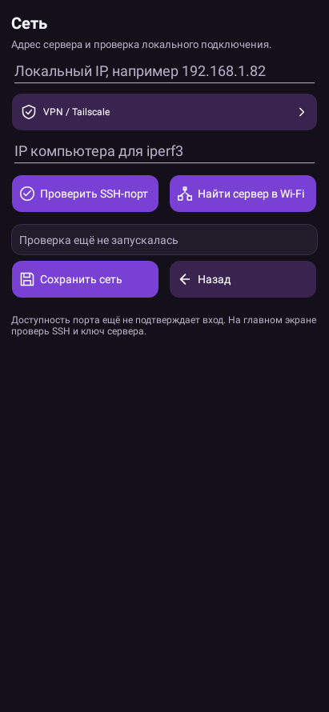

## Диагностика

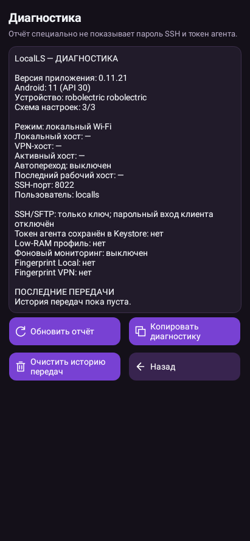

## Перенос подключения

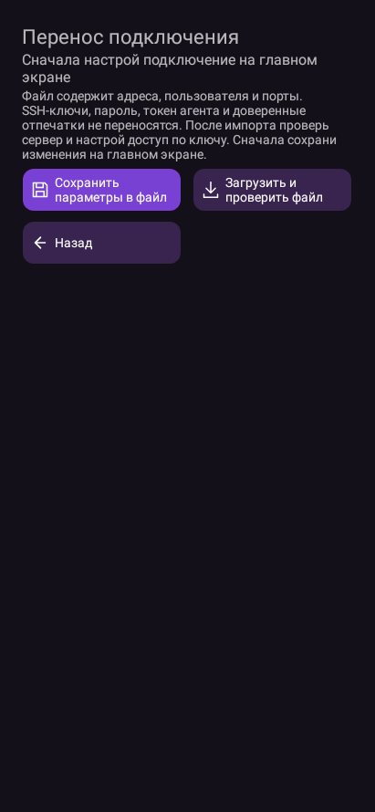

## Очередь

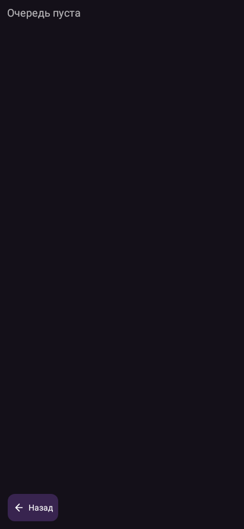

## История и графики

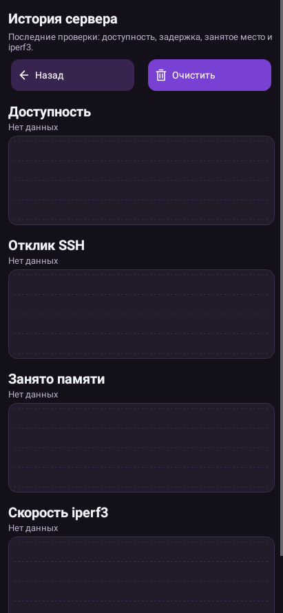

## Главное меню

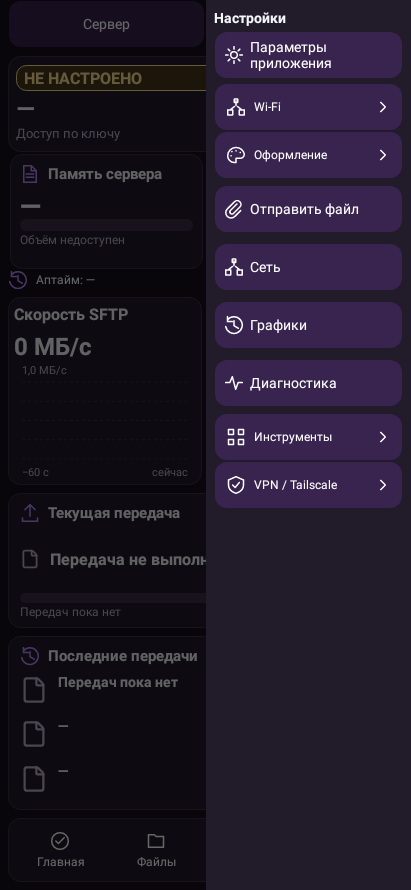

## Существующий дополнительный мастер Termux

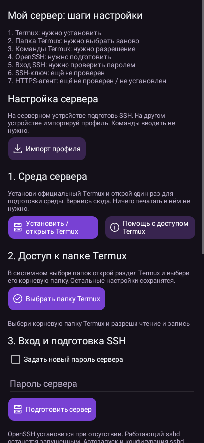

## Просмотр папки встроенного сервера

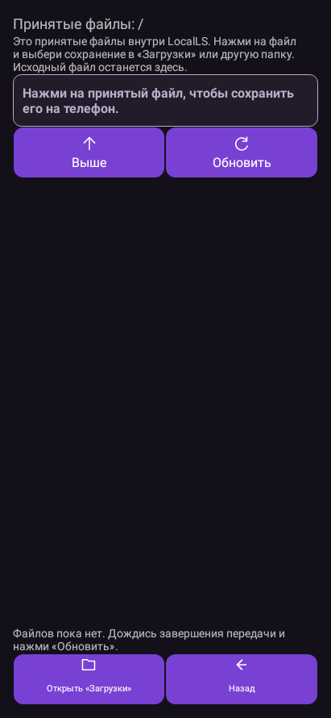

## Инструкция

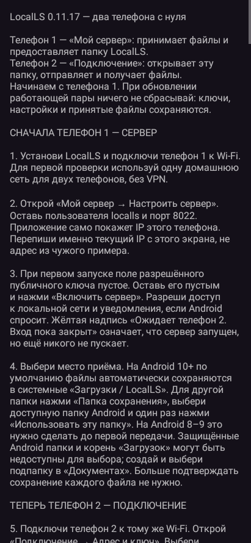

## Отправка из другого приложения

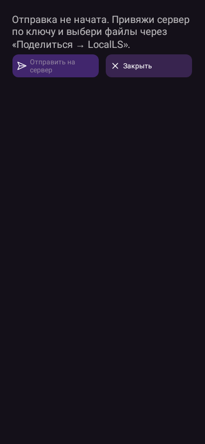

## QR работающего тестового сервера

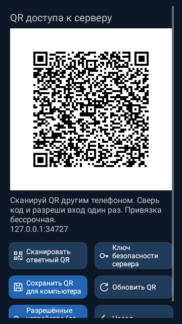

## Список разрешённых устройств

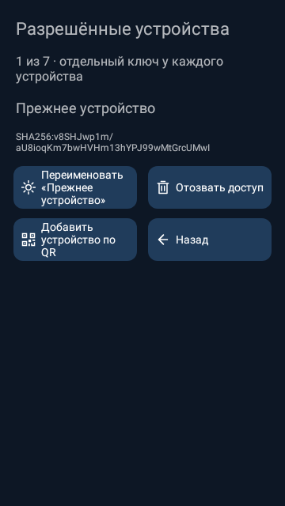

