# LocalLS — согласованный дизайн и серверная панель

Нативные отрисовки Android views в Robolectric с демонстрационными данными. Это не генеративные макеты и не фотографии физических телефонов. Показаны новые серверные экраны, QR-переключатель, журнал и главная клиента в двух темах.

## Сервер телефона: QR скрыт

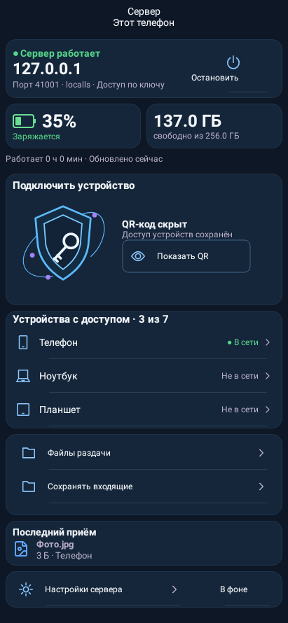

## Сервер телефона: QR открыт

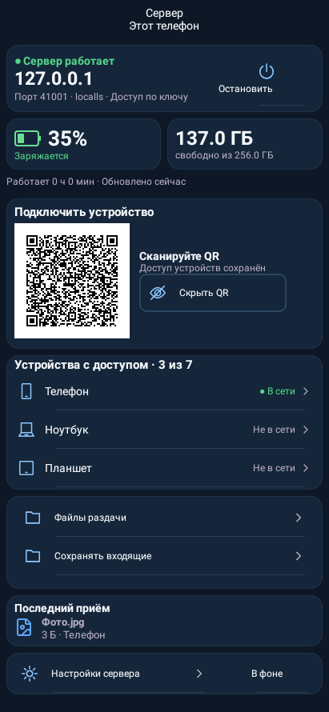

## Сервер планшета: QR скрыт

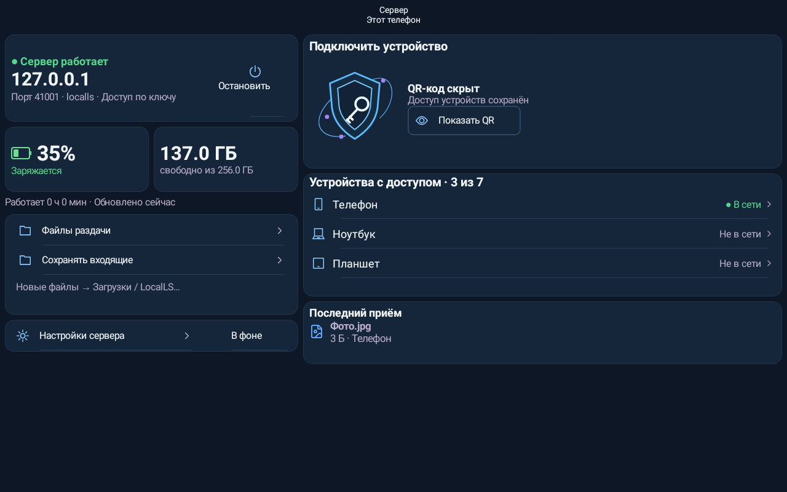

## Сервер планшета: QR открыт

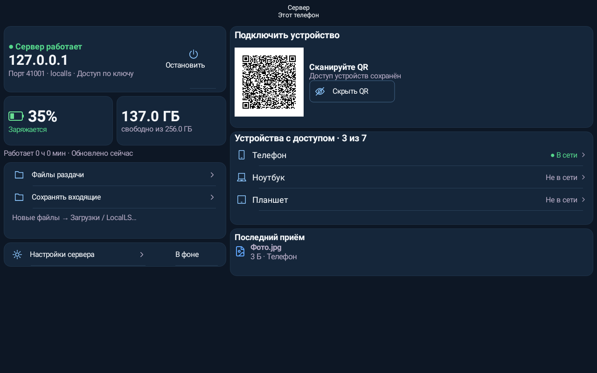

## Подключение: постоянные подписи и список команд

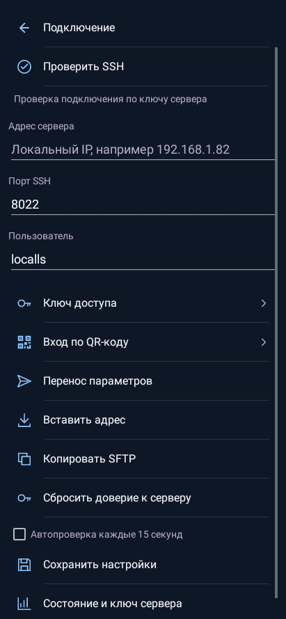

## Журнал фактически полученных тестовых файлов

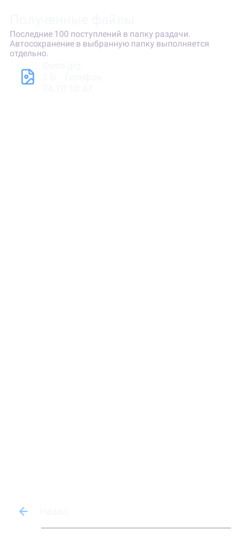

## Сервер: горизонтальное окно и системный шрифт200%

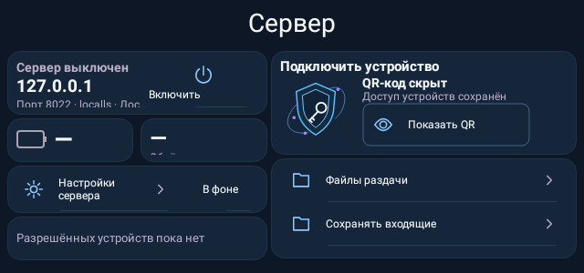

## Главная клиента: пример передачи и графиков, фиолетовая тема

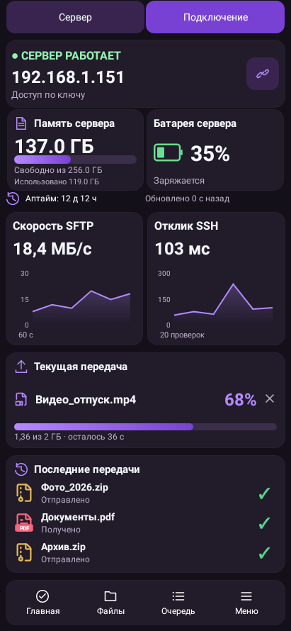

## Главная планшета: пример передачи и графиков, фиолетовая тема

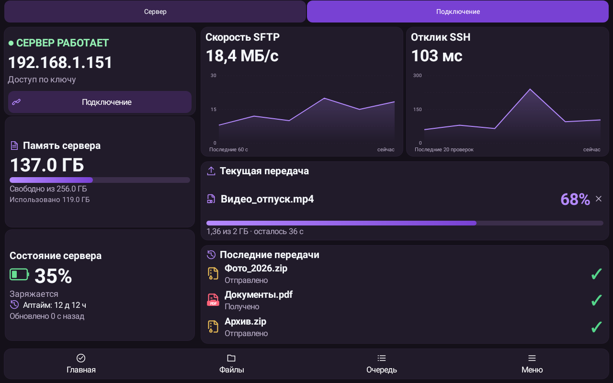

## Главная клиента: тема Океан, состояние без замеров

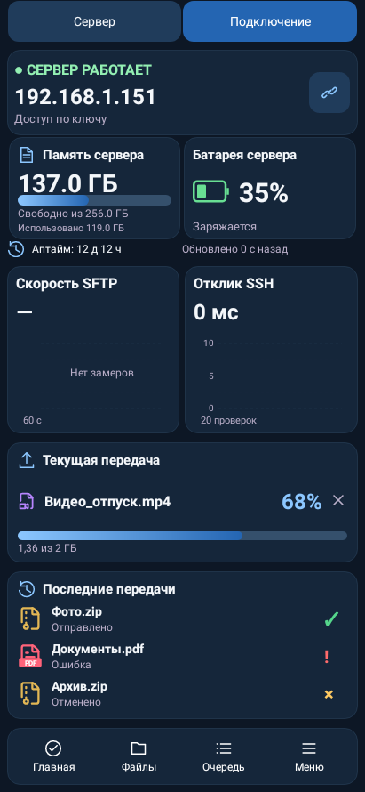

## Главная планшета: тема Океан, состояние без замеров

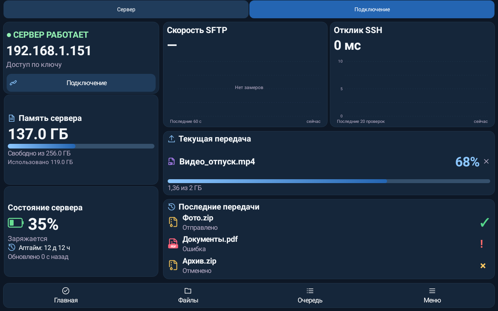

## Подключение: нижняя часть

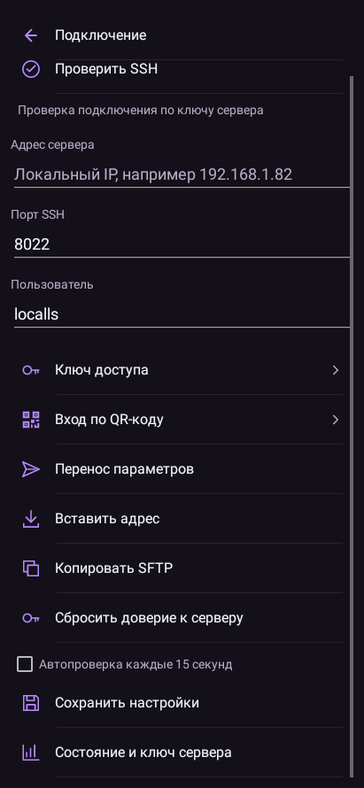

## Настройки сервера, включая явное включение клиентского режима

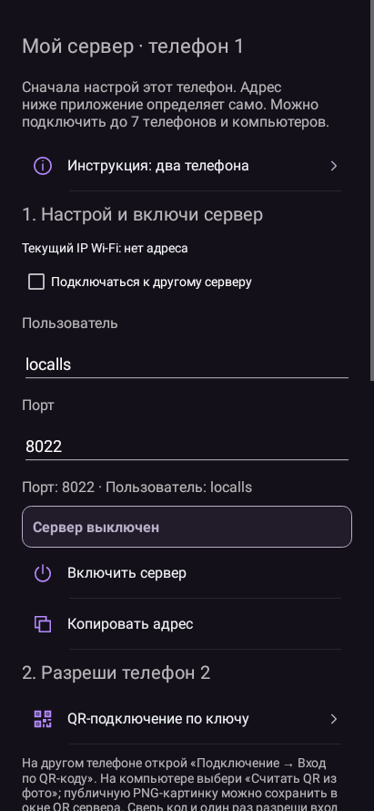

## Ключ доступа

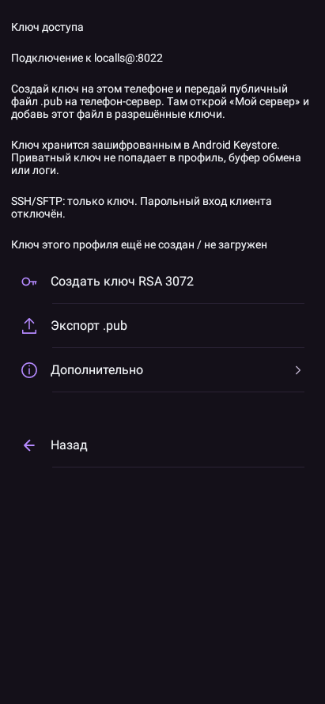

## Управление доступом устройств

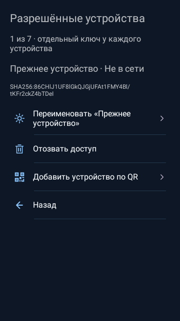

## Настройки приложения

