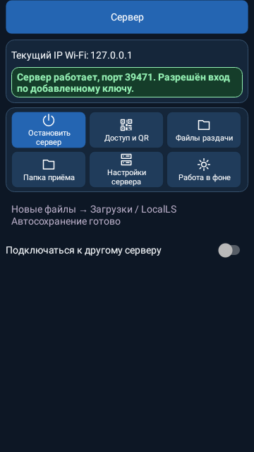
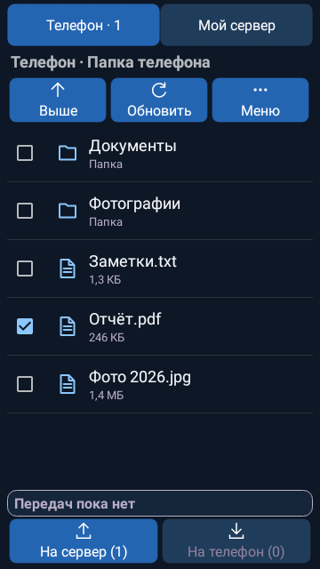
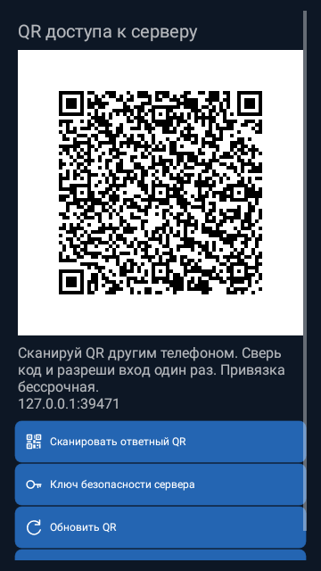

# LocalLS — интерфейс после аудита

Нативные кадры настоящих Android views с демонстрационными данными, 360×640 px. Это тестовый рендер, не фотографии физического телефона. QR относится к закрытому локальному стенду. Подпись, ключи и настройки пользователя в кадры не попадают.

## Главная клиента

## Главная сервера

## Выбор файлов телефона

## Выбор файлов сервера

## QR-подключение

