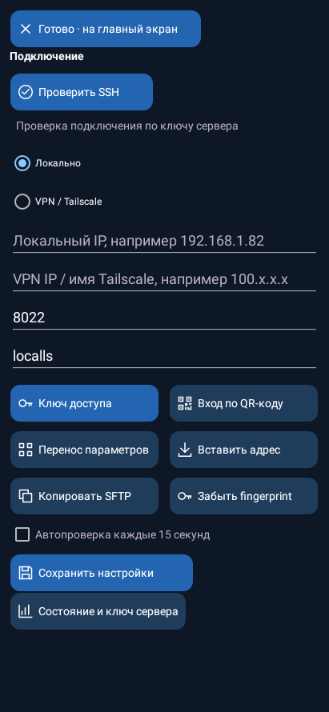
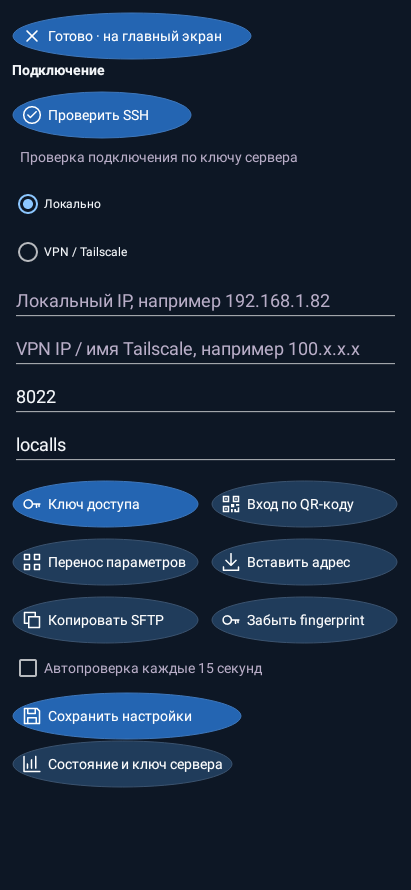
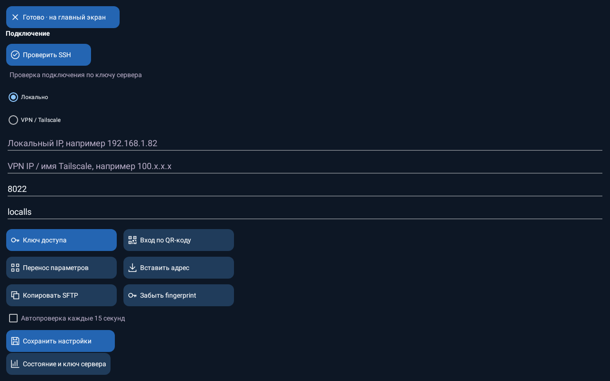

# LocalLS — компактные кнопки и формы

Нативные отрисовки Android views в Robolectric с демонстрационными данными. Это не генеративный макет и не фотографии физических телефонов.

## Подключение: компактные кнопки

## Круглая форма: внешний контур

## Скруглённая форма

## Прямоугольная форма

## Главная с прежними графиками

## Подключение на планшете: ширина кнопок ограничена

