# LocalLS — исправление контуров, UI-R3

Свежие нативные Android-отрисовки Robolectric из полного прогона: это не генеративные макеты и не фотографии физических телефонов. Данные стенда, реальный loopback SSH для серверных снимков. Сохранённая тема пользователя автоматически не меняется.

## Сервер телефона — QR скрыт

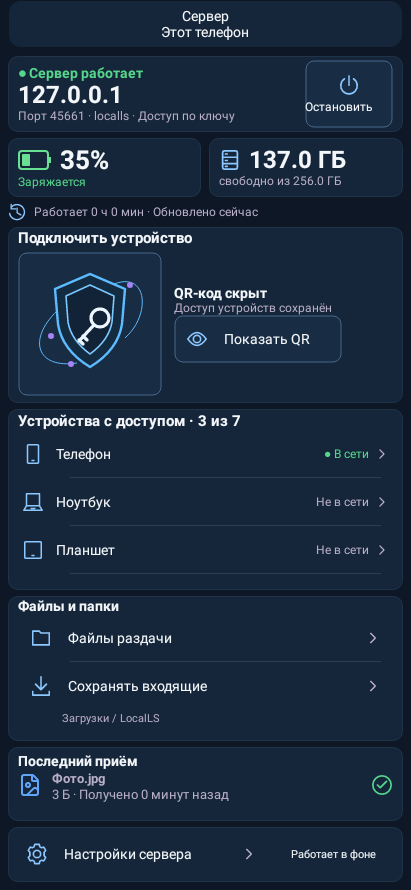

## Сервер телефона — QR показан

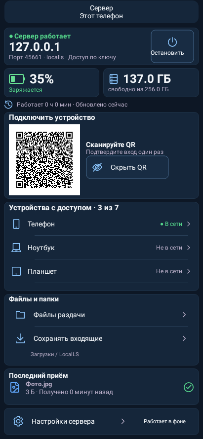

## Сервер планшета — заголовок слева, QR справа

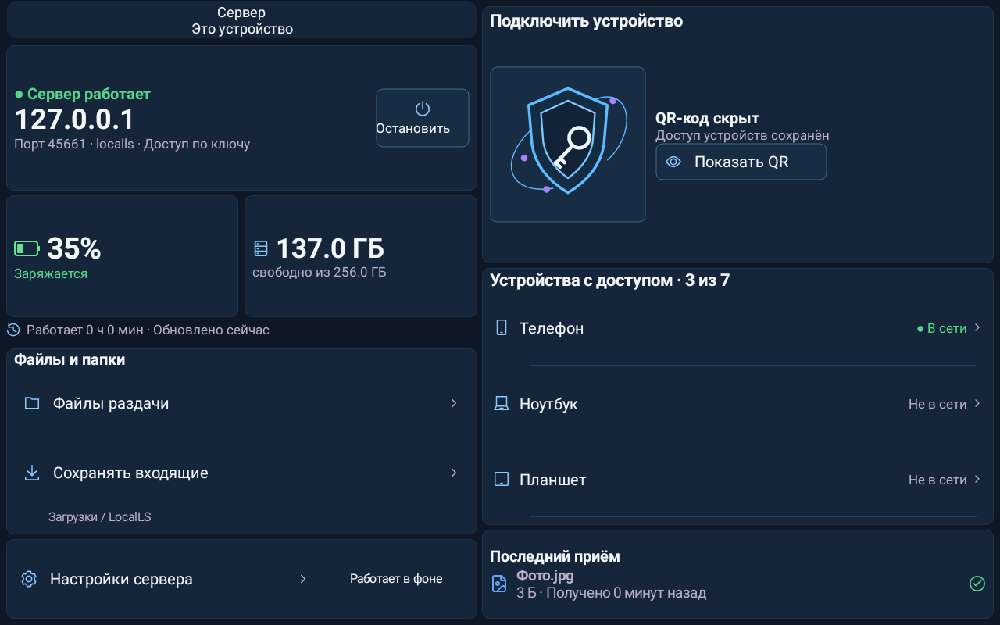

## Сервер планшета — QR показан

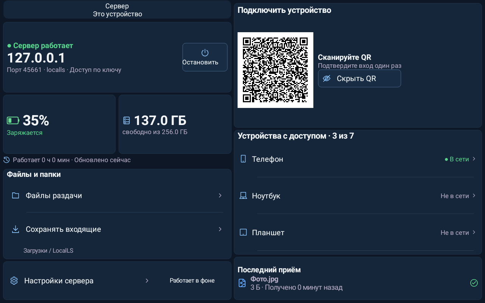

## Подключение — карточка проверки SSH и список действий

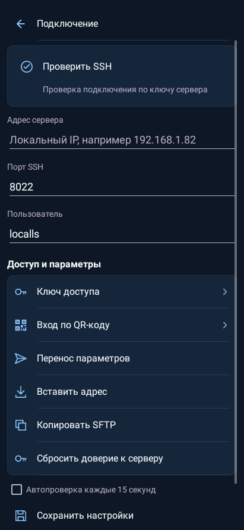

## Малое горизонтальное окно, системный шрифт 200%

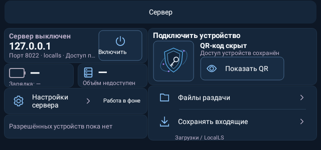

## Главная телефона — тема Океан, без замеров

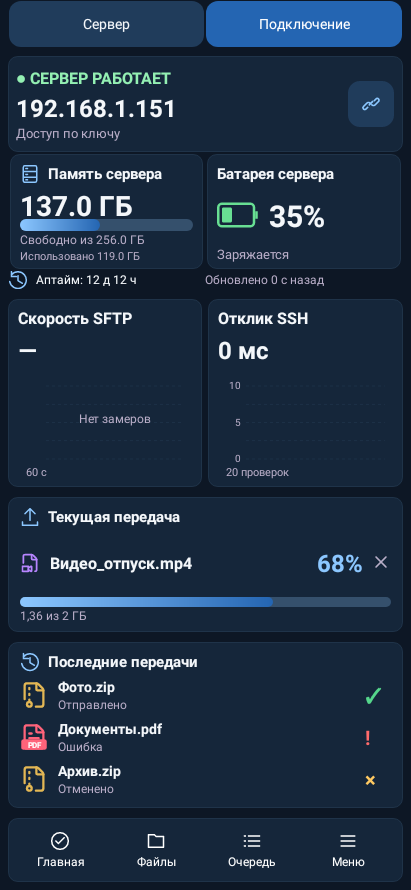

## Главная планшета — тема Океан, без замеров

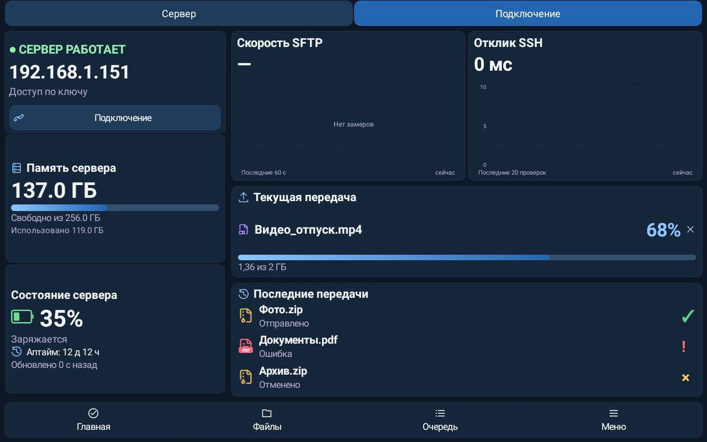

## Главная телефона — пример передачи и графиков, фиолетовая тема

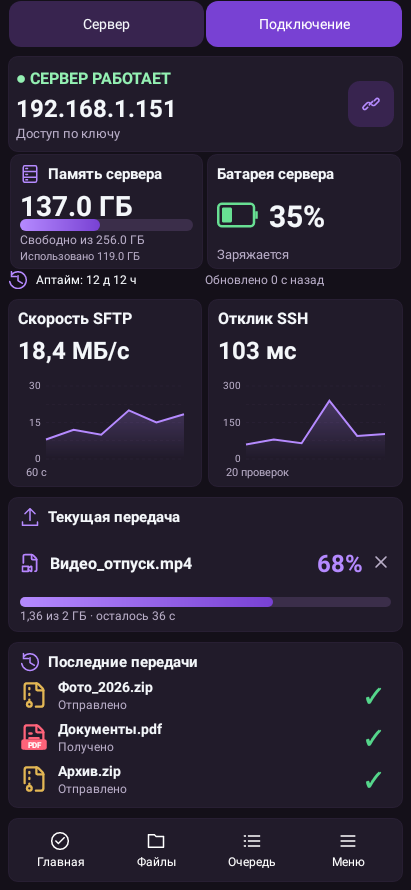

## Главная планшета — пример передачи и графиков, фиолетовая тема

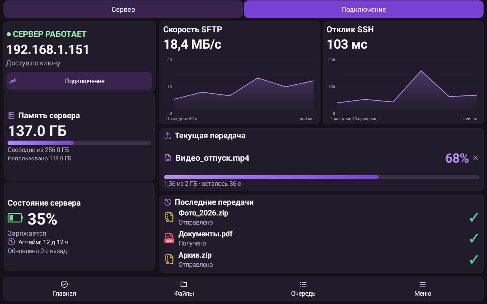

## Журнал фактически полученных тестовых файлов

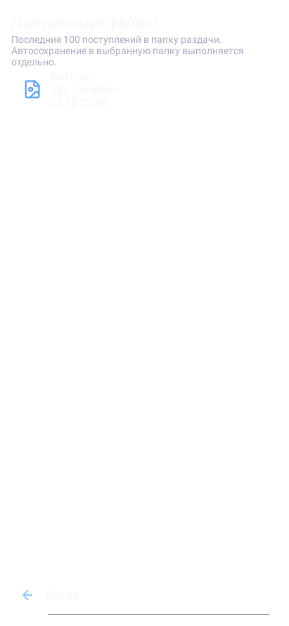

## Диагностика — отметка установленной сборки UI-R3

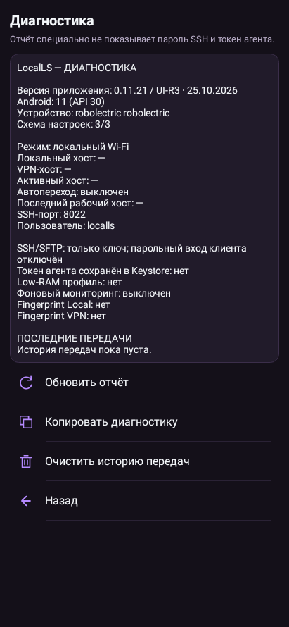

