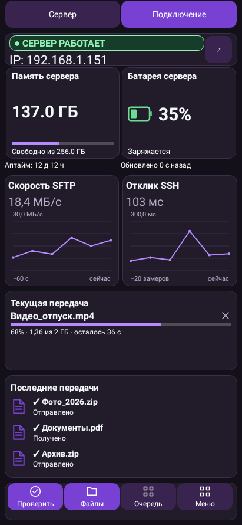
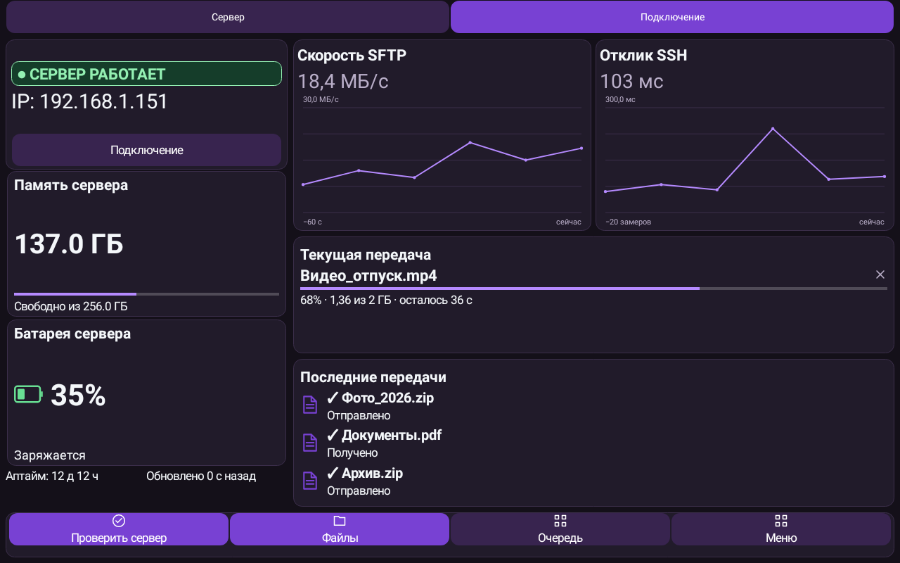
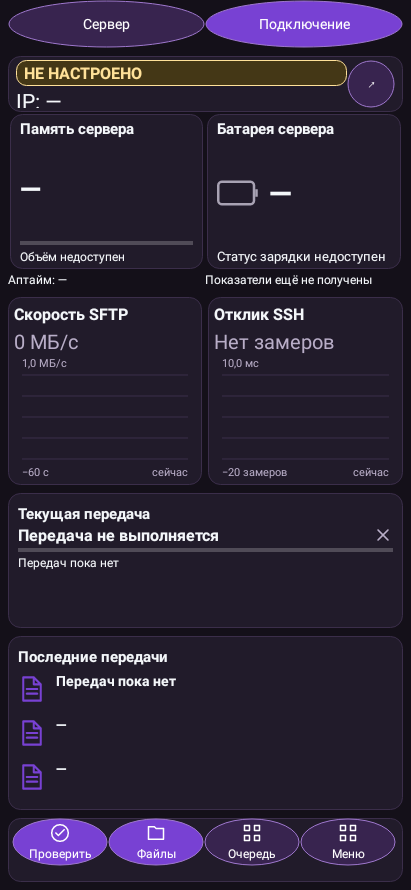
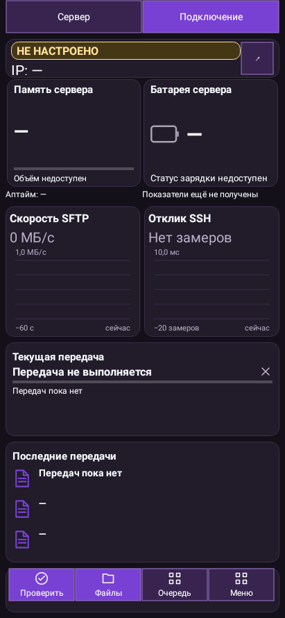
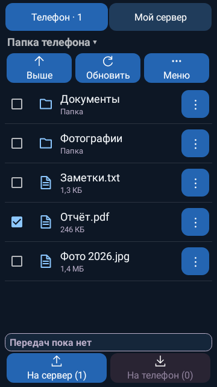
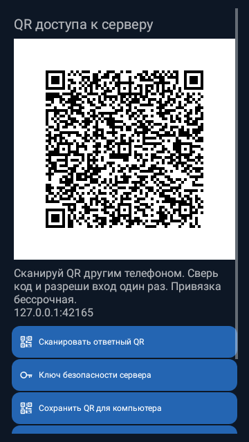
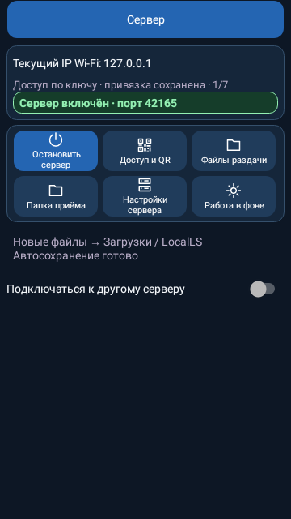
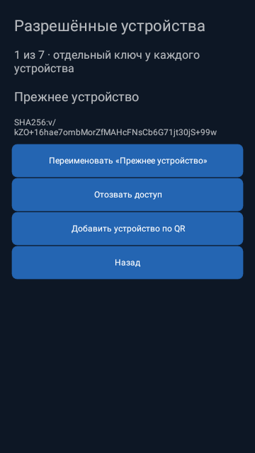

# LocalLS — главная телефона/планшета и внешняя форма кнопок

Это нативные Android view renders Robolectric, не сгенерированные макеты и не снимки физических устройств. Данные демонстрационного закрытого стенда: заряд, память, графики и файлы заданы явно для проверки UI. В рабочем приложении значения поступают с сервера/из очереди.

## Главная телефона: компактные карточки и три последних файла

## Главная планшета: крупные карточки и графики

## Круглая внешняя форма кнопок

## Прямоугольная внешняя форма кнопок

## Файловый менеджер: галочка и отдельное меню ⋮

## QR доступа

## Главная телефона-сервера

## Разрешённые устройства

