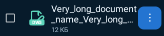
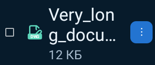

# LocalLS 1.23 / code45 — дополнительная проверка файлового менеджера

Проверено UTC: 2026-10-26T14:28:15.539774+00:00.

Подтверждена и исправлена ошибка длинных имён: FileEntryRow сочетал maxLines=2 с MIDDLE, который Android не поддерживает для многострочного сокращения. Layout имени содержал больше двух строк, а видимая часть молча обрезалась. Режим заменён на поддерживаемый END: две строки и видимое многоточие. Полное имя, путь, содержимое файла, тип значка и описание для выбора остаются неизменными.

Проверки:

- Новый нативный регрессионный тест воспроизвёл ошибку до правки. Исправление проверено в 80 вариантах: 5 тем, два масштаба шрифта, две плотности и четыре ширины 280/320/411/600dp. Тест также проверяет сохранность полного имени и доступность меню.
- Целевой прогон 22 тестов FileLabelRendering/ConnectionFileIcons/FileManagerTools прошёл без ошибок.
- Полный финальный прогон: **423 JVM + 19 Python**, без ошибок, пропусков и необработанных исключений в Gradle/XML. Все 422 прежних теста сохранены. QR, SSH/SFTP, очередь, папки, выбор файлов и отрисовка входят в существующий набор.
- Аудит проекта/архитектуры, проверка версий, lintDebug/lintRelease, assembleRelease, assembleDebug и assembleDebugAndroidTest пройдены. Lint UnusedResources: 0.
- Прежние исправления 1.22 и очистка 1.21 сохранены; удалённые классы и JVM-тесты не попали в APK. Windows/Linux код в этом этапе не менялся, их тесты повторно не запускались.
- Превью — нативный рендер Robolectric с тестовым именем файла. Проверка на физических устройствах не заявляется.

APK `LocalLS-1.23-code45-files-20261026.apk`. SHA256 `fbd21e9168df5e673ca39c5cf450d293ed519302d0da2aef933c673bcd883a0b`.

Package `com.bitpoint.homeservercontrol`, 1.23/code45. Прежний сертификат SHA256 `a2230c3032135def93cd5e8224ca3e26ad8e98f294b5e372a33b1e468caa221a`. Подпись API24–36, ZIP alignment и обновление с 1.22/code44 проверены. Файлы подписи, ключи, доверие, настройки и helper сохранены; прежние APK не перезаписывались.

## Нативные превью

| Обычный шрифт | Двойной шрифт |
|---|---|
|  |  |
