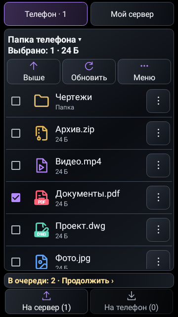
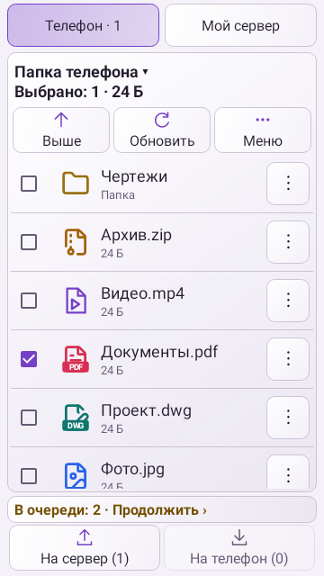
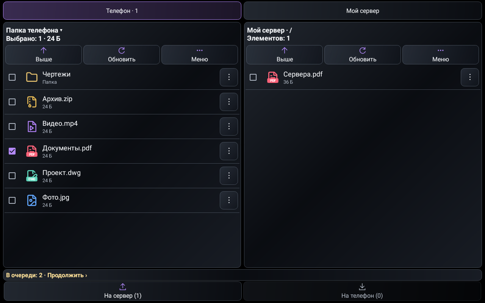
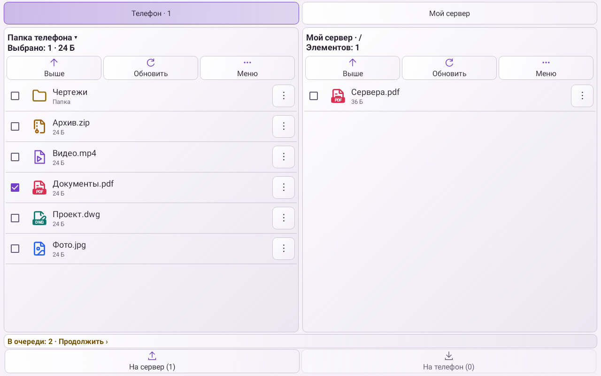
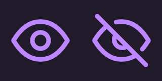
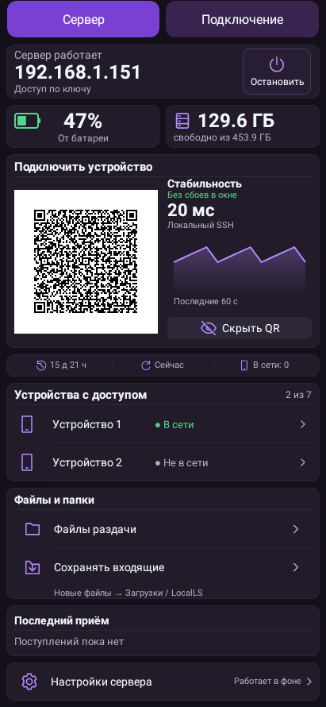

# LocalLS 1.28 / code50 — файловый обмен

Проверено 2026-10-27T14:48:56.460982+03:00 (МСК).

Настройка **«Эффект стекла»** теперь применяется к панелям файлового обмена, вкладкам, кнопкам, меню строки и состоянию передачи. Используются полупрозрачные поверхности, выбранная форма кнопок и общая обводка. Кэш прокрутки прозрачен, разделители и галочки соответствуют теме.

**«Светлый фон»** доступен в списке тем. Сохранён прежний ID `light`: дубликата и сброса выбора нет. Исправлен конфликт с чёрным стеклянным оформлением — светлая тема сохраняет светлый фон и прозрачные светлые карточки. Текст и значки контрастные. На Android API26+ системная навигация светлая с тёмными значками; на API24/25 сохранена читаемая тёмная панель.

Значки «Показать / Скрыть QR» перерисованы с общей геометрией глаза и чистой диагональю. Полоска QR остаётся без обводки.

В файловом менеджере:

- Выбор показывает количество и объём отмеченных файлов. Для папок не подставляется непроверенный рекурсивный размер. Галочка выбирает, нажатие на папку открывает её.
- Сохранённая очередь отображается кратко: «В очереди: 2 · Продолжить». Нажатие сразу открывает очередь. Ошибки сохраняют подробности и диагностику в диалоге; ошибка приёма не скрывается сообщением об очереди.
- Индикатор передачи — 4dp, цвет соответствует теме. В коротком горизонтальном окне сохранены список высотой не менее 80dp и области нажатия 48dp.
- На планшете выровнены заголовки и инструменты обеих панелей, включая выбор только с одной стороны. Без выбора показано число элементов. Зазоры между вкладками и блоками согласованы.

## Проверки

Полный прогон **438 JVM + 19 Python** прошёл по утверждениям. Строгая сверка журналов затем обнаружила одно фоновое исключение при закрытии стандартного Apache SSHD клиента тестового стенда. Новая детерминированная проверка сначала воспроизвела потерю позднего callback. Исправлено завершение стендового клиента через уже проверенный `NioCompletionExecutor`; пакетные проверки и проверки авторизации сохранены.

После этого повторён весь транспортный набор **75 JVM + 19 Python**, lint и сборки. Production-файлы совпадают с полным прогоном по SHA256. Итоговые результаты **439 уникальных JVM** успешны: ошибок, пропусков и необработанных исключений нет. Все **433 прежних test IDs** сохранены.

Дополнительно проверены:

- **192 нативных состояния** файлового менеджера: 3 темы × 2 режима стекла × 2 размера шрифта × 4 размера экрана × 4 состояния передачи.
- Галочки, количество и объём выбора, переход к очереди, полные сведения об ошибках, сохранность настроек связи, системные панели API24/30, значки глаза и 8 сочетаний формы/стекла.
- Прежняя матрица стекла из 320 вариантов сохранена. Ожидание фона обновлено только для светлого стекла.
- QR, SSH, SFTP, очередь, папки и доверие входят в прежний набор; проверки не отключались и не ослаблялись.
- Аудит версий, проекта и архитектуры; lintDebug/lintRelease; assembleRelease, assembleDebug и assembleDebugAndroidTest — **BUILD SUCCESSFUL**. Тестовые и ранее удалённые классы отсутствуют в release DEX.

При проверках исправлены недостаточная высота списка при активном индикаторе, потеря формы меню строки без стекла и смещение заголовков планшета. Ошибки настройки тестового DocumentsProvider и снимка настроек исправлены в фикстуре; разрешения приложения не менялись. Прерванные собственные прогоны не выдаются за завершённые.

Снимки ниже — нативный Robolectric-рендер с демонстрационными файлами и показателями. QR содержит только данные макета. Физические устройства не подключались; desktop/Linux не менялись.

## APK

`LocalLS-1.28-code50-files-20261027.apk`

SHA256: `7d4fb0c1928756234d5376a5c0f29f87e3cb08775bb0e3c01cd18cbd25e69c8f`.

Package: `com.bitpoint.homeservercontrol`, версия **1.28 / code50**.

Прежний сертификат SHA256: `a2230c3032135def93cd5e8224ca3e26ad8e98f294b5e372a33b1e468caa221a`.

Подпись API24–36, ZIP alignment и обновление с 1.27/code49 проверены. Ключи, доверие, настройки связи, release-ветка, тег и прежние APK сохранены.

## Телефон

| Тёмное стекло | Светлое стекло |
|---|---|
|  |  |

## Планшет

## Значки QR

