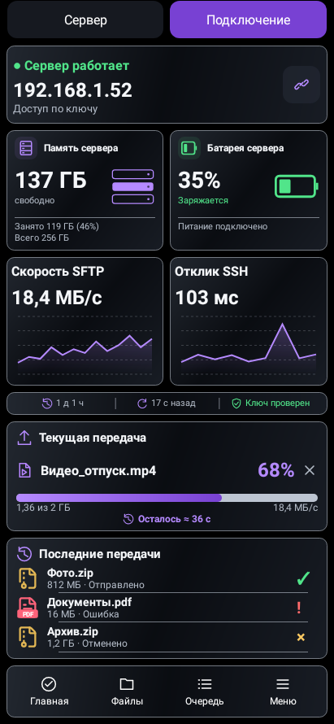
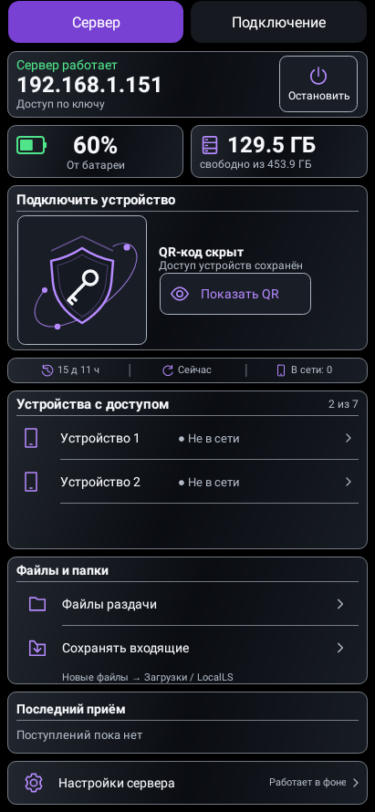
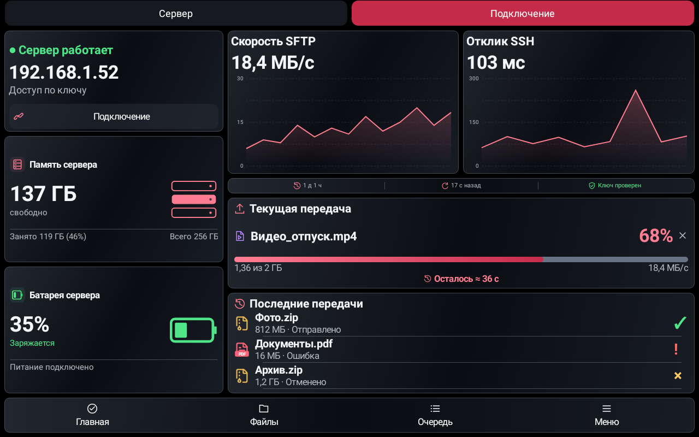
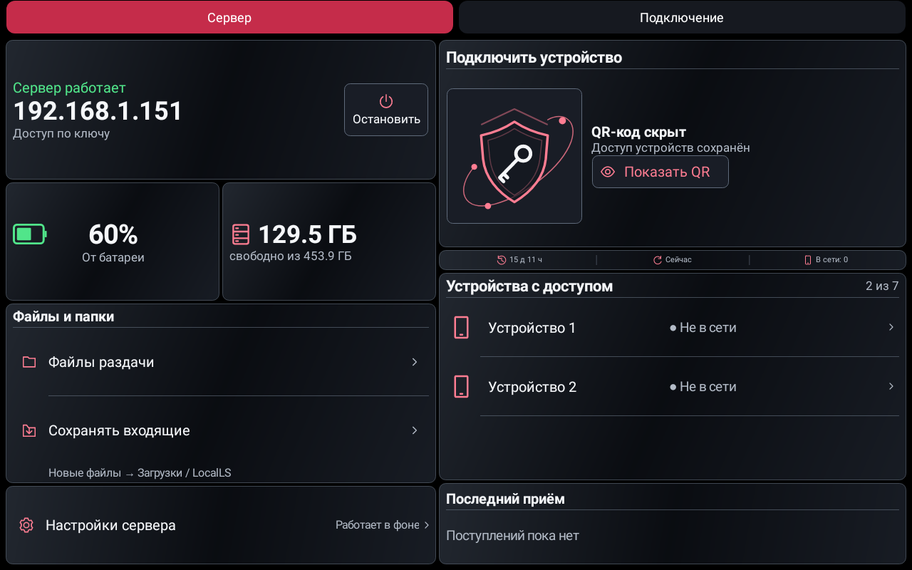
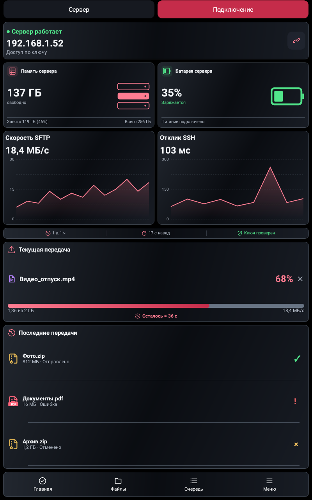
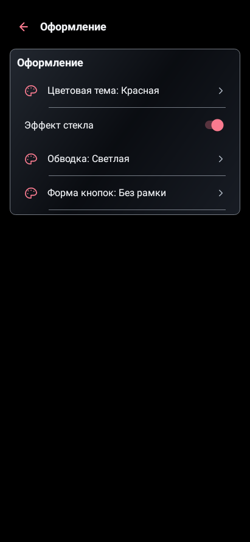

# LocalLS 1.26 / code48 — оформление и тонкие полоски

Проверено UTC: 2026-10-27T05:40:20.534802+00:00.

В «Оформлении» добавлен отдельный тумблер **«Эффект стекла»**: чёрный фон и полупрозрачные дымчатые поверхности с мягким градиентом. По умолчанию стекло выключено, прежняя тема сохранена. **«Обводка → Светлая»** выбирается независимо от стекла и цвета. Три новых цвета — **Красная, Бирюзовая, Серебристая** — добавлены в существующий список, всего8тем. Отдельных цветных плиток нет. Оформление доступно также из настроек телефона-сервера.

Однострочная полоска расположена под QR-блоком сервера и под графиками на клиенте. Высота28dp, в тесной горизонтальной раскладке24dp. Значки и подписи центрируются вместе, используются одинаковые разделители. Время работы и обновление убраны из прежней свободной строки. На сервере показано действительное число подключённых устройств; на клиенте зелёное подтверждение требует успешного входа и совпадения сохранённого ключа, без mismatch/необходимости первого доверия. Зазор между вкладками увеличен до6dp.

Сохранены обе диаграммы, текущая передача с временем по центру, три записи истории, QR/папки и выбранная графика. На тесных экранах уплотняются вторичные пояснения; основные действия сохраняют48dp. Свободная высота текущей передачи при необходимости отдаётся полным строкам истории без уменьшения текста.

## Проверки

- Чистый повторный полный прогон: **430 JVM +19 Python**. После него усиленная проверка возврата между экранами выявила восстановление старого состояния тумблера Android. Исправлена одна настройка сохранения состояния Switch; остальные production-файлы совпадают с полным прогоном по SHA256. После исправления повторены **18 профильных JVM +19 Python**, lint и сборка. Итоговые результаты всех430 уникальных тестов успешны, без ошибок/пропусков/необработанных исключений. Все426 прежних test IDs сохранены.
- Новый набор: **320 нативных сочетаний** стекла (8 тем ×2 плотности ×2 шрифта ×5 размеров ×2 роли), независимое сохранение оформления без изменения связи/ключей, крупные подписи контролов в6 вариантах,16 сочетаний флагов доверия, доступ из серверного режима.
- Существующая проверка состояний передачи теперь покрывает **1344 сочетания** из-за8тем. Первый полный прогон выявил единственный край32px при строке33px на360×728/320dpi; причина исправлена распределением высоты, полный набор повторён и прошёл. Проверки текста не ослаблялись.
- Структурные проверки обновлены под утверждённые полоски: каждый зазор до/после полоски и отдельный центрированный значок времени вместо старого compound-значка. Проверки исходного значка хранилища сохранены.
- Версии, аудит проекта/архитектуры, lintDebug/lintRelease, assembleRelease, assembleDebug и assembleDebugAndroidTest пройдены; **BUILD SUCCESSFUL**. Lint UnusedResources:0. Тестовые и ранее удалённые классы отсутствуют в release DEX.
- QR/SSH/SFTP/очередь/папки входят в прежний набор. Windows/Linux в этом этапе не менялись и повторно не тестировались.
- Картинки ниже — нативный рендер Robolectric с демонстрационными данными. Физические устройства не подключались; это не изображение генератора и не физический скриншот.

APK `LocalLS-1.26-code48-glass-20261026.apk`, SHA256 `387dd78b6fff54eb4e071e7eef78b9b69cfa24bd8fee6842aa70bc65d9502cff`.

Package `com.bitpoint.homeservercontrol`,1.26/code48. Прежний сертификат SHA256 `a2230c3032135def93cd5e8224ca3e26ad8e98f294b5e372a33b1e468caa221a`. Подпись API24–36, ZIP alignment и обновление с1.25/code47 проверены. Подпись, SSH-ключи/доверие, настройки связи и прежние артефакты сохранены.

## Телефон: фиолетовая, стекло, светлая обводка

| Подключение | Сервер |
|---|---|
|  |  |

## Планшет: красная, стекло, обводка по теме

## Оформление

