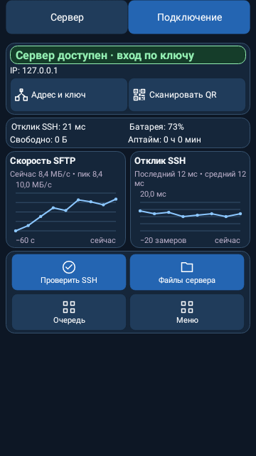
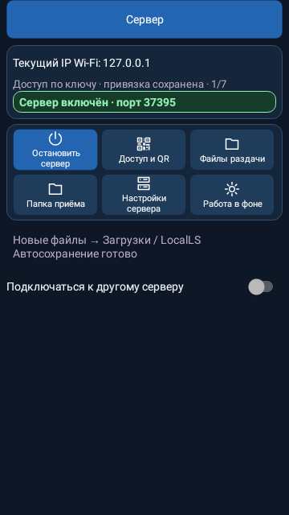
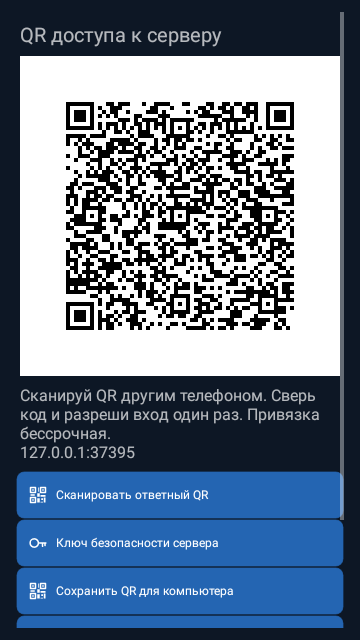
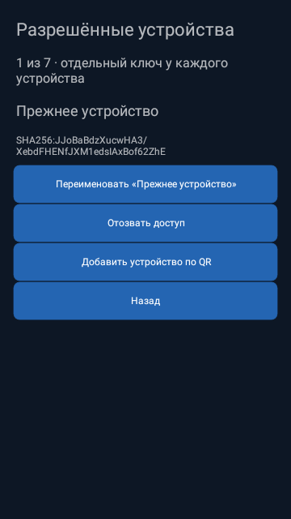
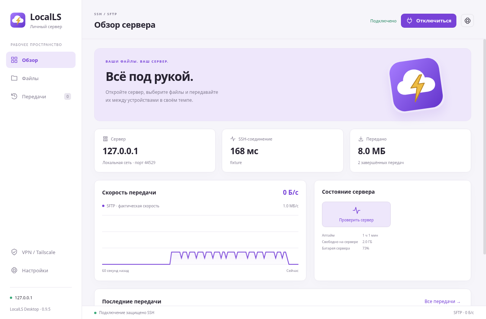
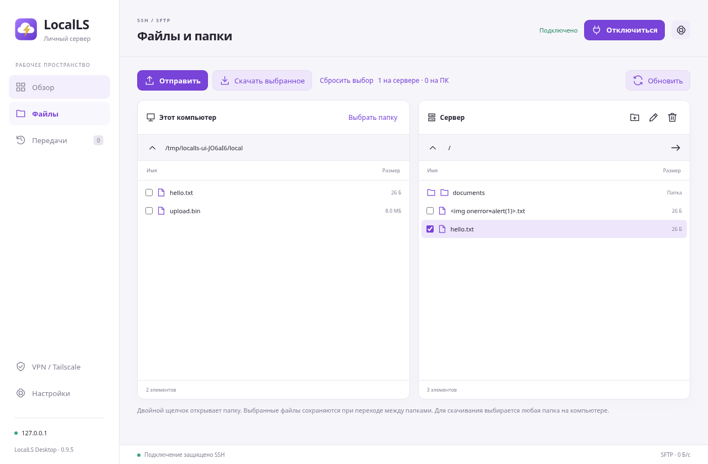

# LocalLS — меньше повторных кнопок, показатели сервера

Нативные Android view renders Robolectric и настоящий Electron GUI на Linux/Xvfb. Демонстрационные данные приватного loopback-стенда. Заряд 73% задан тестовым системным broadcast/SSH fixture; это не измерение физического телефона. Графика и оба Android-графика сохранены.

## Android: главная клиента, заряд и свободное место сервера

## Android: главная телефона-сервера

## Файлы телефона

## Файлы раздачи

## QR доступа

## Разрешённые устройства

## ПК: главная с показателями сервера

## ПК: файловый менеджер

