# LocalLS — действия списком, вариант1

Нативные отрисовки Android views в Robolectric с демонстрационными данными. Это не генеративные макеты и не фотографии физических телефонов. Главные экраны сохранены и показаны в конце галереи.

## Настройки сервера

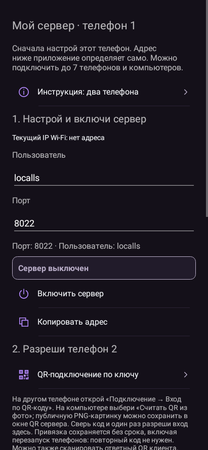

## Приём файлов и отчёт

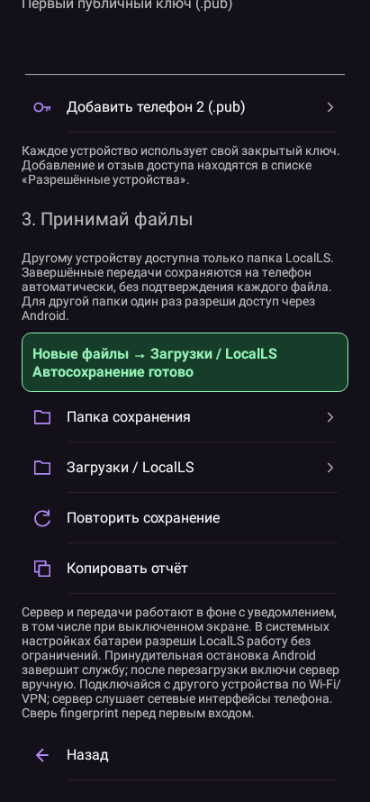

## Подключение

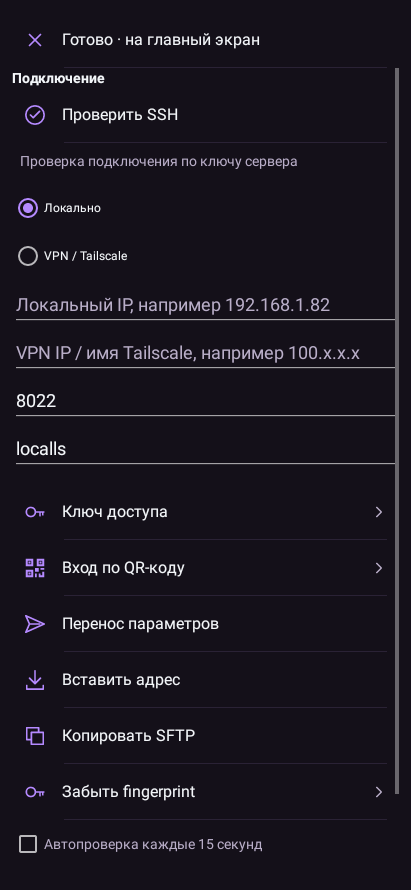

## Подключение: нижняя часть

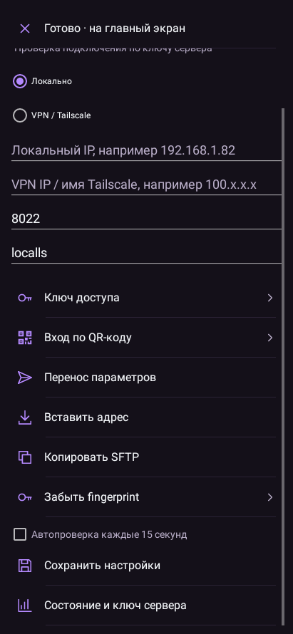

## Подключение на широком экране

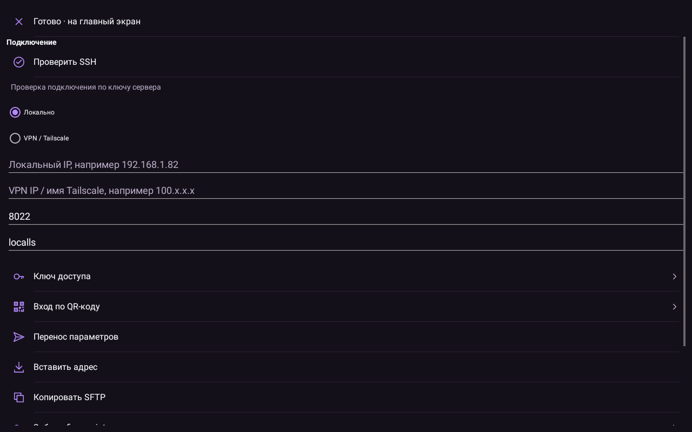

## Ключ доступа

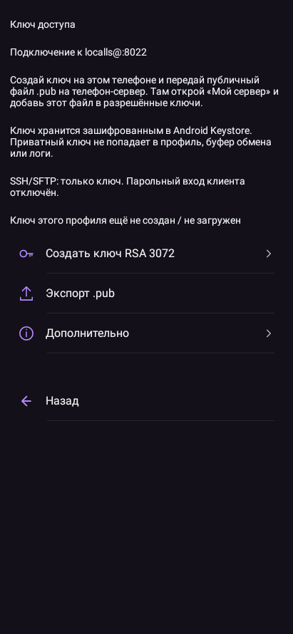

## Настройки приложения

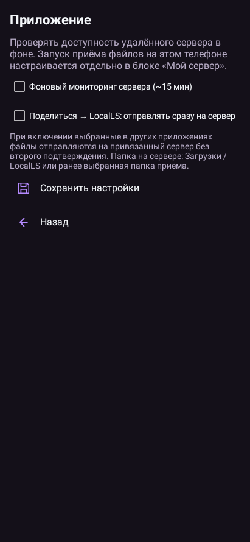

## Сеть

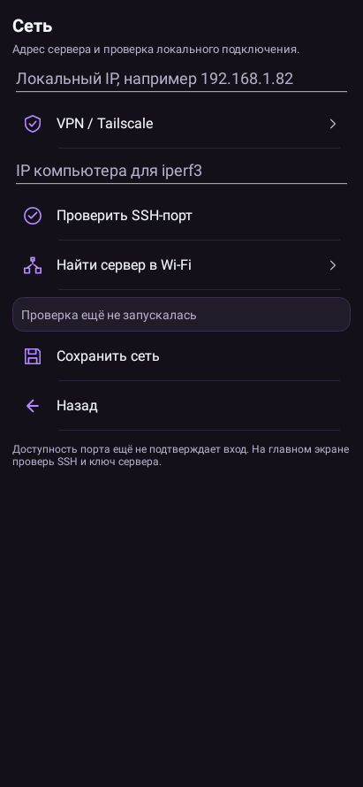

## Диагностика

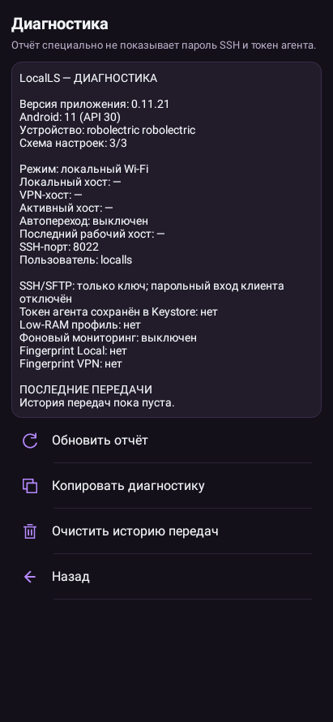

## Перенос подключения

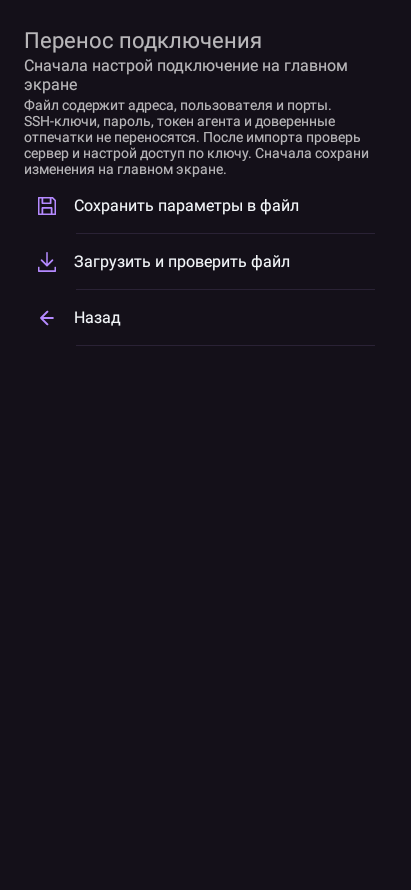

## Очередь

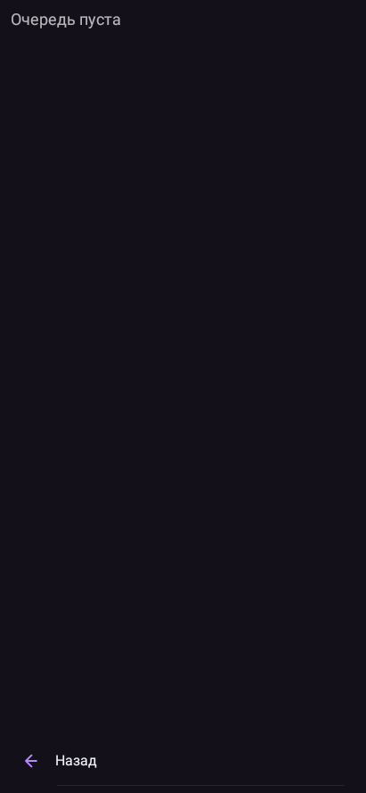

## История и графики

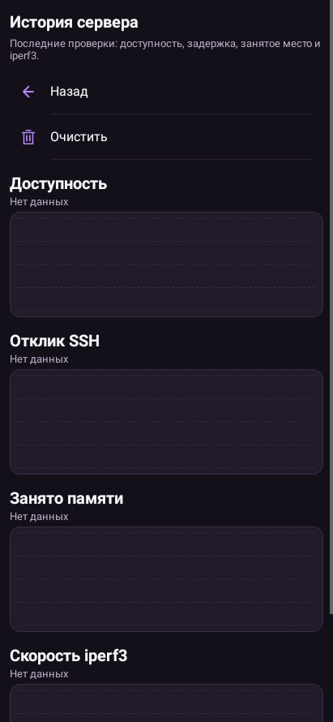

## Боковое меню

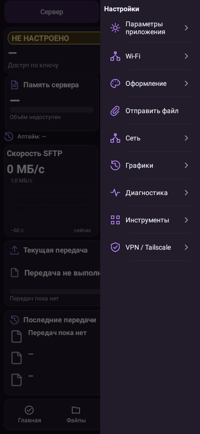

## Существующий дополнительный мастер Termux

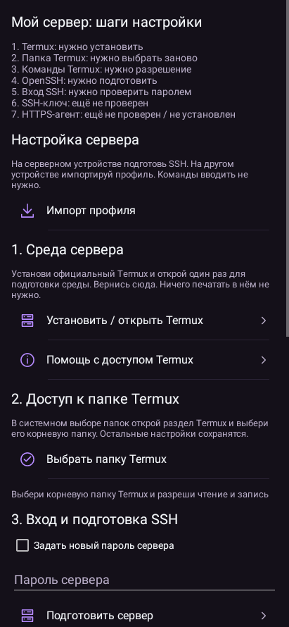

## Просмотр папки встроенного сервера

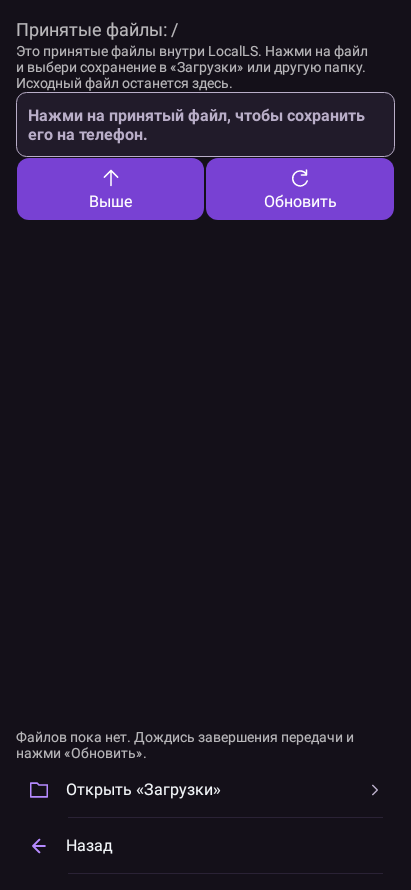

## Инструкция

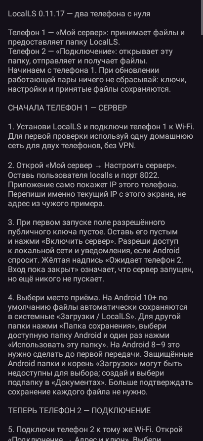

## Отправка из другого приложения

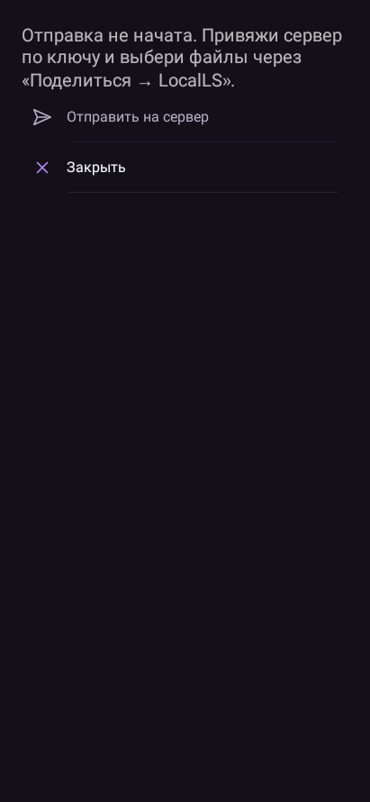

## QR работающего тестового сервера

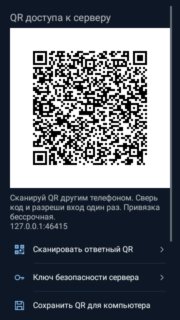

## Разрешённые устройства

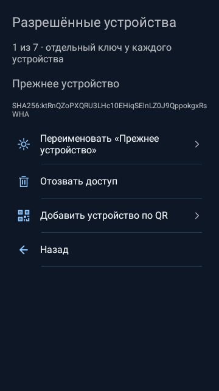

## Главный экран телефона сохранён

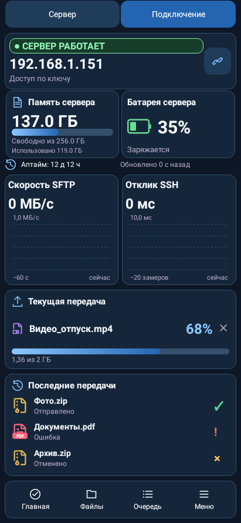

## Главный экран планшета сохранён

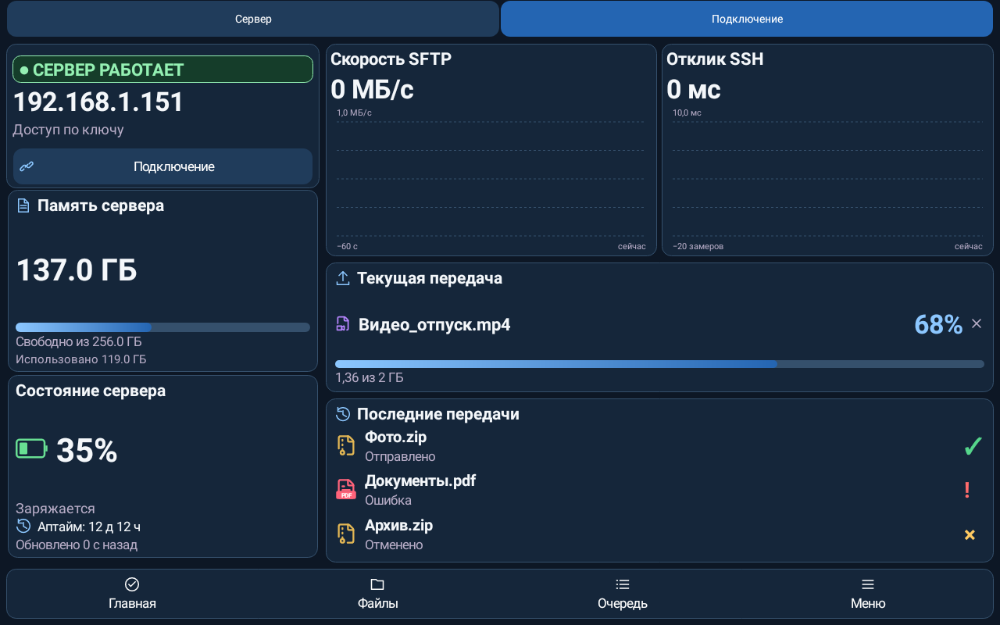

## Главный экран сервера сохранён

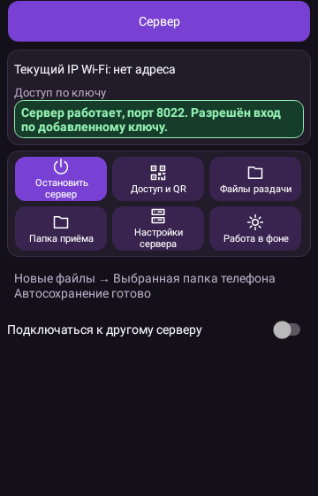

