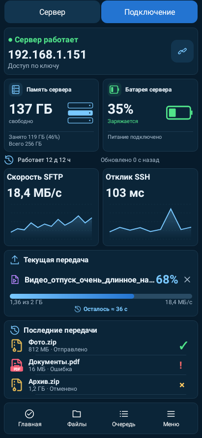
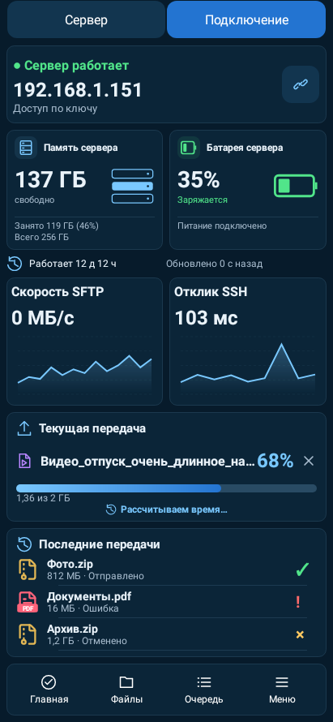
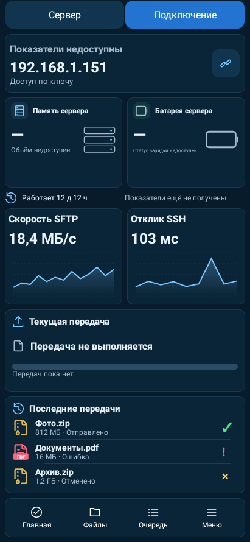
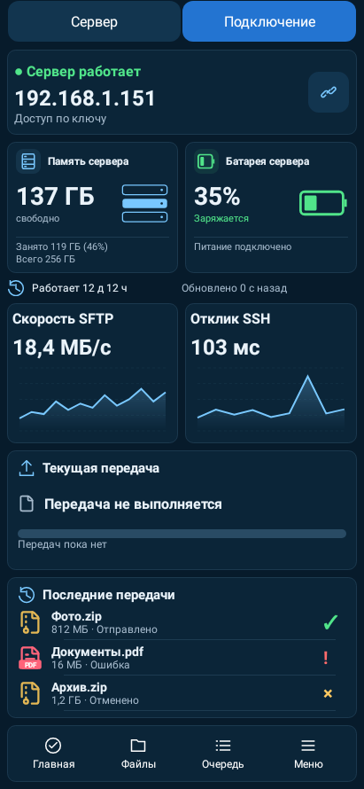
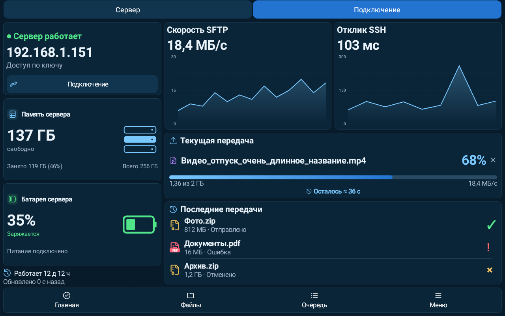
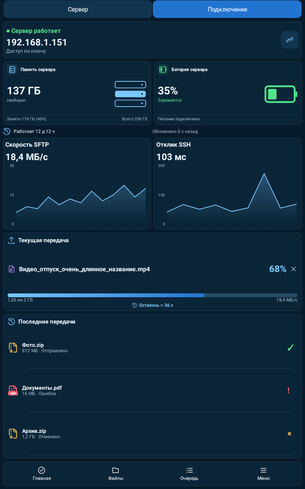

# LocalLS 1.25 / code47 — карточки варианта3 и время передачи

Проверено UTC: 2026-10-26T18:45:29.013211+00:00.

В клиентском главном экране внедрён выбранный вариант3: крупное число слева, графика накопителя/батареи справа, отдельные подписи и тихий разделитель. На узком экране показатели занятого и полного объёма занимают две строки. При нехватке высоты используется компактная раскладка. Самостоятельный серверный экран и исправления планшета1.24 сохранены.

Приблизительное время текущей передачи вынесено в отдельную строку по центру вместе со значком часов. Объём показан слева, скорость справа. Оценка пересчитывается по скорости; при отсутствии скорости/размера показывается ожидание расчёта, при завершении — завершение передачи. Ошибка и отсутствие заданий не сохраняют прежний отсчёт.

Во время проверки исправлены подтверждённые ошибки новой раскладки: обрезание больших обновлённых значений из-за отсутствия переизмерения, недостаточная высота процентов и истории на маленьком телефоне. Для читаемых строк уменьшены лишние внутренние отступы графиков и высота верхней карточки подключения на небольшом экране. Сами графики и три записи истории сохранены.

- Полный набор **426 JVM +19 Python** выполнен:425 JVM прошли сразу, единственное падение было устаревшей проверкой правого выравнивания в DetailPolishTest. После замены этого требования на утверждённое левое выравнивание повторно пройдены все4 теста класса и сборочные проверки. Код приложения между прогонами не менялся (сверен по SHA256). Итоговые результаты всех426 уникальных тестов успешны, без пропусков и необработанных исключений;430 JVM-выполнений в этой финальной последовательности. Все424 прежних test IDs сохранены.
- Новый нативный тест проверяет840 сочетаний:5 тем ×2 плотности ×2 масштаба шрифта ×6 размеров/ориентаций ×7 состояний. Проверяет отдельные границы числа/графики/подписей, высоту строк, центрирование часов с ETA и стабильность карточек при потере телеметрии.
- Отдельно проверены расчёт и формат секунд/минут/часов, нулевая/неизвестная скорость, NaN/Infinity, неизвестный размер и завершение. До исправлений строгие проверки выявляли обрезание строк; причины исправлены.
- В CompactMetricsTest и DetailPolishTest прежнее требование правого выравнивания числа заменено проверками утверждённого левого выравнивания числа, правой границы графики и зазора между ними. Проверки отсутствия пересечений и обрезания полного текста сохранены.
- Проверки версий, проекта и архитектуры, lintDebug/lintRelease, assembleRelease, assembleDebug, assembleDebugAndroidTest пройдены. BUILD SUCCESSFUL.
- Превью — нативный Android-рендер Robolectric с демонстрационными данными, не снимки физического устройства. Windows/Linux на этом этапе не менялись и повторно не тестировались.

APK `LocalLS-1.25-code47-metrics-20261026.apk`, SHA256 `f7e972e8bedd0c565a998b67aeb7cce237020150971d0cb77a0434bcf16011db`.

Package `com.bitpoint.homeservercontrol`; прежний сертификат SHA256 `a2230c3032135def93cd5e8224ca3e26ad8e98f294b5e372a33b1e468caa221a`. Подпись API24–36, ZIP alignment и обновление с1.24/code46 проверены. Подпись, SSH-ключи/доверие, настройки и прежние артефакты сохранены.

## Телефон: передача

## Ожидание скорости

## Нет показателей

## Нет активных заданий

## Планшет горизонтально

## Планшет вертикально

