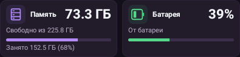
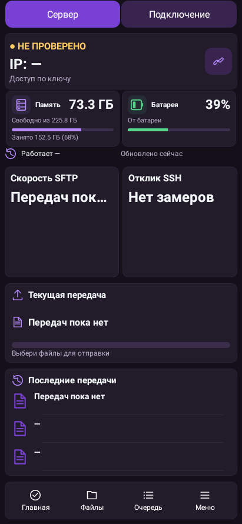
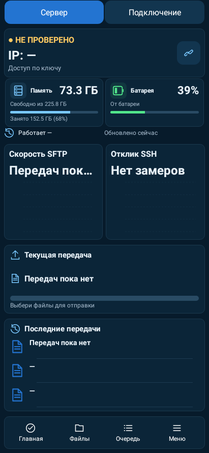
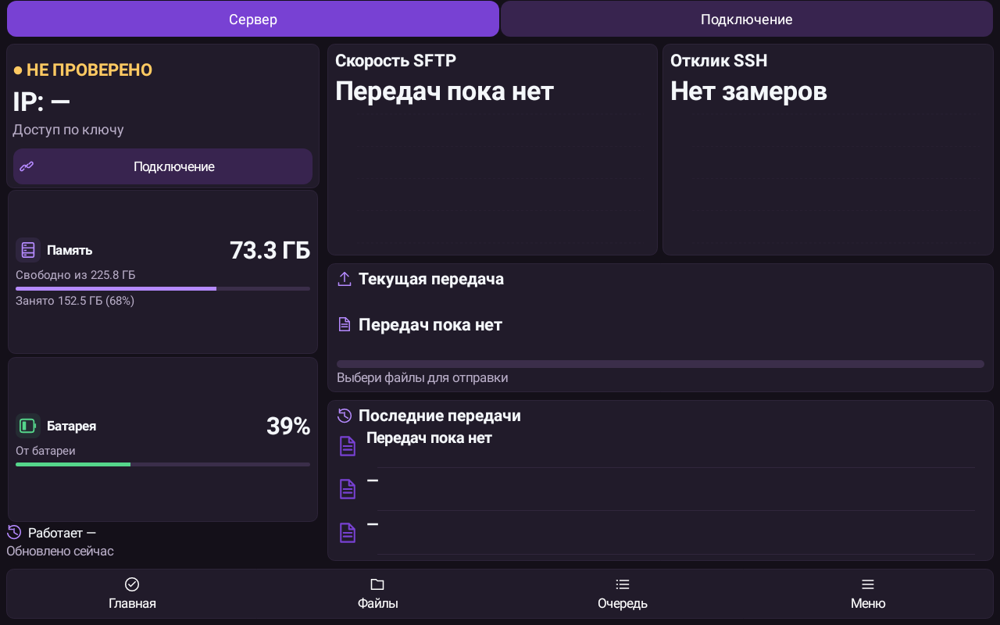
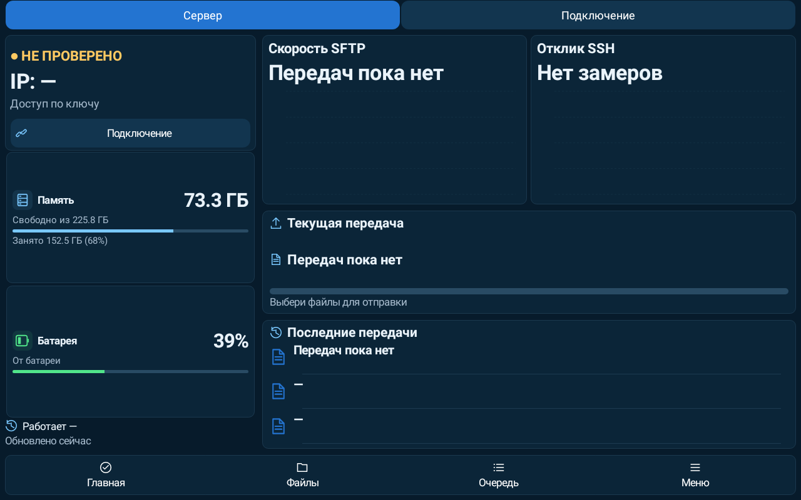
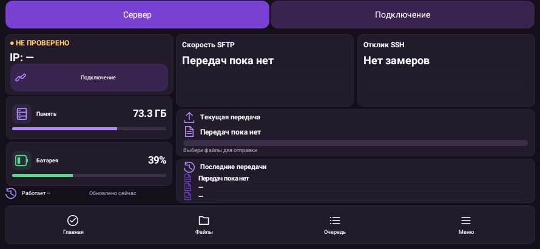
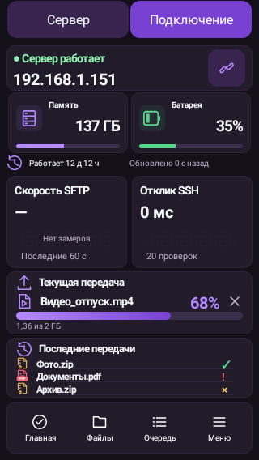

# LocalLS — компактные карточки, вариант 2, UI-R8

Свежие нативные Android-отрисовки Robolectric из полного прогона: это не генеративные макеты и не фотографии физических телефонов. Данные стенда; снимки показывают выбранный вариант 2 на телефоне, планшете и в горизонтальной ориентации с демонстрационными данными. Сохранённая тема пользователя автоматически не меняется.

## Компактные карточки — вариант 2

## Главная телефона — фиолетовая тема

## Главная телефона — тема Океан

## Главная планшета — фиолетовая тема

## Главная планшета — тема Океан

## Горизонтальная ориентация

## Маленький экран 320×568 — демонстрационная передача

