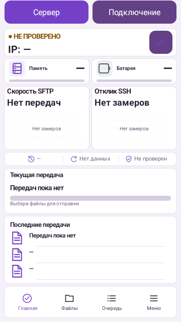
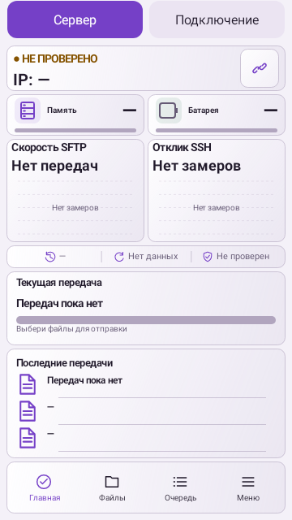
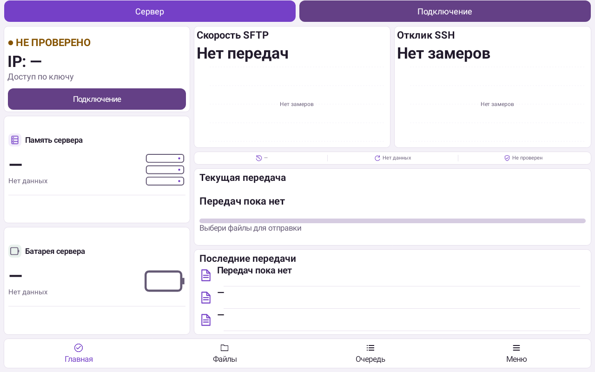
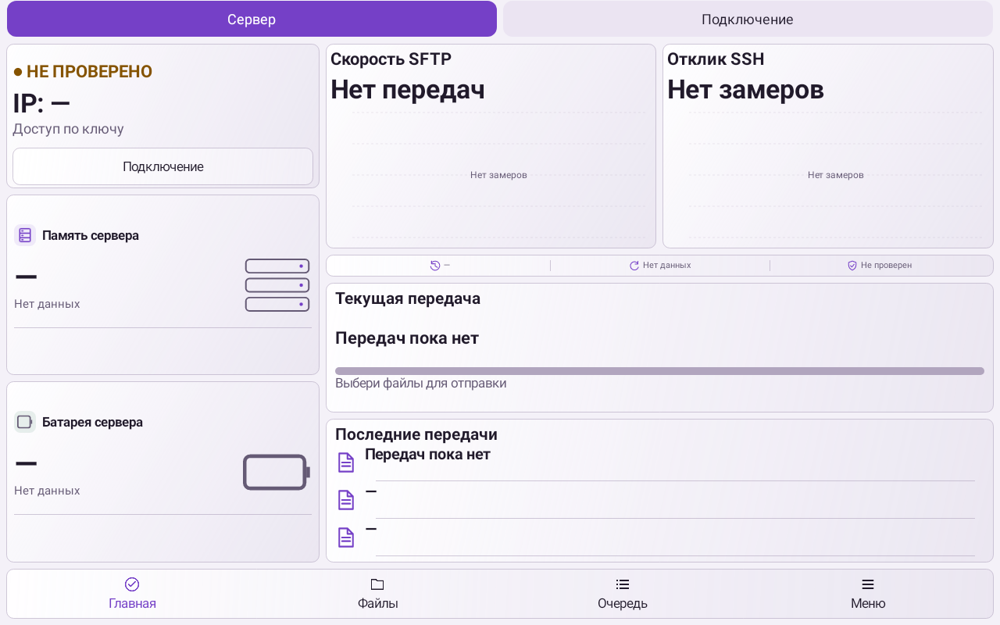

# LocalLS 1.29 — видимая нижняя панель в светлой теме

[Скачать APK](../LocalLS-1.29-code51-navigation-20261027.apk) · [SHA256](../LocalLS-1.29-code51-navigation-20261027.apk.sha256)

Исправлена нижняя панель «Главная / Файлы / Очередь / Меню»: в форме «Без рамки» белые подписи и значки оставались на белой карточке. Теперь подписи и значки используют контрастные цвета выбранной темы; «Главная» выделена акцентом. В светлом стекле также исправлены вторичные действия «Очередь» и «Меню» с круглой, скруглённой и прямоугольной формой. Выбранная геометрия и заливка этих форм сохранены. Также исправлены подписи верхних вкладок «Сервер / Подключение» в светлой теме при переключении ролей и повторном оформлении. QR и сетевые функции не менялись.

Две новые регрессии сначала воспроизвели исходную ошибку. Отдельная проверка затем воспроизвела потерю контраста при смене формы без перезапуска; теперь явно обновляются и заливка, и цвета текста/значка. В новом тесте тонких линий исправлен способ измерения: цвет вектора проверяется на увеличенном рендере, поскольку штрих1.5px может не иметь полностью непрозрачных пикселей. Порог контраста4.5:1 сохранён. Дополнительный прогон выявил белые значки на светлых вторичных кнопках стекла; они тоже исправлены. Два промежуточных полных прогона остановлены только собственным SIGINT до правки исходников; ниже учтён финальный полный успешный повтор после последнего изменения.

Проверки после последней правки: **443 JVM +19 Python**, все прежние 439 test IDs сохранены;0ошибок, пропусков и необработанных исключений. Новый нативный набор проверяет 96 состояний панели:3темы ×2режима стекла ×2обводки ×2размера шрифта ×4размера окна. Отдельно проверены смена формы без перезапуска, отключённые кнопки, переключения верхних вкладок, все 4 формы, повторное оформление, видимые значки, контраст текста, размеры нажатия и полные подписи. Прежние QR/SSH/SFTP/очередь/папки/UI-тесты сохранены. lintDebug/lintRelease, release/debug/androidTest-сборки прошли: **BUILD SUCCESSFUL**.

APK: `LocalLS-1.29-code51-navigation-20261027.apk`. Версия 1.29/code51, package `com.bitpoint.homeservercontrol`. SHA256 `e7ff99a0baf2fec3637bce9f0d908d78c2d3e99f68937c475c349f88845894e7`.

Подпись прежняя: `a2230c3032135def93cd5e8224ca3e26ad8e98f294b5e372a33b1e468caa221a`. Проверены подпись API24–36, ZIP alignment и обновление с 1.28/code50. Защищённые файлы, прежние APK, SSH-ключи/доверие и настройки сохранены. Release-ветка и тег не менялись. Время завершения проверок: 27.10.2026 16:40 МСК.

Снимки ниже — нативный Robolectric-рендер с демонстрационными пустыми состояниями. Физические телефоны и планшеты не подключались. Это отдельная проверка исправления, не продолжение закрытого десятичасового окна.

## Телефон

| Светлая тема | Светлое стекло |
|---|---|
|  |  |

## Планшет

