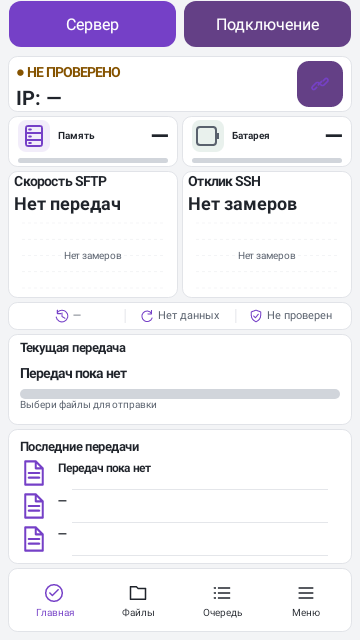
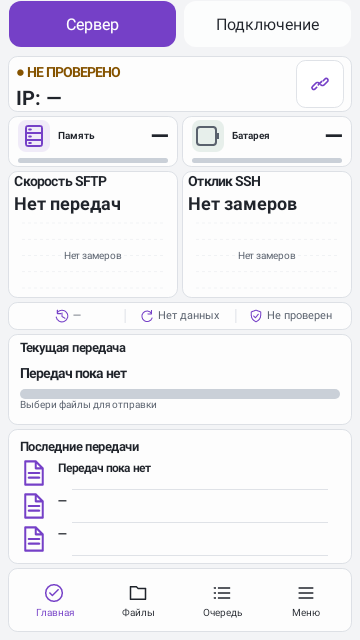
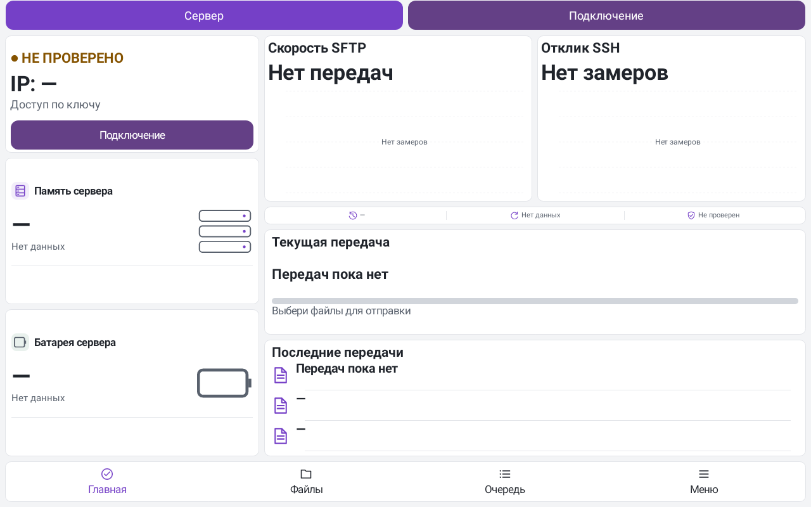
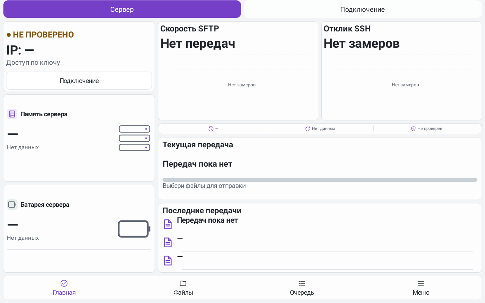
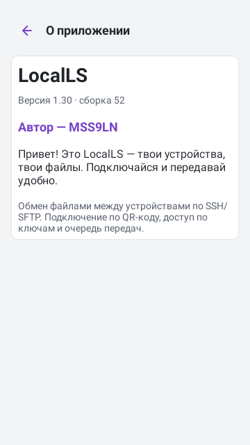
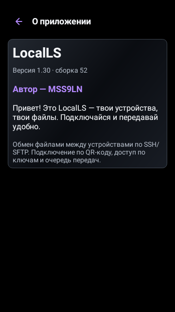
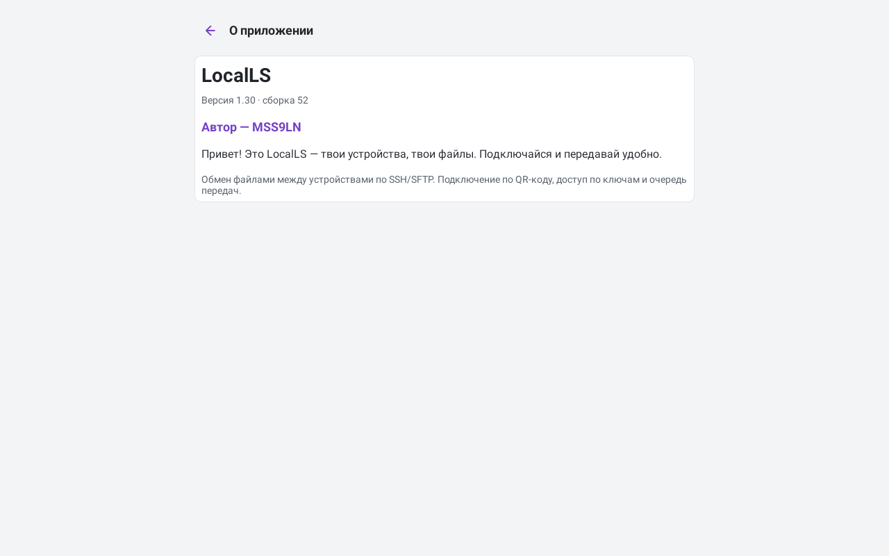

# LocalLS 1.30 — MSS9LN

[Скачать APK](../LocalLS-1.30-code52-MSS9LN-20261027.apk) · [SHA256](../LocalLS-1.30-code52-MSS9LN-20261027.apk.sha256) · [Подготовка Windows/Fedora](PREPARE_WINDOWS_FEDORA.md)

Удалены выбор формы кнопок, его пункт меню, обработчики и ветвления рабочего кода. Используется единый постоянный стиль; прежняя запись настройки не меняет интерфейс. Старые подключения, ключи и доверие сохраняются.

Светлая тема получила нейтральный фон и одинаковые поверхности карточек. У светлого стекла убраны диагональные сиреневые переливы; прозрачность остаётся отдельным переключателем. Обводка и восемь цветовых тем сохранены. Проверены подписи и значки верхней и нижней навигации.

В общих настройках и настройках сервера появился раздел **«О приложении»**: LocalLS, фактическая установленная версия и сборка, автор **MSS9LN**, приветствие. Новая Activity не экспортируется наружу. При просмотре нативного снимка найдена и исправлена ошибка новой разметки: карточка имела нулевую ширину из-за горизонтальной ориентации контейнера. Усиленная проверка видимой ширины сначала воспроизвела сбой, затем прошла после исправления.

## Проверки

- Финальный полный прогон после последней правки: **447 JVM + 19 Python**, без ошибок, пропусков и необработанных исключений. Все прежние **443 test IDs** сохранены. Старые матрицы тем и сохранённых значений не сокращались: ожидания изменены только для удалённой настройки и согласованной палитры. Проверки фиксированной геометрии и её независимости от старых значений усилены.
- Четыре новых теста: одинаковые пиксели при прежних настройках формы; ровные нейтральные поверхности; автор, реальная версия и доступ к About из обеих ролей; 48 сочетаний темы, стекла, шрифта и размера About. Проверяются видимая ширина, границы, полные подписи и области нажатия. Прежние QR/SSH/SFTP/очередь/папки/UI-тесты сохранены.
- Аудиты проекта и архитектуры, lintDebug/lintRelease, release/debug/androidTest-сборки: **BUILD SUCCESSFUL**. Удалённый IconShapeCatalog отсутствует в release DEX; старые значения используются только тестовыми фикстурами.
- Подготовительный прогон существующих PC-клиентов: **Windows — 28/28**, **Fedora — 32/32** Node-тестов на Linux loopback-стенде. Исходники PC не изменялись; новые EXE/RPM не собирались. Подробный список следующего этапа — по ссылке выше.

Снимки ниже — нативный Robolectric-рендер с демонстрационными пустыми состояниями. Физические телефоны, Windows и Fedora не подключались. Это отдельная проверка исправлений, не продолжение закрытого десятичасового окна.

APK `LocalLS-1.30-code52-MSS9LN-20261027.apk`, версия **1.30/code52**, package `com.bitpoint.homeservercontrol`.

SHA256: `2ab245ebc227947a700e405b8b5eaf3df1fa81543b0cc063c4e0fd76a80836b9`.

Прежний сертификат SHA256: `a2230c3032135def93cd5e8224ca3e26ad8e98f294b5e372a33b1e468caa221a`. Проверены подпись API24–36, ZIP alignment и совместимость обновления с 1.29/code51. Защищённые файлы и прежние APK сохранены. Release-ветка и тег не менялись.

Завершение проверок: 28.10.2026 00:10 МСК.

## Светлая тема на телефоне

| Без стекла | Со стеклом |
|---|---|
|  |  |

## Планшет

## О приложении

| Светлая тема | Тёмное стекло |
|---|---|
|  |  |

