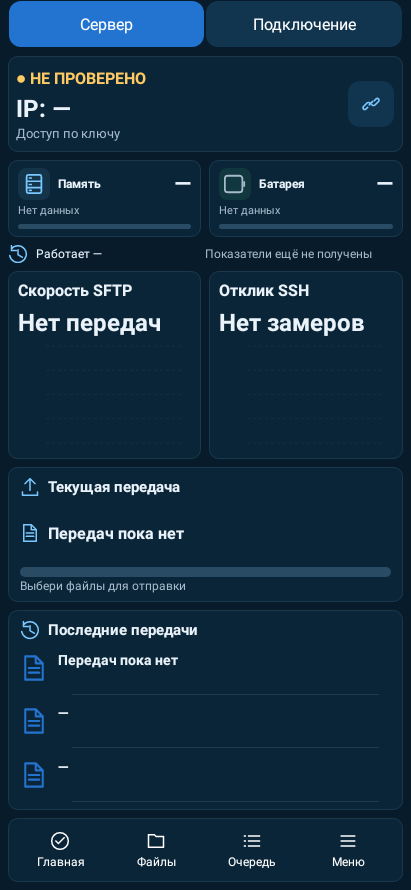
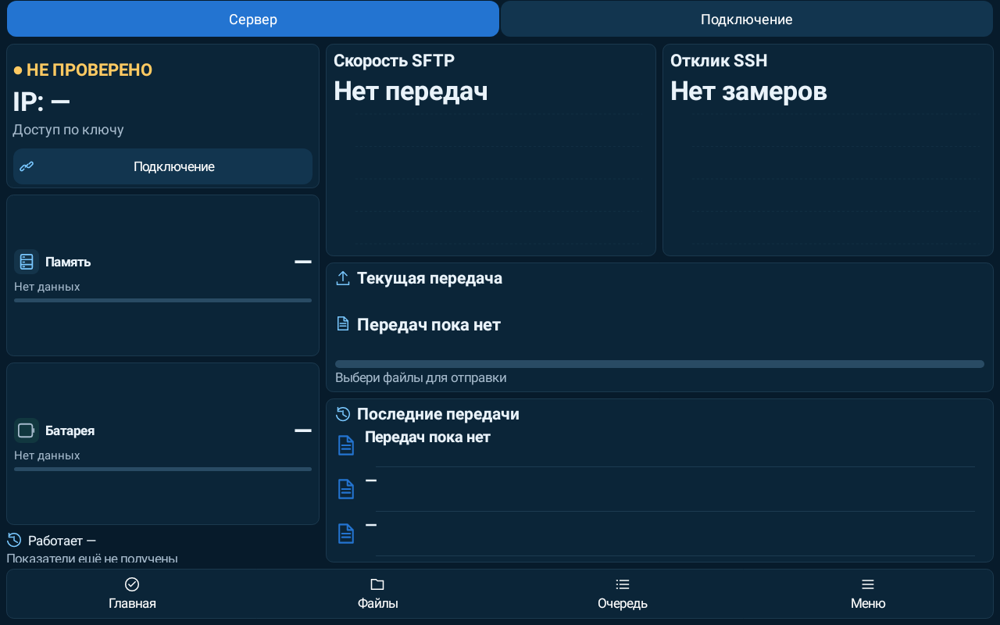
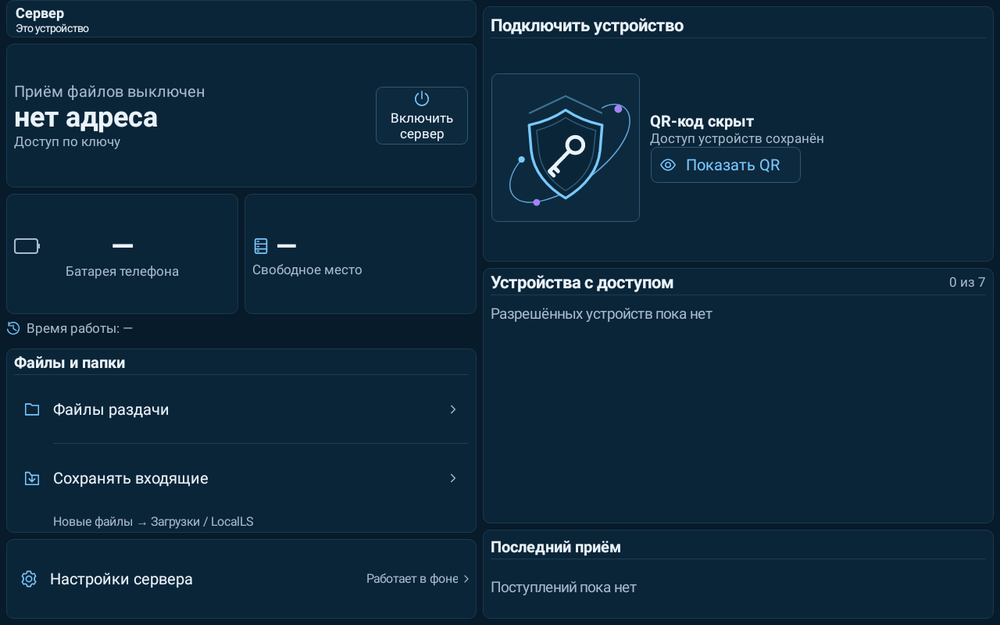

# LocalLS 1.20 / code42 — точечная полировка интерфейса

Проверено UTC: 2026-10-26T11:35:16.393990+00:00.

Исправления:

- На компактном планшете 960×600 правая граница заголовка сервера отличалась от карточки на 3 px: 457 вместо 460. Shell теперь использует тот же доступный viewport и адаптивный зазор, что серверная колонка.
- Отступ под заголовком оставался 8 px при зазорах 1 px на тесном планшете. Исправлен расчёт header inset с учётом padding.
- На телефоне 320×568 начальная подпись графика обрезала 6 символов. Она сокращена до «Нет передач». Заголовки и значения графиков подгоняются под фактическую ширину; размер не опускается ниже 12 dp.

Проверки:

- Новые 2 геометрических теста сначала воспроизвели обе ошибки; первый повтор дополнительно выявил вертикальный отступ. Падения сохранены, проверки не отключены и не ослаблены.
- Исправленный повтор: 6 тестов пройдены, включая прежние ReferenceLayout и SpacingConsistency. Новые проверки охватывают две плотности, шрифты 1×/2×, телефоны, планшеты и горизонтальный режим.
- Финальный прогон: **309 тестов app + 19 Python**, без ошибок, пропусков и необработанных исключений в логах/XML. Все 307 прежних тестов app сохранены. Модульные core/transport тесты в этом этапе не повторялись; их 110 проверок прошли в предыдущем полном прогоне.
- Версии, аудит проекта/архитектуры, lintDebug/lintRelease, assembleRelease и assembleDebugAndroidTest пройдены.

Дизайн, темы, графики, щит QR и версия 1.20/code42 сохранены. Package `com.bitpoint.homeservercontrol`. Прежний сертификат SHA256 `a2230c3032135def93cd5e8224ca3e26ad8e98f294b5e372a33b1e468caa221a`. Подпись API24–36, выравнивание ZIP и совместимость обновления с code41 проверены. Защищённые файлы подписи, ключей, доверия и helper совпадают с контрольными суммами. Прежний APK с исправлением отступов сохранён; этот APK собран заново.

APK: `LocalLS-1.20-code42-polish-20261026.apk`. SHA256 `f72b6f11ace3d295bbc2b1e4eb083cf0caf919b8015cbeb7ea6f3587d043b053`.

## Нативные превью

Рендер Robolectric, тестовые/пустые состояния; это не фотографии физических устройств.

| Телефон | Планшет |
|---|---|
|  |  |
|  |  |
