# LocalLS — полировка показателей и настроек, UI-R6

Свежие нативные Android-отрисовки Robolectric из полного прогона: это не генеративные макеты и не фотографии физических телефонов. Данные стенда; снимки сервера 01–04 используют реальный loopback SSH, примеры тем используют демонстрационное состояние. Сохранённая тема пользователя автоматически не меняется.

## Сервер телефона — процент по центру, подпись хранилища слева

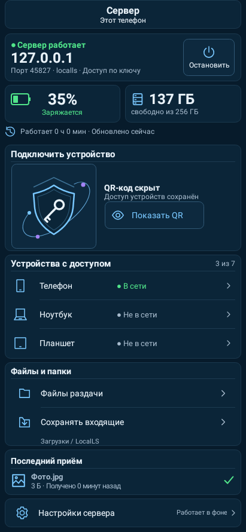

## Сервер телефона — открытый QR

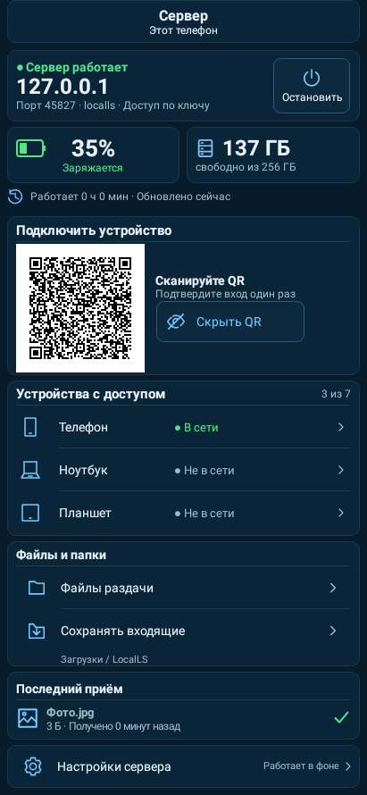

## Сервер планшета

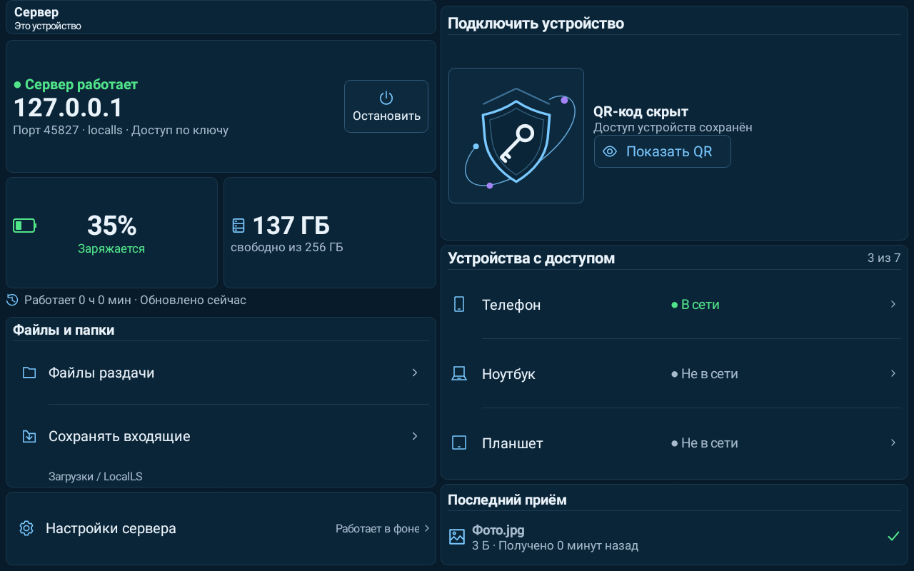

## Сервер планшета — открытый QR

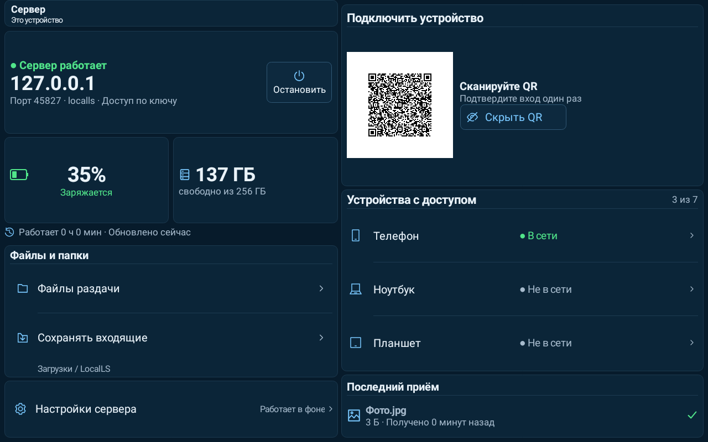

## Главная принимающего телефона — данные стенда

## Главная принимающего планшета — данные стенда

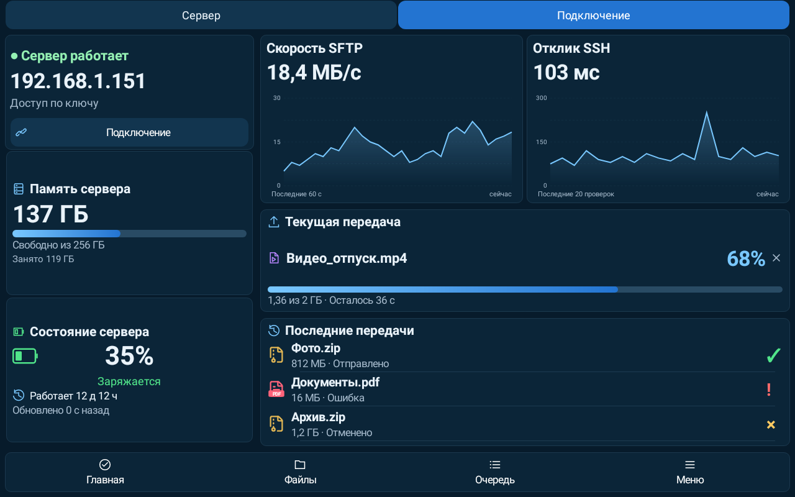

## Настройки приложения — телефон

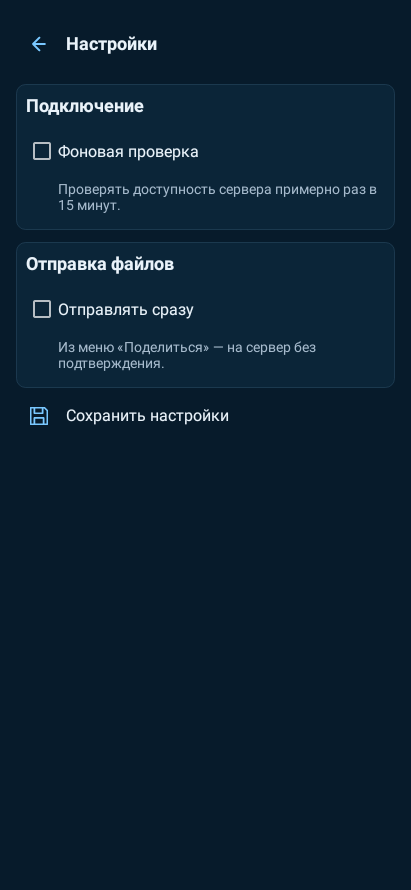

## Настройки приложения — планшет, ограниченная ширина формы

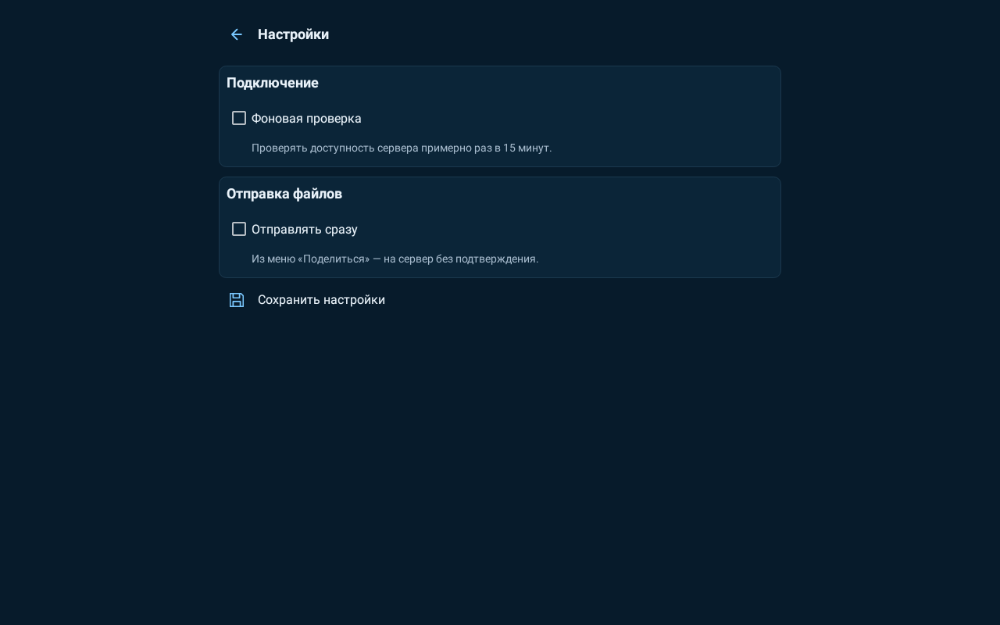

## Настройки сервера — телефон, ручной ключ свёрнут

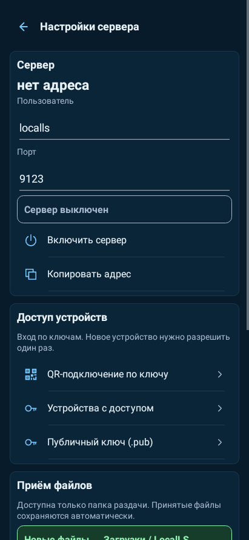

## Настройки сервера — планшет

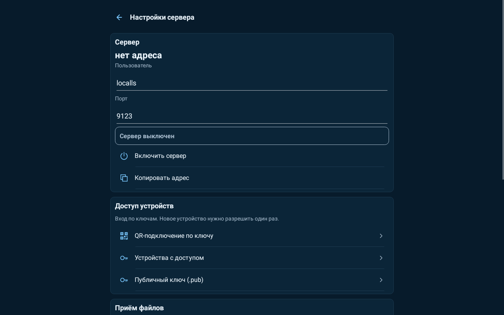

## Подключение и русские подписи

## Диагностика — UI-R6

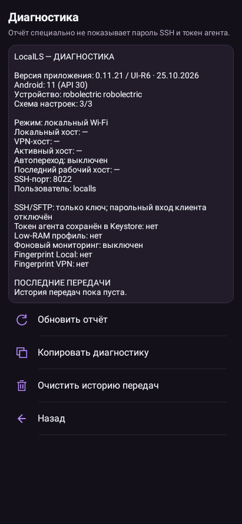

## Светлая тема сервера — демонстрационные данные

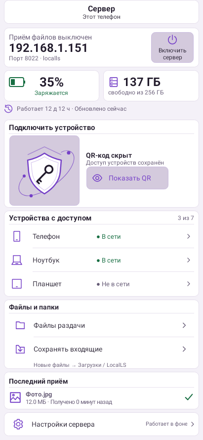

## Малое горизонтальное окно и шрифт200%

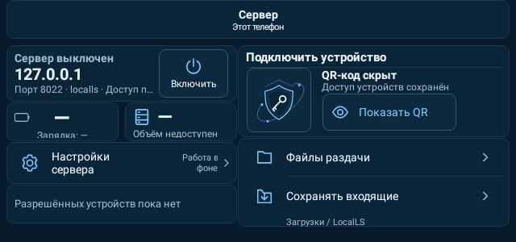

