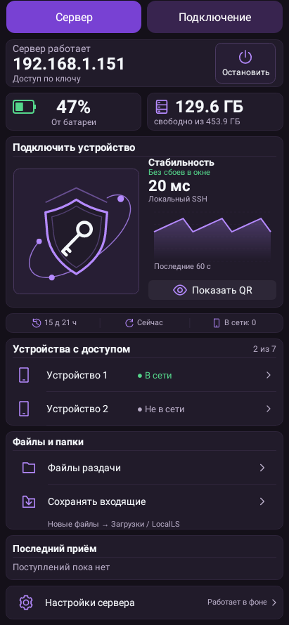
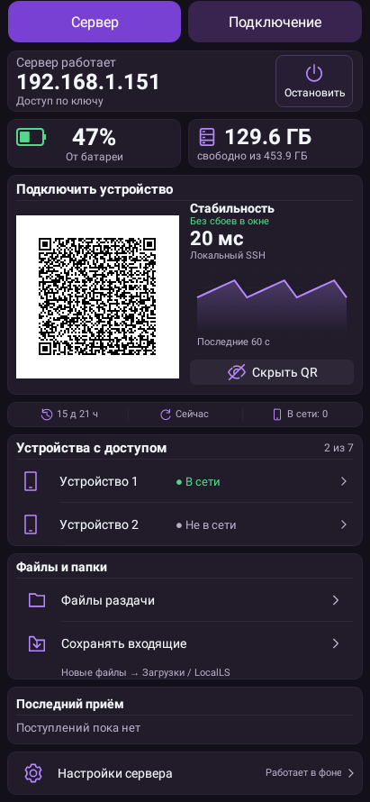
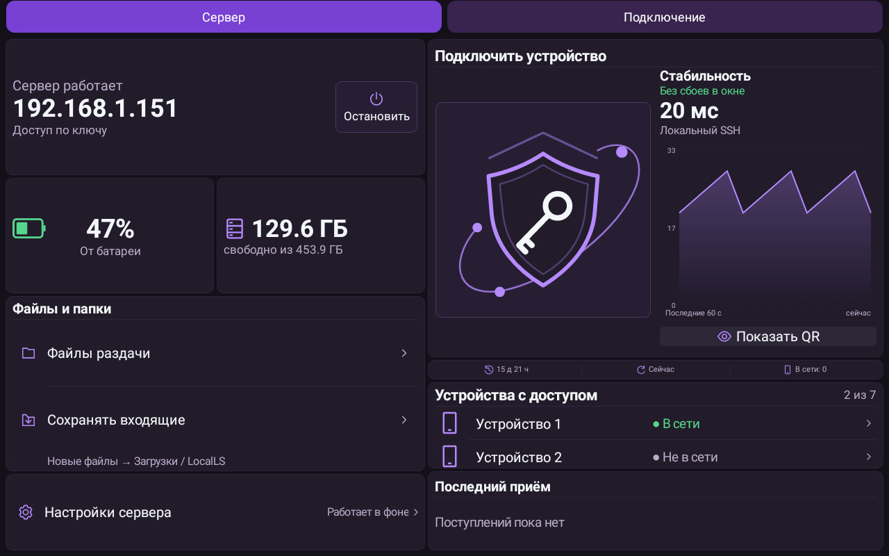
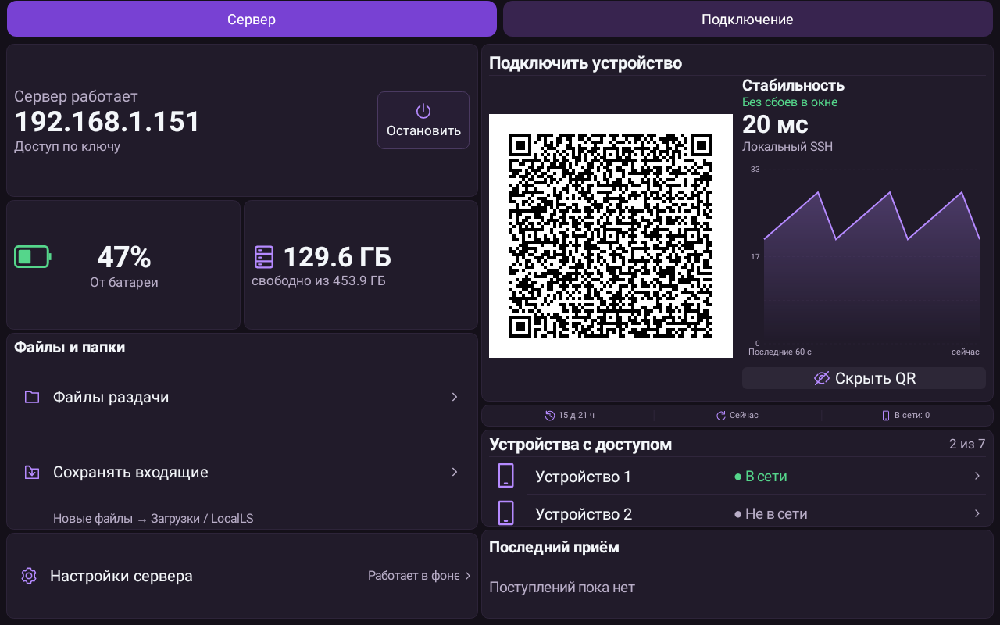
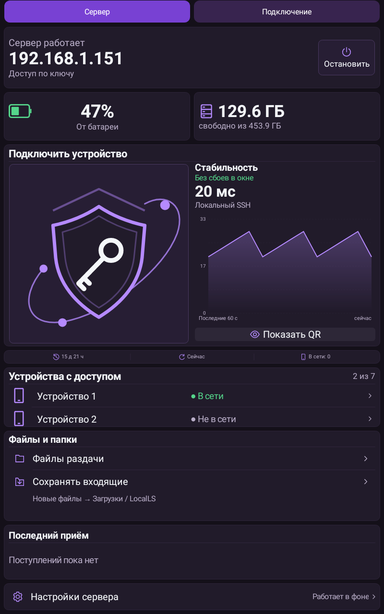
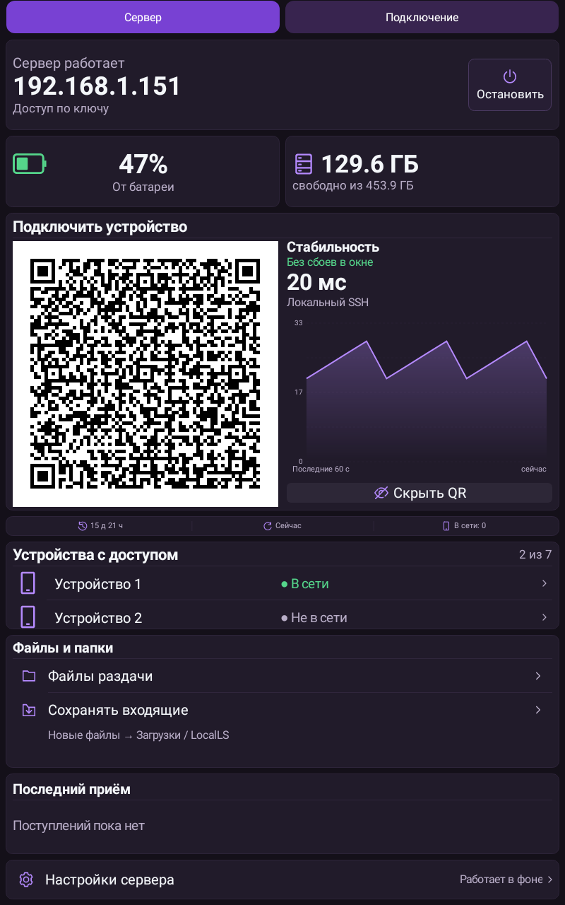

# LocalLS 1.27 / code49 — крупный QR и компактные устройства

Проверено (МСК): 2026-10-27T11:29:29.698967+03:00.

Блок устройств больше не резервирует большую пустую высоту: строки по48dp, размер карточки зависит от числа видимых записей. До3устройств видны на главном экране, полный список по нажатию, лимит7 сохранён. Освободившееся место отдано блоку подключения. QR квадратный, занимает почти половину ширины карточки, на планшете растёт вместе с ней. На тесных экранах открывается прежнее отдельное окно QR.

Справа от QR убраны постоянные пояснения. Добавлен график **локального отклика SSH**. Это измерение ответа SSH-службы на127.0.0.1, а не проверка Wi-Fi/маршрута с другого телефона или аутентификации. Выполняется только при обновлении видимого экрана, максимум раз в5с; абсолютный таймаут700мс, проверяется SSH identification banner. Ключи, доверие, пароли и конфигурация не используются и не меняются. После остановки/ошибки/паузы график не выдаёт старые данные за непрерывную работу; зелёный статус появляется только после нескольких успешных замеров в текущем окне.

«Показать QR / Скрыть QR» — тихая28dp полоска **без контура**, с областью нажатия48dp. Значок и подпись рисуются одной центрированной группой. Эта полоска намеренно остаётся без обводки при любом выборе формы/темы. Скрытый QR заменяет прежний щит; защита окна FLAG_SECURE при открытом коде и явное подтверждение нового устройства сохранены. Ошибка подготовки QR сообщается пользователю, постоянные инструкции не возвращаются.

## Проверки

- Полный **433 JVM +19 Python**,0 ошибок/пропусков/необработанных исключений. После него lint потребовал заменить литерал1 на именованную константу Typeface.BOLD. Изменена только эта эквивалентная запись; исполняемые инструкции debug/release совпадают с полным прогоном (javap-c, без индексов constant pool), остальные production-файлы совпадают по SHA256. После замены повторены **3профильных JVM +19Python**, оба lint и все сборки. Все430 прежних test IDs сохранены.
- Новая матрица **960 раскладок**:8тем ×2плотности ×2шрифта ×5вариантов количества устройств ×6размеров. Проверены квадрат QR,48dp действия, полные подписи, границы всех видимых элементов и отсутствие пустого резерва списка на телефоне.
- Проба реальными loopback-сокетами: SSH2/1.99, отказ HTTP/неверного порта, абсолютный таймаут при медленной передаче байтов. Состояния графика: первый замер, успех, ошибка, восстановление, пауза и остановка.
- Прежние QR/SSH/SFTP/папки/очередь, настоящий QR decode, сохранность активной SSH-сессии при скрытии QR и защита окна входят в полный набор.
- Обновлена только устаревшая проверка контура QR-кнопки: вместо обязательной рамки она требует утверждённую полоску без верхней/нижней рамки; проверки замкнутой рамки питания и щита сохранены.
- Аудит версий/проекта/архитектуры, lintDebug/lintRelease, assembleRelease, assembleDebug и assembleDebugAndroidTest — **BUILD SUCCESSFUL**. Тестовые и ранее удалённые классы отсутствуют в release DEX.
- Первый полный прогон выявил2сбоя от одной причины:40dp высоту кнопки папки и обрезание подписи назначения; восстановлена минимальная высота блока папок и усилена новая матрица для всех основных действий. После исправления повторён полный набор.
- Первый профильный прогон10/11: ошибка тестового контекста без оформления исправлена в тесте. Визуальная проверка выявила смещение compound-значка; центрирование исправлено до полного прогона.
- Скрины ниже — нативный Robolectric-рендер с демонстрационными показателями; изображённый QR содержит только надпись макета, не доступ к серверу. Физические устройства не подключались. Desktop/Linux не менялись.

APK `LocalLS-1.27-code49-qr-20261027.apk`, SHA256 `7e0eb9b5c5d5a5d0d9cca3d44215722da397f82a5d4d6a005319aa60e7a8a7dd`.

Package `com.bitpoint.homeservercontrol`,1.27/code49. Прежний сертификат SHA256 `a2230c3032135def93cd5e8224ca3e26ad8e98f294b5e372a33b1e468caa221a`. Подпись API24–36, ZIP alignment и обновление с1.26/code48 проверены. SSH-ключи/доверие, настройки связи, release-ветка/тег и прежние APK сохранены.

## Телефон

| QR скрыт | QR открыт |
|---|---|
|  |  |

## Планшет горизонтально

## Планшет вертикально

