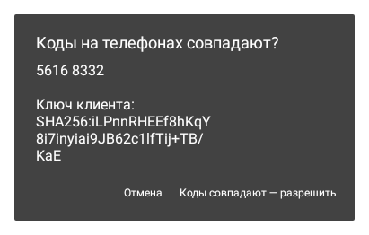
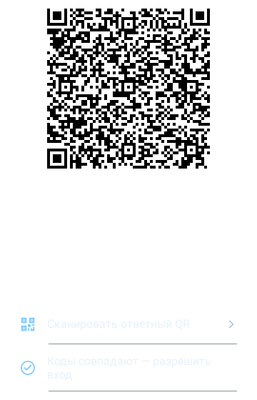
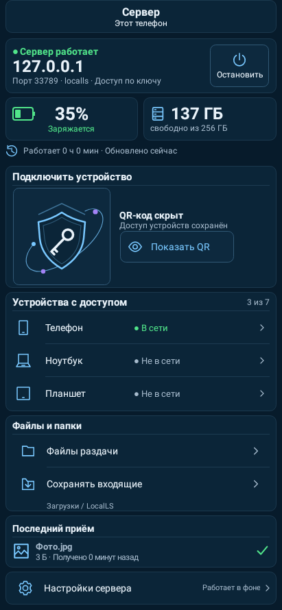
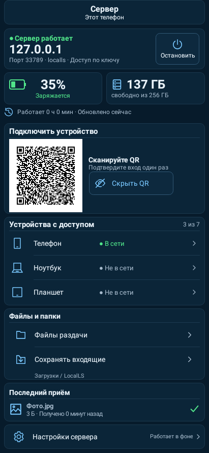
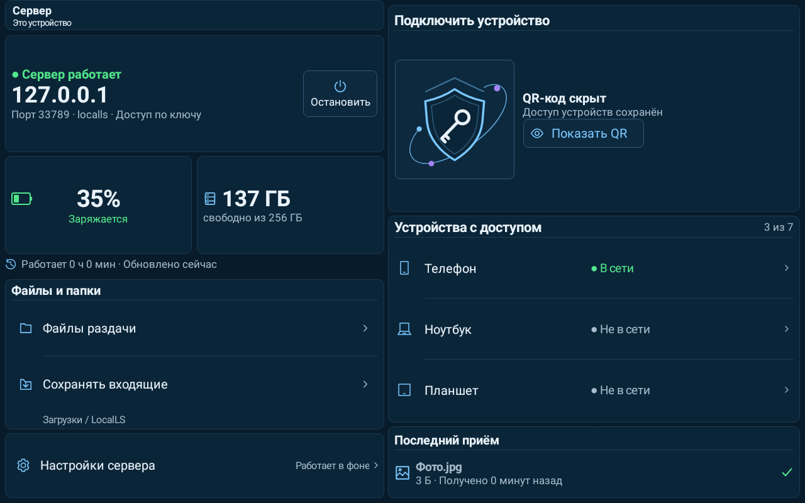
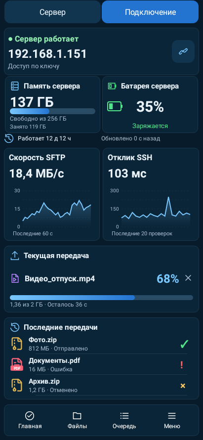
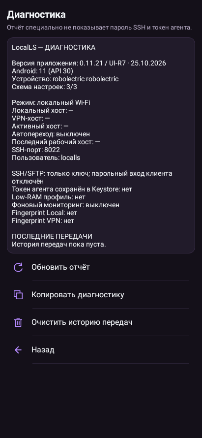

# LocalLS — исправление входа по QR, UI-R7

Свежие нативные Android-отрисовки Robolectric из полного прогона: это не генеративные макеты и не фотографии физических телефонов. Данные стенда; снимки 01–03 получены в регрессиях QR-входа; снимки главных экранов используют демонстрационное состояние. Сохранённая тема пользователя автоматически не меняется.

## Явное подтверждение владельца сервера — окно с кодом сверки

## Код и кнопка разрешения видны на коротком экране

## Понятное сообщение при недоступной сети

## Главная сервера телефона

## QR на главной сервера

## Главная сервера планшета

## Главная принимающего телефона — данные стенда

## Диагностика — UI-R7

