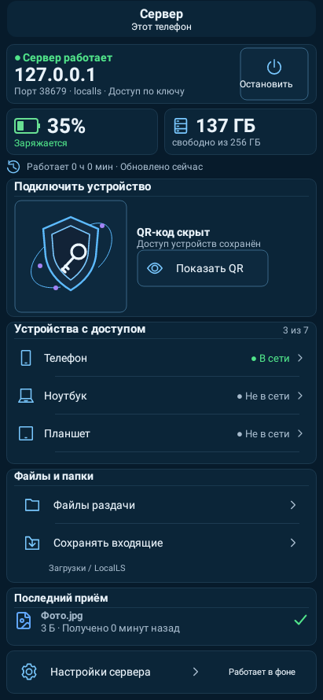
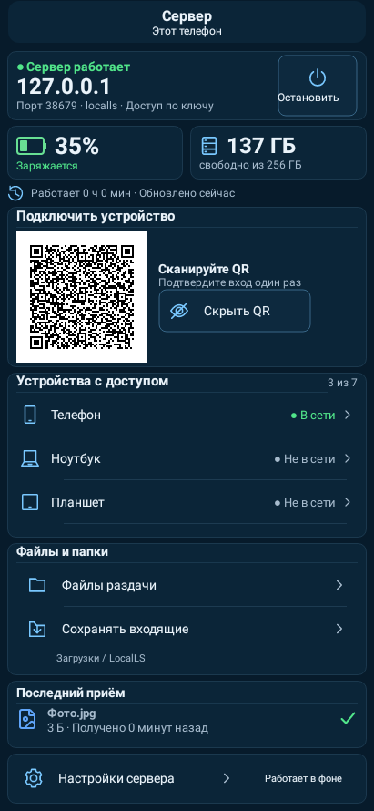
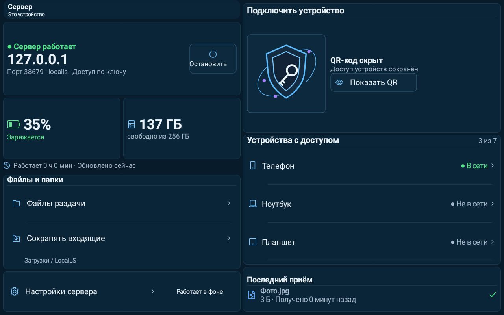
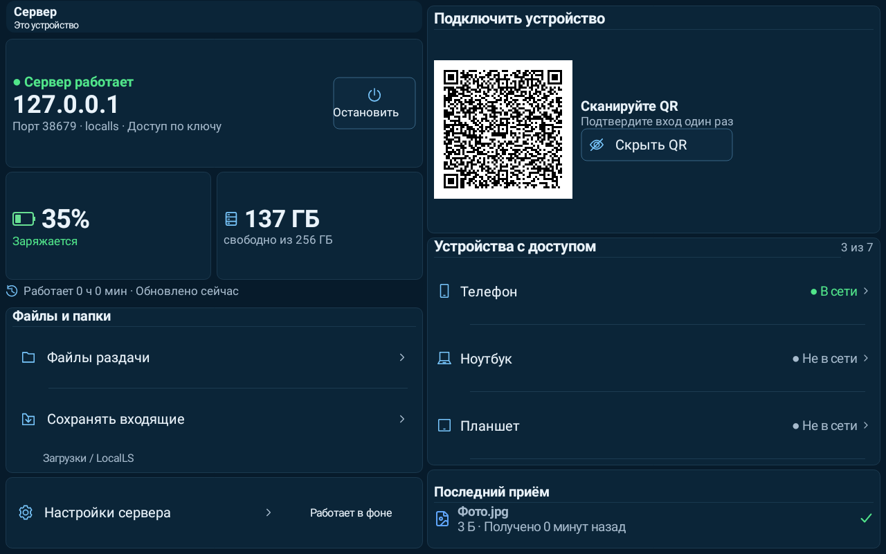
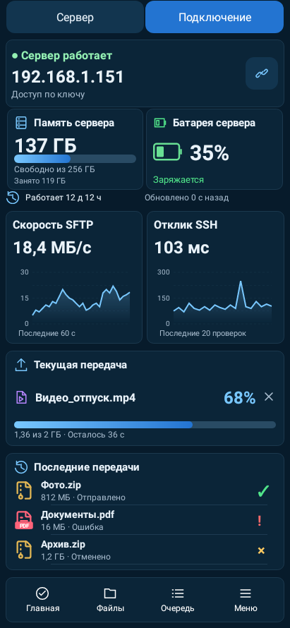
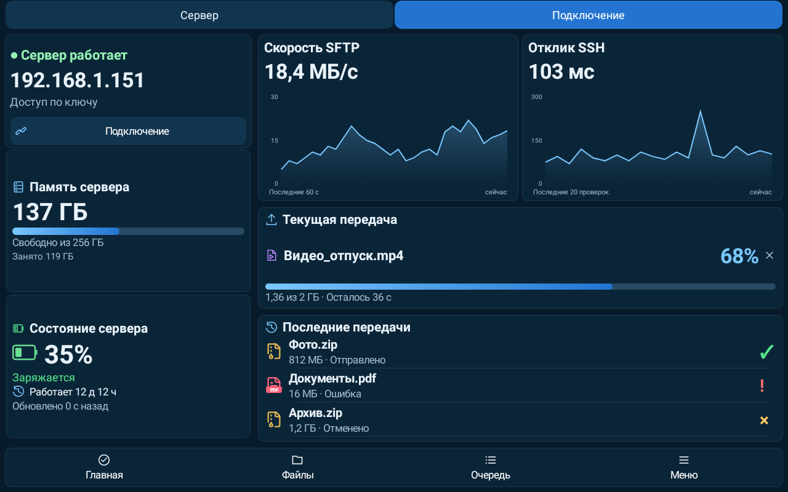
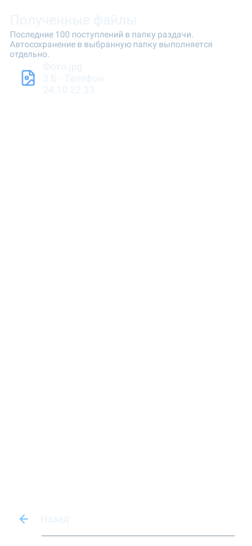
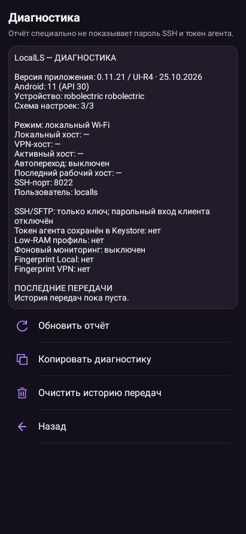
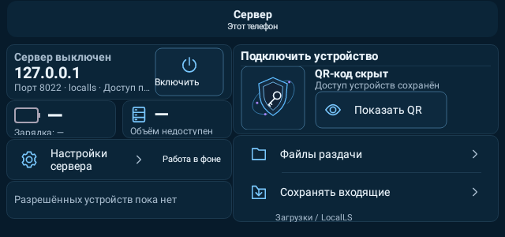

# LocalLS — исправление контуров, UI-R4

Свежие нативные Android-отрисовки Robolectric из полного прогона: это не генеративные макеты и не фотографии физических телефонов. Данные стенда, реальный loopback SSH для серверных снимков. Сохранённая тема пользователя автоматически не меняется.

## Сервер телефона — QR скрыт

## Сервер телефона — QR показан

## Сервер планшета — QR скрыт

## Сервер планшета — QR показан

## Главная телефона — тема Океан, пример передачи и графиков

## Главная планшета — тема Океан, пример передачи и графиков

## Подключение — иерархия, поля и список команд

## Журнал тестового приёма

## Диагностика — отметка UI-R4

## Малое горизонтальное окно и системный шрифт200%

