# LocalLS — исправление контуров, UI-R5

Свежие нативные Android-отрисовки Robolectric из полного прогона: это не генеративные макеты и не фотографии физических телефонов. Данные стенда; снимки сервера 01–04 используют реальный loopback SSH, примеры тем используют демонстрационное состояние. Сохранённая тема пользователя автоматически не меняется.

## Сервер телефона — QR скрыт

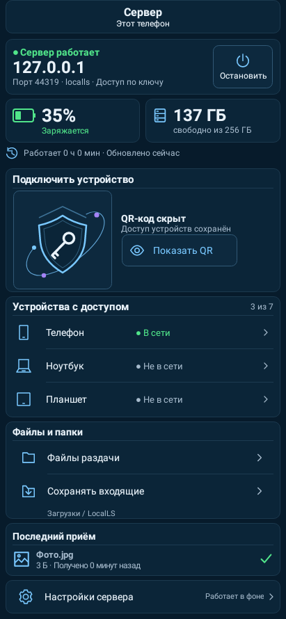

## Сервер телефона — QR показан

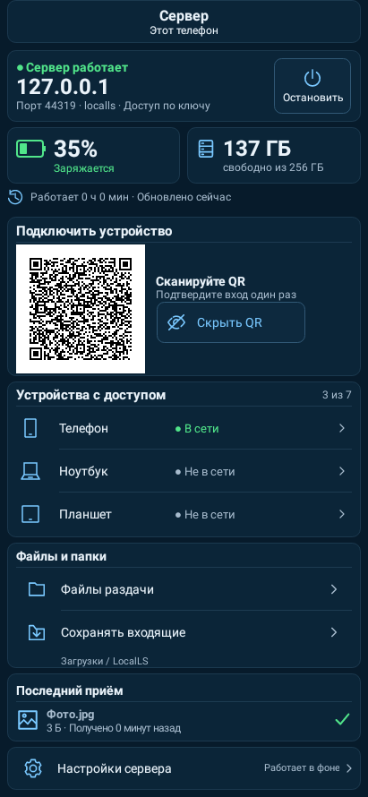

## Сервер планшета — QR скрыт

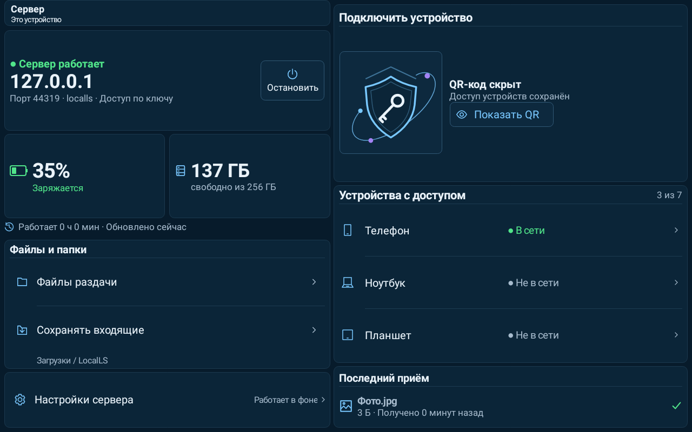

## Сервер планшета — QR показан

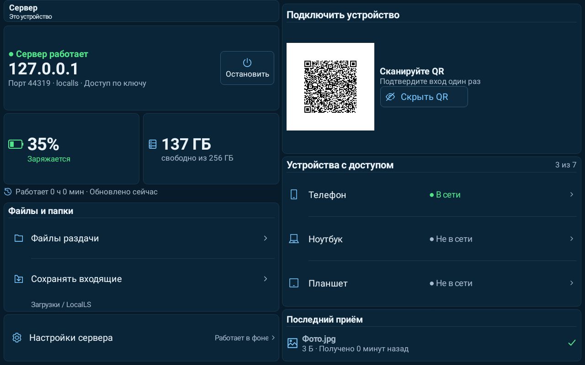

## Главная телефона — данные стенда

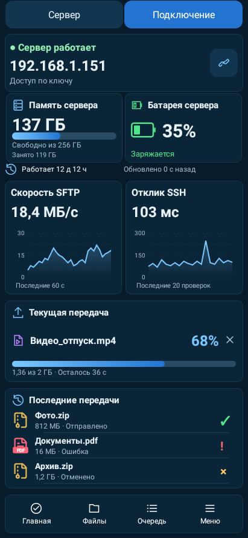

## Главная планшета — данные стенда

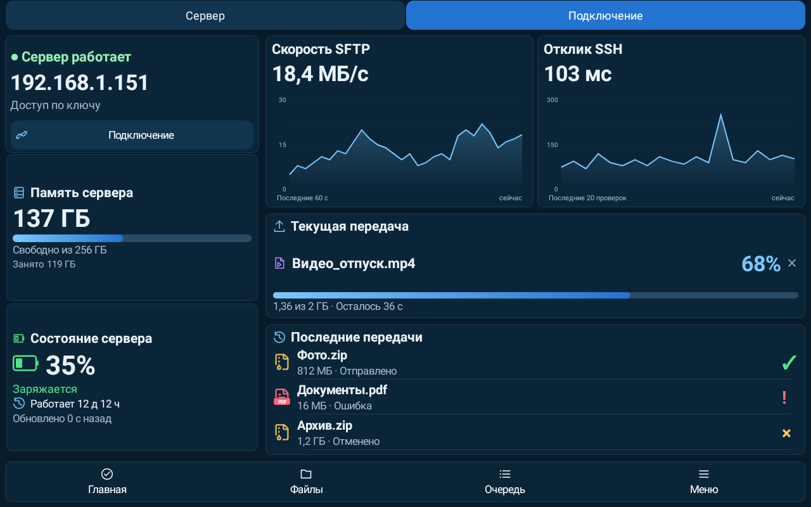

## Подключение

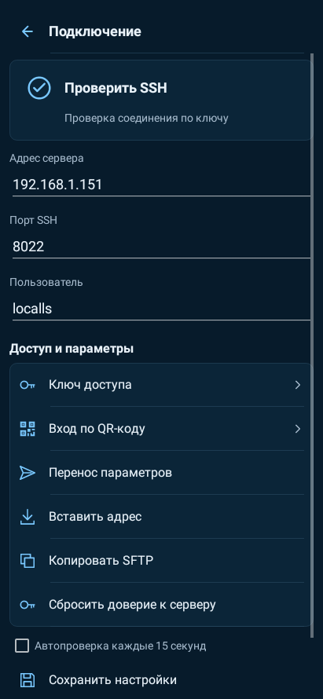

## Диагностика — отметка UI-R5

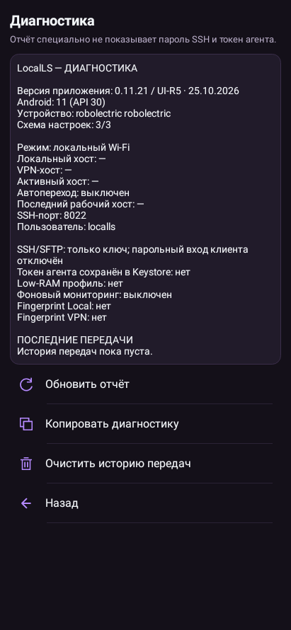

## Малое горизонтальное окно, системный шрифт 200%

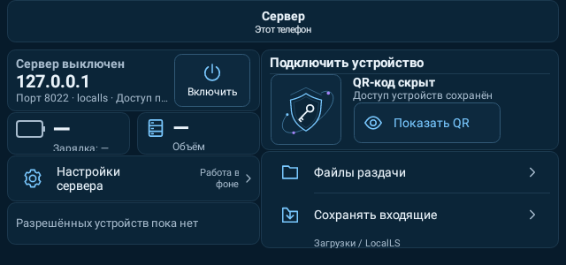

## Тема purple — сервер, демонстрационные данные

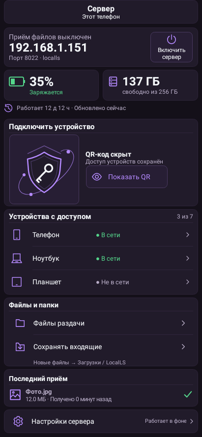

## Тема ocean — сервер, демонстрационные данные

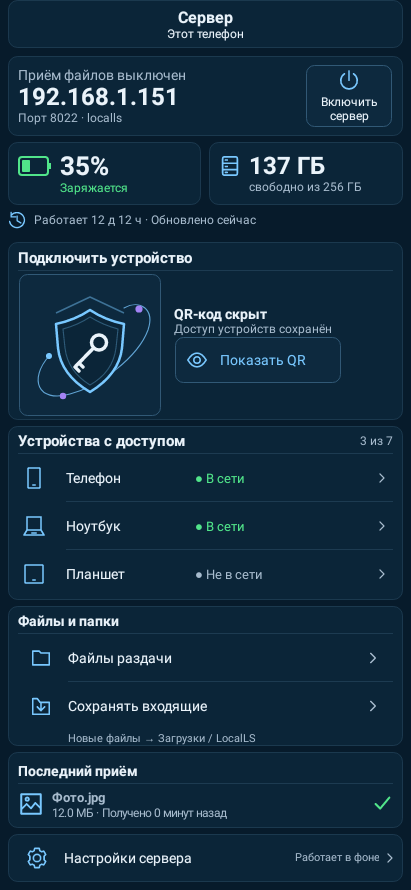

## Тема emerald — сервер, демонстрационные данные

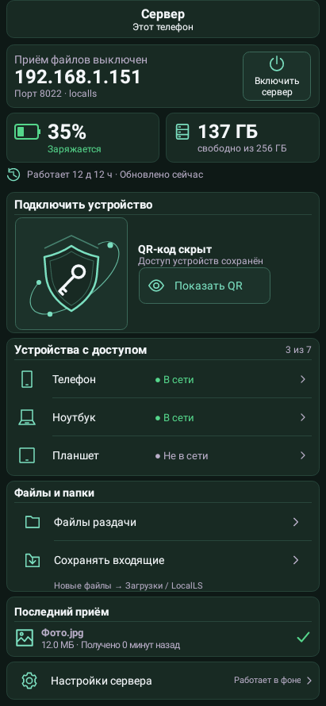

## Тема amber — сервер, демонстрационные данные

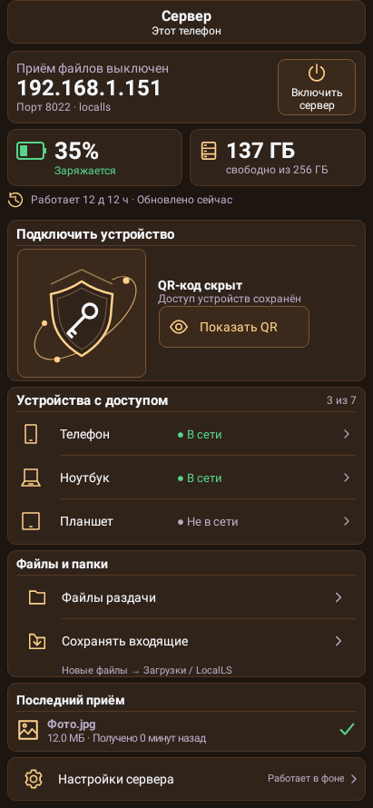

## Тема light — сервер, демонстрационные данные

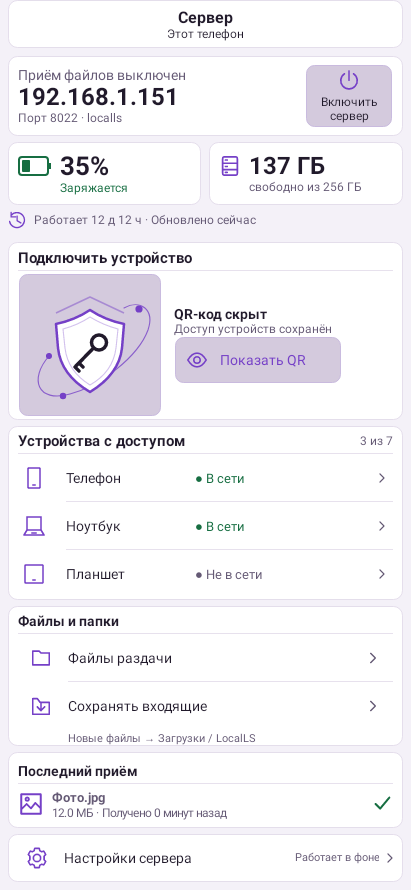

