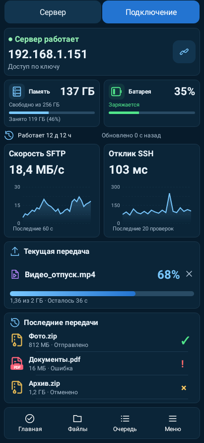
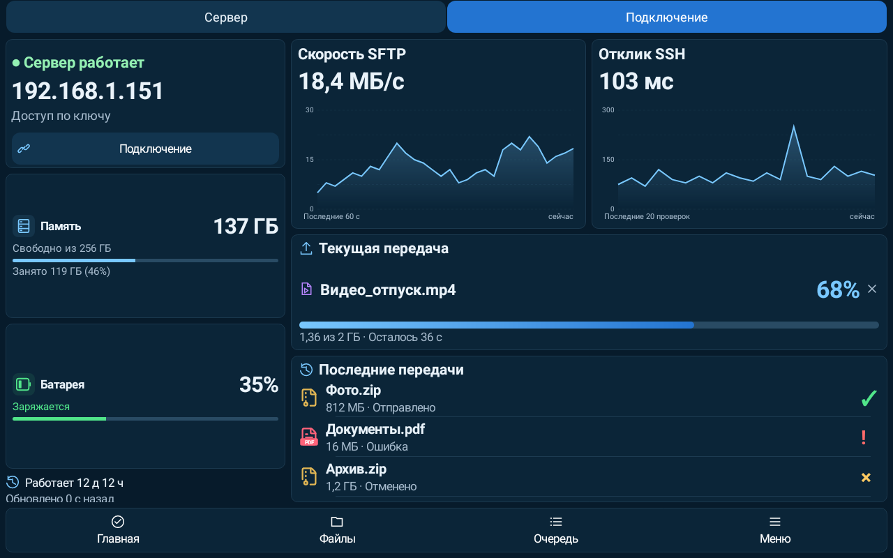
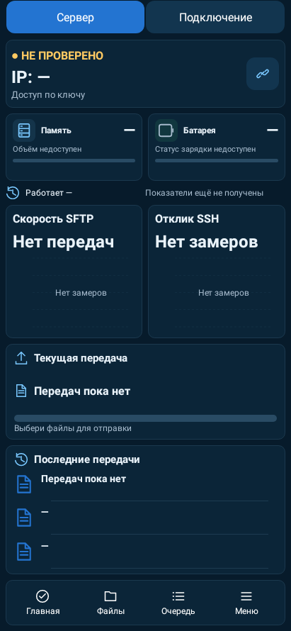
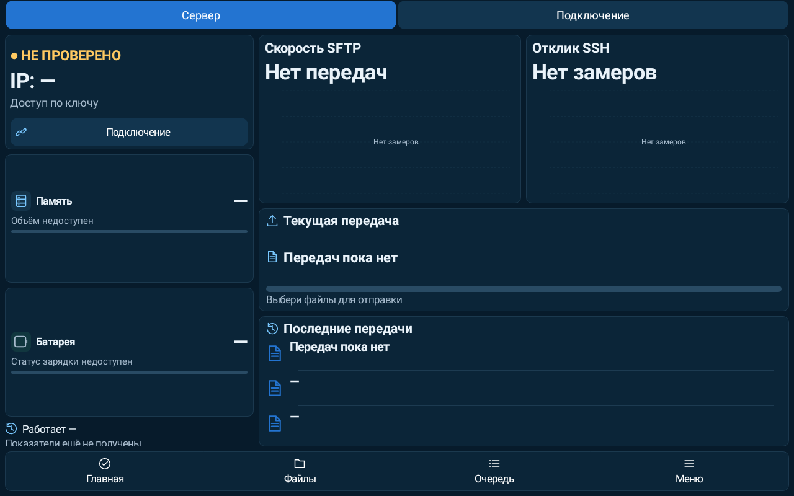

# LocalLS 1.22 / code44 — исправление отрисовки

Проверено UTC: 2026-10-26T13:43:48.477331+00:00.

Исправлены подтверждённые ошибки:

- Значок ⋮: при двойном шрифте строка 59px не помещалась в кнопку 48px. Значок теперь имеет постоянный размер 22dp без лишнего font padding. Зона нажатия 48dp и описание действия сохранены.
- При потере телеметрии метрики сжимались 95→77px, сдвигая графики. Сохранено место под строку сведений, высоты строк рассчитываются до вписывания текста. Визуальные блоки сохраняют положение в проверенных состояниях подключения и потери данных.
- Подпись шкалы 10000 выходила за левый край на 7px. Отступ рассчитывается по реальной ширине подписей, нижние подписи учитывают descent шрифта и не перекрываются. «Нет замеров» центрируется в графике и показывается до первого измерения. Значения сервера не выдумываются.
- Статус недоступной батареи сохранял зелёный цвет после зарядки. Цвет корректно сбрасывается в цвет вторичного текста темы.

Проверки:

- Новые 3 регрессионных метода воспроизвели дефекты до правок; дополнительно усилен сценарий потери телеметрии проверкой цвета. Принудительное переизмерение View исключает ложный результат из-за кэширования. Сбои и промежуточные результаты сохранены; проверки не отключались и не ослаблялись.
- Промежуточный прогон 9 тестов исправлений и прежних CompactMetrics/UiAlignment/SpacingConsistency пройден.
- Финальный прогон: **422 JVM + 19 Python**, 0 ошибок/пропусков/необработанных исключений. Все 419 прежних тестов сохранены. Телефон, планшет, горизонтальное положение, пять тем, две плотности, шрифт 1×/2× проверяются новыми и существующими UI тестами.
- Аудит проекта/архитектуры, проверка версий, lintDebug/lintRelease, assembleDebug, assembleRelease и assembleDebugAndroidTest пройдены. Lint UnusedResources: 0. Удалённые в 1.21 классы и тестовый класс отсутствуют в DEX.
- Физические устройства не подключены. Это нативный рендер Android Canvas в Robolectric и проверки реальной геометрии/цветов; данные на превью тестовые. Windows/Linux код в этом этапе не менялся и их тесты не повторялись.

APK `LocalLS-1.22-code44-render-20261026.apk`. SHA256 `bf354fef96c308cb9aae40d243d10a8fd04a4df2de52edf7bd56029c52e513cc`.

Package `com.bitpoint.homeservercontrol`, 1.22/code44. Прежний сертификат SHA256 `a2230c3032135def93cd5e8224ca3e26ad8e98f294b5e372a33b1e468caa221a`. Подпись API24–36, ZIP alignment и обновление с 1.21/code43 проверены. Файлы подписи, ключи, доверие, настройки и helper сохранены; прежние APK не перезаписывались.

## Нативные превью

| Состояние | Телефон | Планшет |
|---|---|---|
| Данные доступны (демо) |  |  |
| Данные недоступны |  |  |

Отдельные проверки: [крупные подписи шкалы](chart-delay.png), [пустой график](chart-empty.png).
