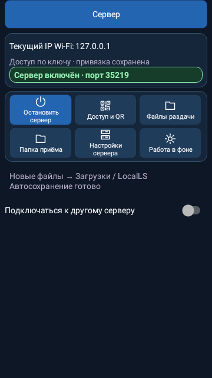
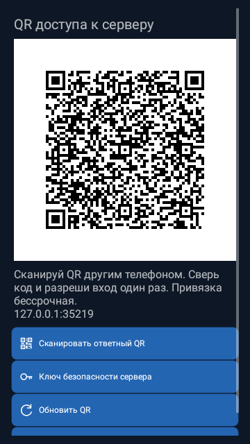

# LocalLS — интерфейс после проверки безопасности

Нативный рендер настоящих Android views, 360×640 px, демонстрационные данные закрытого локального стенда. Физический телефон не использован. Пользовательские ключи и настройки в кадры не попадают.

## Главная клиента

## Главная телефона-сервера

## Файлы телефона и выбор папки

## Файлы раздачи

## QR доступа к серверу

