# LocalLS 1.31 — компактные настройки

[Скачать APK](../LocalLS-1.31-code53-settings-20261028.apk) · [SHA256](../LocalLS-1.31-code53-settings-20261028.apk.sha256)

По подтверждённому запросу пользователя убраны:

- управление VPN/Tailscale, его меню, подсказки и фоновые обновления состояния;
- пустой дублирующий раздел настроек;
- поле iperf3, которое только записывалось в настройки и не использовалось;
- отдельная проверка TCP-порта, дублировавшая раздел подключения;
- лишнее повторное пояснение в серверных настройках и 20 неиспользуемых строк ресурсов.

Вместо расширенного сетевого экрана остался **«Поиск сервера»**: один адрес, поиск в сети и сохранение адреса. Полноценная **«Проверить SSH»** сохранена в подключении. Подписи меню сокращены до «Приложение» и «Журнал», внутренние отступы уплотнены; размер текста не уменьшался, слова не разрываются. Оформление, приём и отправка файлов, фоновая проверка, диагностика и **«О приложении — MSS9LN»** остаются доступными.

Старый мастер Termux/Realme Agent уже не имел входа из настроек в 1.30; отсутствие его пункта проверено. Рабочие установки старых серверов и их конфигурации не изменялись. Внешний VPN не останавливался и не удалялся: из LocalLS убрано только управление им. Прежние адреса, режимы хранения профилей, запасные маршруты, ключи и доверие сохранены для совместимости; адрес редактора относится к исходному активному профилю.

## Исправленный сбой

Подтверждена регрессия восстановления редактора: после поворота старый черновик мог затереть профиль, уже изменённый через другое окно или QR-вход. Проверка сначала упала: адрес 192.0.2.99 заменялся старым черновиком 192.0.2.55. Теперь несекретный черновик восстанавливается вместе со снимком исходного адреса, порта, пользователя и маршрута. Устаревшее сохранение блокируется. Обычный черновик сохраняется и работает после поворота для обоих прежних слотов профиля.

## Проверки

Финальный полный прогон после последней правки: **450 JVM + 19 Python**, без ошибок, пропусков и необработанных исключений. Все прежние **447 test IDs** сохранены. Ожидания тестов удалённых пунктов обновлены под согласованное удаление; проверки ключей, доверия, QR, SSH/SFTP, очереди и папок не отключались. Тест TCP-кнопки теперь проверяет отсутствие лишнего действия и наличие полноценной проверки SSH.

Три новых теста проверяют меню и редактор в темах, стекле, при увеличенном шрифте и четырёх размерах окна; сохранность ключей/пинов обоих прежних профилей; отмену устаревшего поиска и сохранение/блокировку черновика после поворота. Нативный рендер фиксирует завершённую анимацию раскрытия меню и проверяет границы панели.

Аудиты проекта и архитектуры, lintDebug/lintRelease, release/debug/androidTest-сборки прошли: **BUILD SUCCESSFUL**. VpnController и прежний каталог форм отсутствуют в release DEX. Исторические проверки команды VPN оставлены только в instrumentation-фикстуре, вне APK приложения. Инструментальные тесты собраны, но на физических устройствах не выполнялись.

Снимки — нативный Robolectric-рендер с демонстрационным адресом 192.0.2.44. Физические телефоны и планшеты не подключались. Windows/Fedora не менялись; портирование не выполнялось. Это отдельная работа, не продолжение закрытого десятичасового окна аудита.

APK `LocalLS-1.31-code53-settings-20261028.apk`, версия **1.31/code53**, package `com.bitpoint.homeservercontrol`.

SHA256: `9e7ef6fde3ae1a9ef51c58be313f8164d7734d6fb4875e658b6375f98e942cc7`.

Прежний сертификат SHA256: `a2230c3032135def93cd5e8224ca3e26ad8e98f294b5e372a33b1e468caa221a`. Проверены подпись API24–36, ZIP alignment и совместимость обновления с 1.30/code52. Защищённые файлы, прежние APK, release-ветка и тег сохранены.

Завершение проверок: 28.10.2026 07:24 МСК.

## Телефон

| Меню — светлое | Меню — тёмное |
|---|---|
| 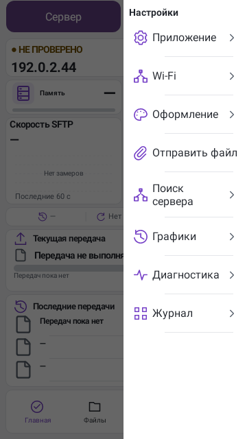 | 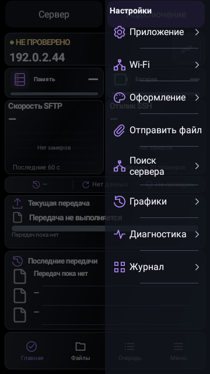 |

| Поиск — светлый | Поиск — тёмный |
|---|---|
| 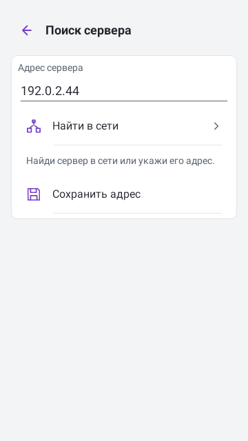 | 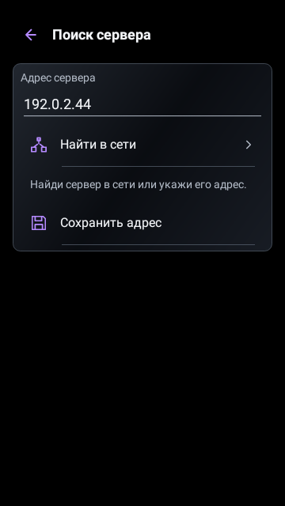 |

| Настройки — светлые | Настройки — тёмные |
|---|---|
| 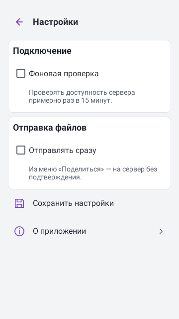 | 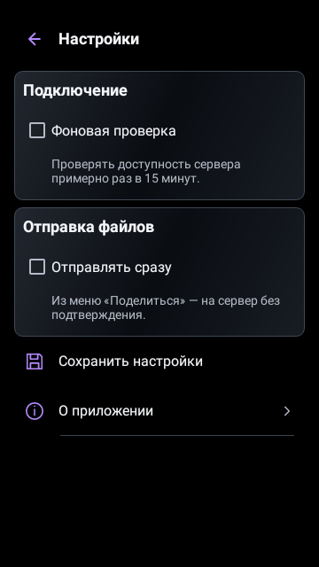 |

## Планшет

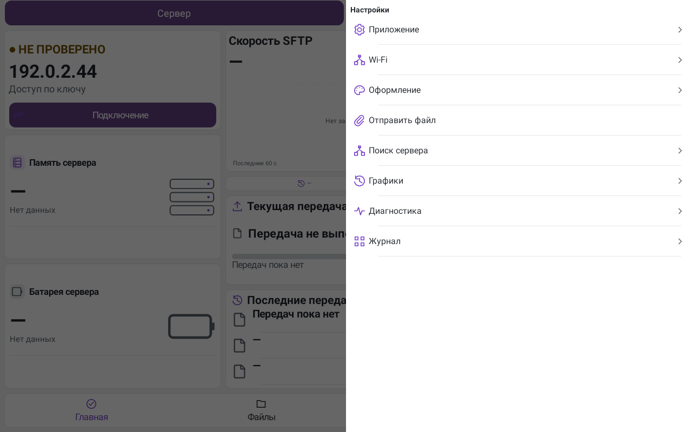
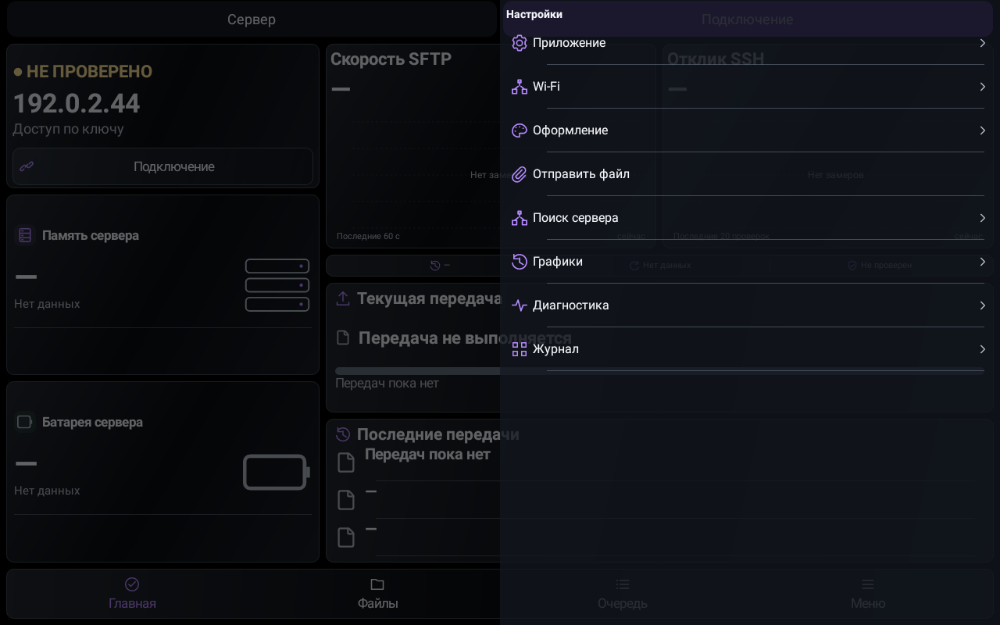
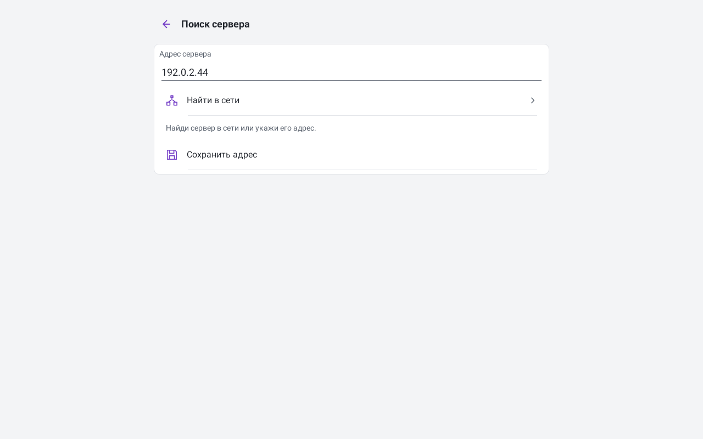
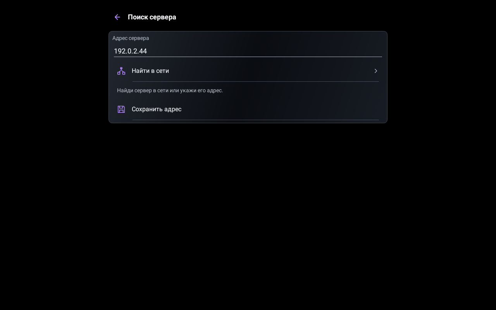
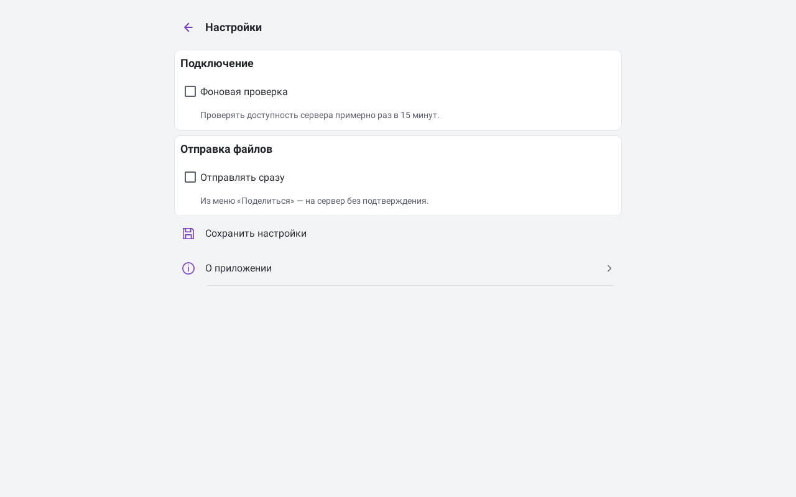
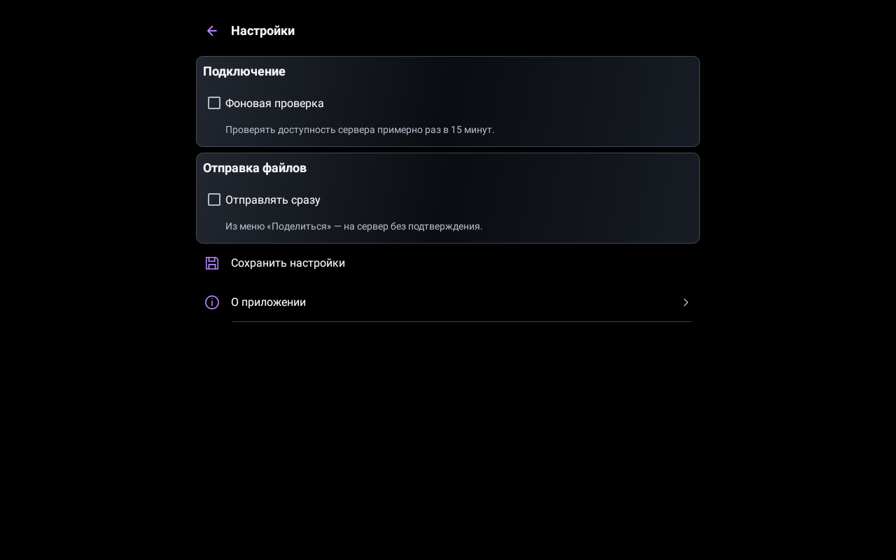
