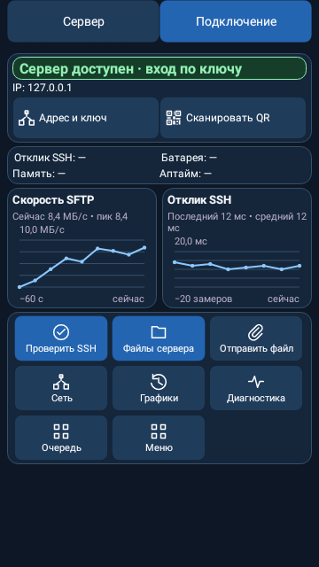
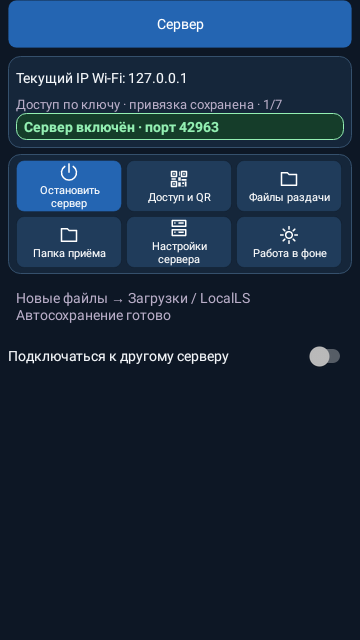
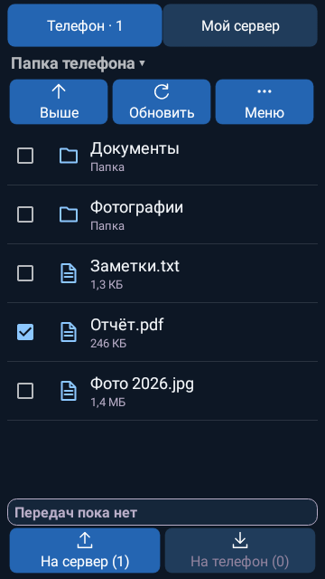
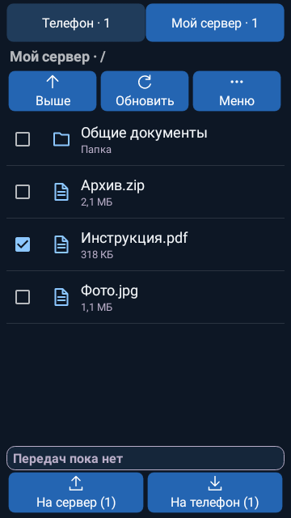
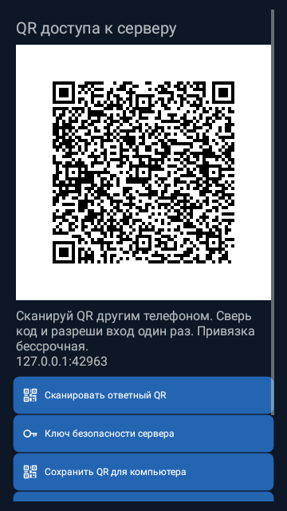
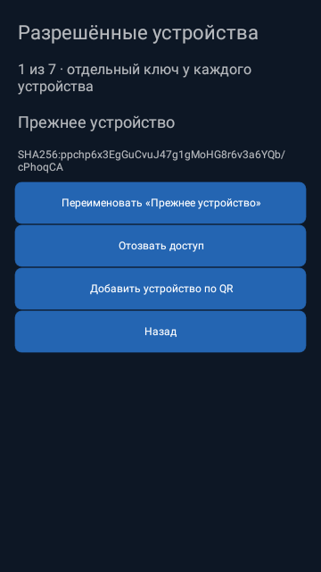
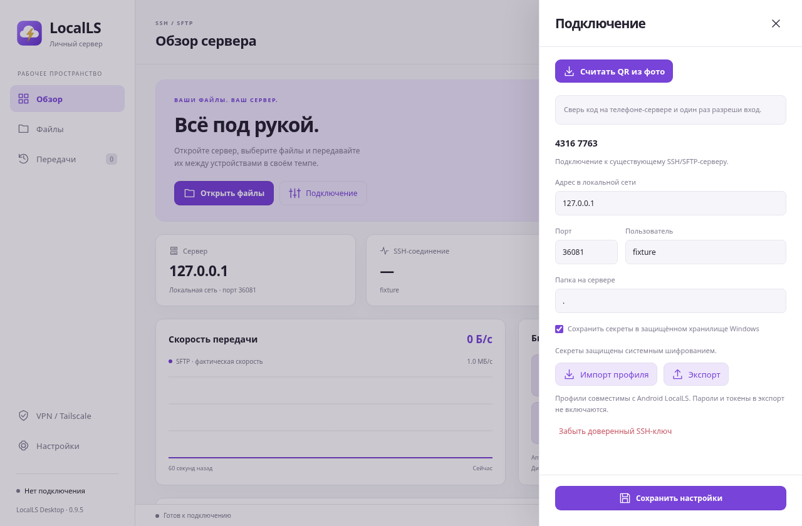
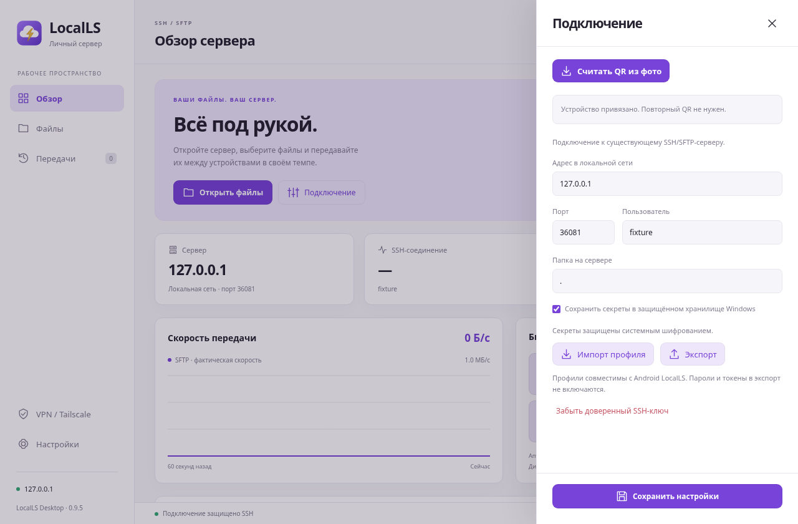

# LocalLS — семь устройств и QR для ПК

Шесть нативных Android view renders и два окна Electron в Linux/Xvfb. Демонстрационные данные закрытых loopback-стендов, без пользовательских ключей/настроек. Физические телефоны и Windows не использованы; Windows DPAPI в GUI-тесте заменён только тестовым шифрующим vault.

## Главная клиента Android

## Главная телефона-сервера

## Файлы телефона

## Файлы раздачи

## QR и сохранение PNG для ПК

## Разрешённые устройства

## ПК: QR из изображения и код сверки

## ПК: устройство привязано, вход по ключу

