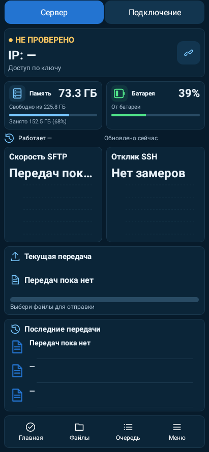
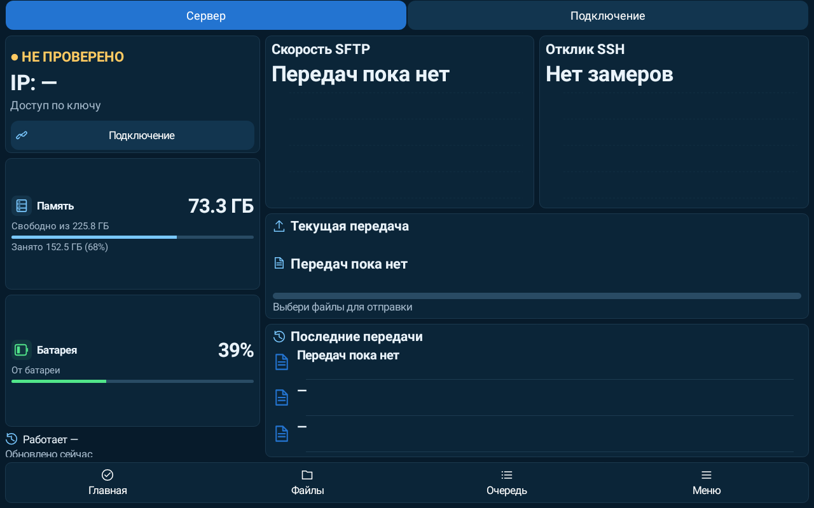
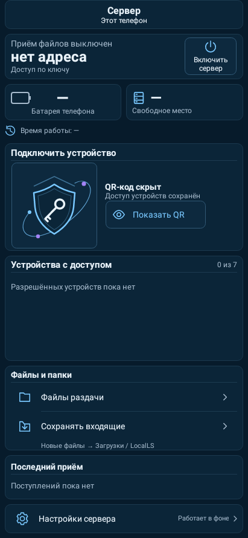

# LocalLS 1.20 / code42 — ровные отступы

Дата проверки UTC: 2026-10-26T09:36:18.722020+00:00.

Исправлены разные зазоры между карточками подключения, памятью/батареей, графиками и передачами. Основной шаг — 8 dp, на тесных экранах адаптивное уменьшение без потери основных блоков. Между карточками ресурсов сервера используется тот же шаг, что между остальными его разделами. Секции настроек — 8 dp. Отступы QR, списка разрешённых устройств и очереди пересчитаны из пикселей в dp для одинаковой плотности интерфейса на разных устройствах. Дизайн, темы, графики и щит QR сохранены.

Новый геометрический тест сначала выявил сохранение старых XML margins у графиков. Исправление проверено повторно: 2 теста, 48 вариантов клиента и 8 сервера; исходные проверки не ослаблялись.

Полный финальный прогон: **417 JVM + 19 Python**, 0 failures/errors/skipped и 0 необработанных исключений в Gradle и XML stdout/stderr. Все 415 тестов прежнего полного набора сохранены. Проверки версий, проекта, архитектуры, lintDebug/lintRelease, assembleRelease и assembleDebugAndroidTest пройдены. До этого 16 существующих UI тестов также прошли отдельно.

Нативный рендер Robolectric: телефон, планшет, горизонтальное положение, пять тем и увеличенные шрифты в существующем наборе. Физические устройства в этой среде не подключены. Превью используют тестовые данные; пустые состояния сервера показывают сохранённую вёрстку без выдуманных подключений.

APK: `LocalLS-1.20-code42-spacing-20261026.apk`; SHA256 `fa1a726cde64d32d6172983e2c444c96a9560970a21354717bf5db9908c25405`.

Package `com.bitpoint.homeservercontrol`, версия 1.20/code42. Это новая сборка с правкой отступов; прежний APK 1.20/code42 сохранён. Прежний сертификат SHA256 `a2230c3032135def93cd5e8224ca3e26ad8e98f294b5e372a33b1e468caa221a`. Подпись API 24–36, выравнивание ZIP и совместимость обновления с code41 проверены. Файлы подписи, ключи, доверие и helper совпадают с защищёнными контрольными суммами. Настройки, package, versionName/code в этом этапе не менялись.

## Нативные превью

| Телефон | Планшет |
|---|---|
|  |  |
|  |  |
