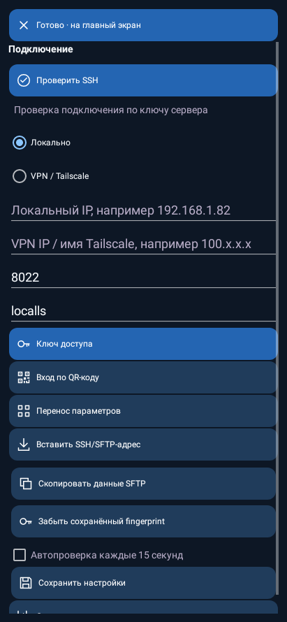
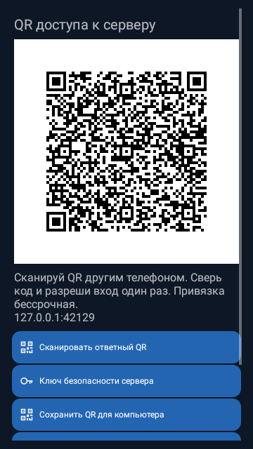

# LocalLS — квадратный значок QR

Нативные Android renders Robolectric, не фотографии физических устройств. Сам QR для сканирования и его данные не изменялись.

## Вход по QR-коду: квадратный значок

## QR сервера: значки кнопок

