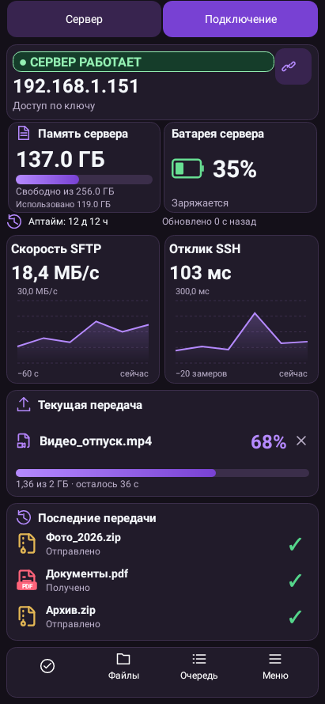
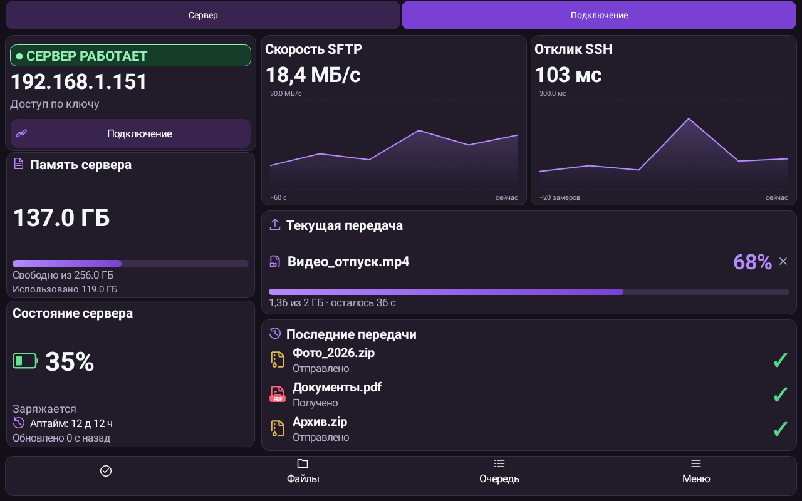
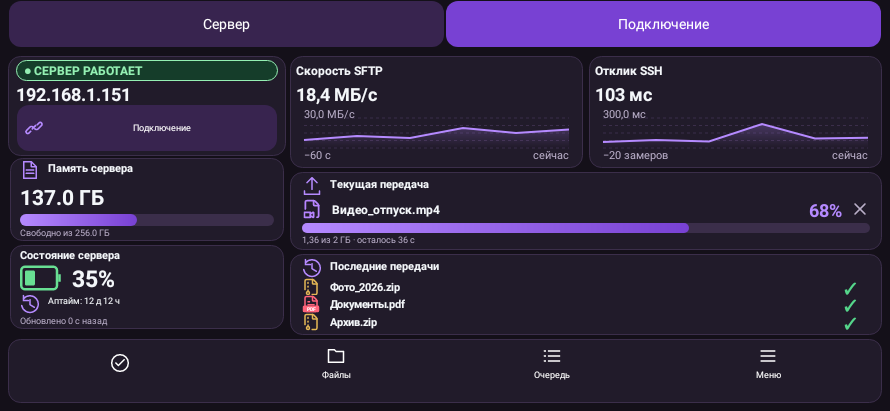
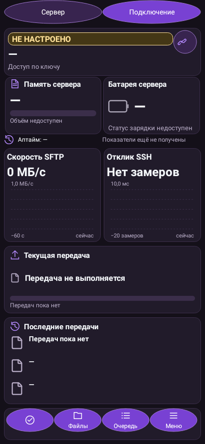
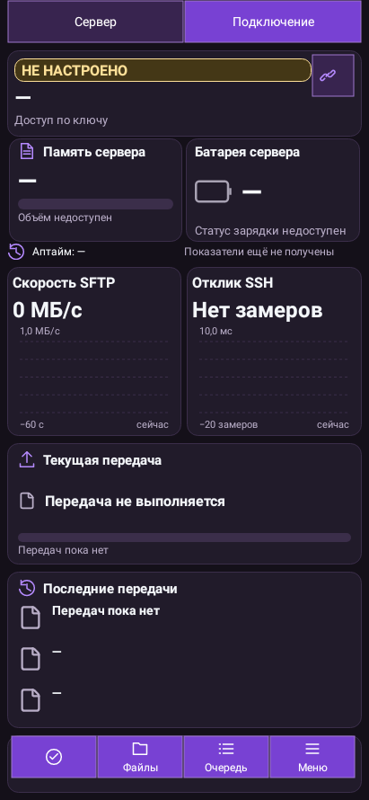
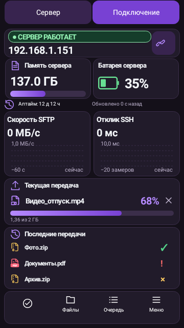
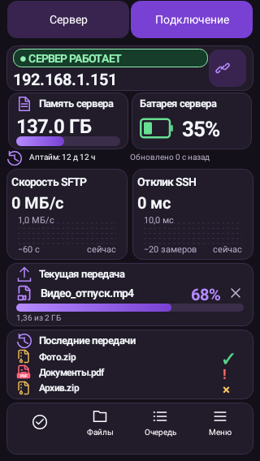
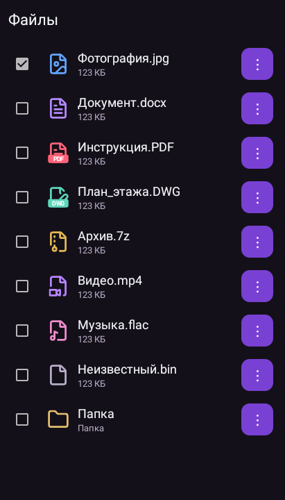
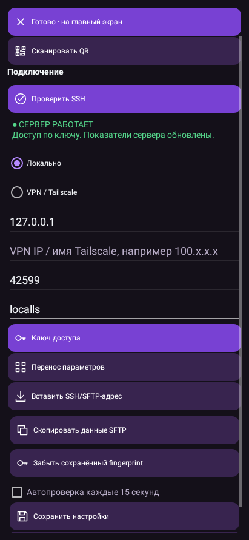

# LocalLS — кнопки SSH и значки файлов

Нативные Android renders Robolectric с явно заданными данными стенда; не фотографии физических устройств.

## Главная телефона вертикально

## Главная планшета

## Горизонтальный телефон

## Круглая внешняя форма кнопок

## Прямоугольная внешняя форма кнопок

## Телефон360×640: успех, ошибка и отмена

## Телефон320×568: три имени файлов

## Значки изображения, документа, PDF, DWG, архива и видео

## Подключение: Проверить SSH и результат настоящего SSH-входа

