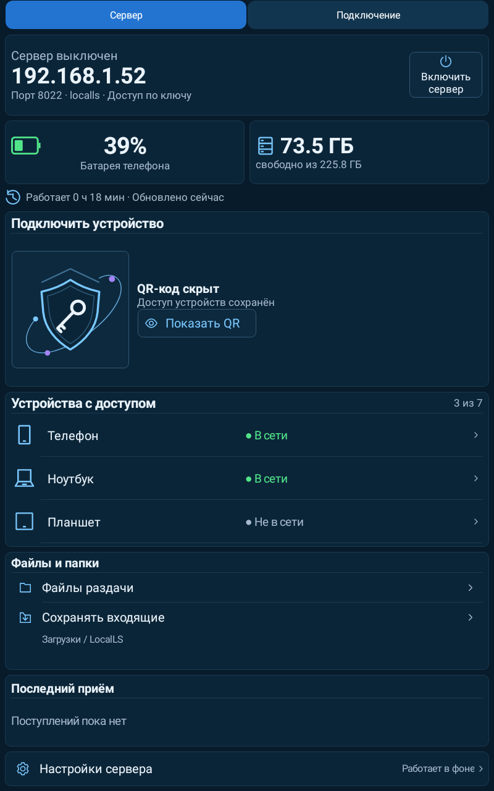
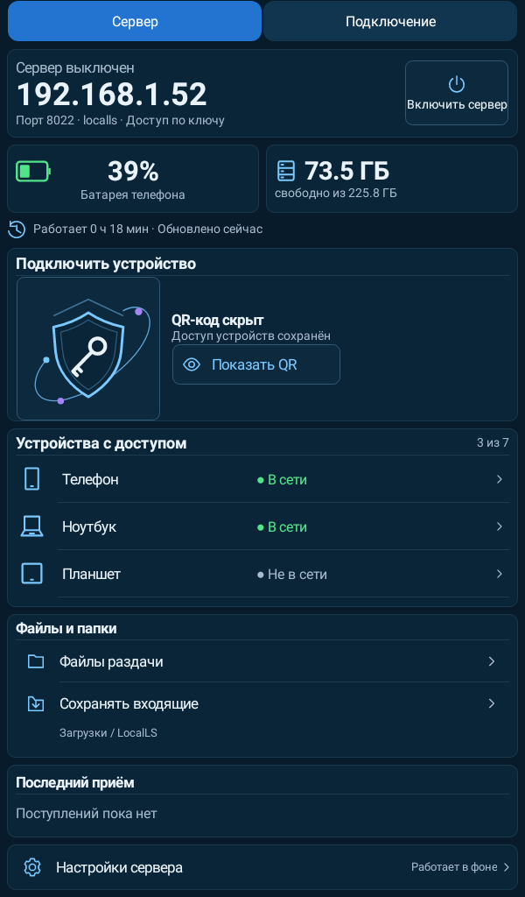
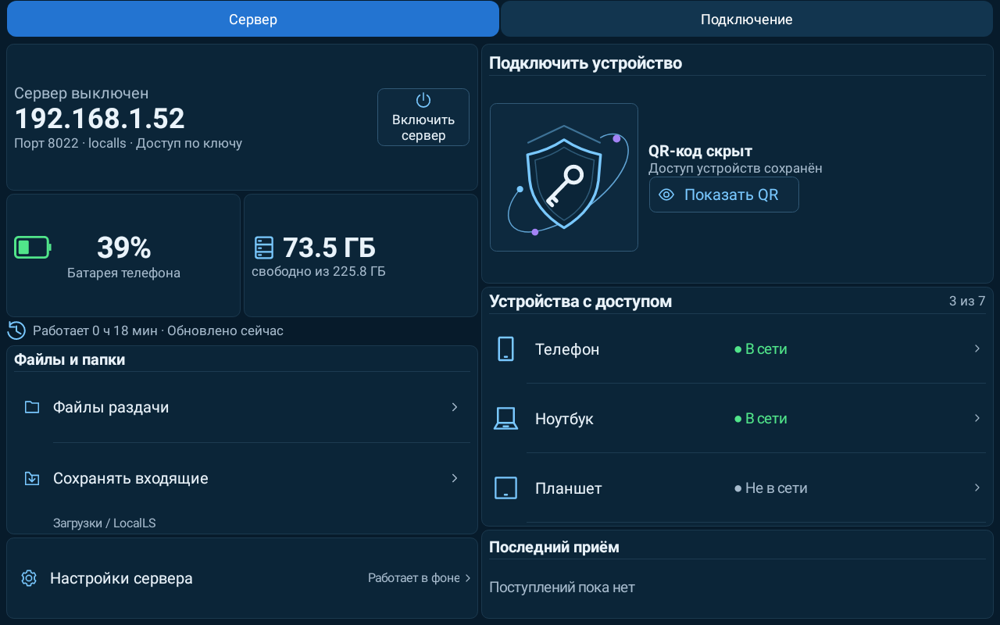
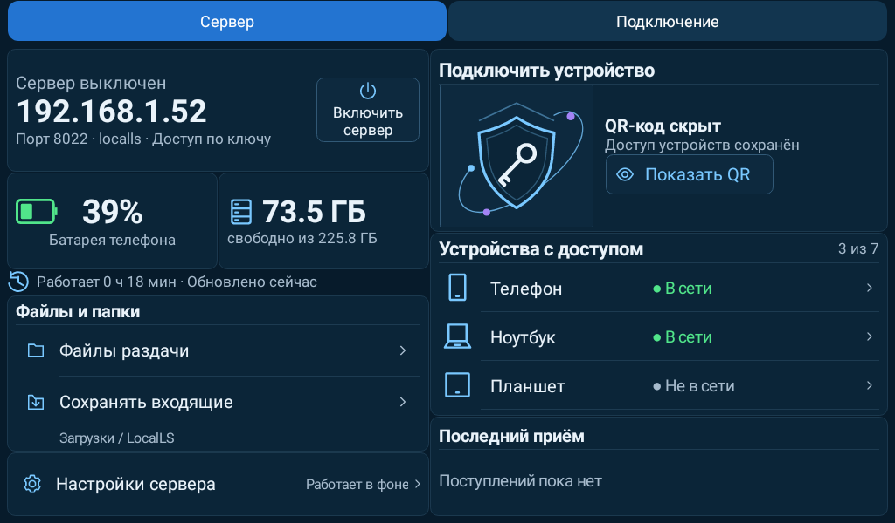

# LocalLS 1.24 / code46 — планшет: масштаб и пустой зазор

Проверено UTC: 2026-10-26T17:53:56.616510+00:00.

На высоком планшете строка времени работы получала20% избыточной высоты и превращалась в пустой промежуток. При этом увеличение шрифтов применялось только к широкой раскладке. Исправлено распределение: строка времени сохраняет высоту одной строки, а в портретном планшете увеличены подписи, значения и значки. Дополнительная высота распределяется между полезными карточками. В горизонтальном режиме сохранены две колонки. Окантовки, темы, QR и действия остаются прежними.

- Новый нативный тест воспроизвёл ошибку до правки на800×1280dp. После исправления проверены48 конфигураций:3 темы ×2 плотности ×2 масштаба шрифта ×4 размера планшета. Проверены компактность времени, масштаб текста,48dp кнопки, границы содержимого и стабильность размеров QR-карточки.
- Полный прогон: **424 JVM +19 Python**, без ошибок, пропусков и необработанных исключений. Все423 прежних теста сохранены; QR/SSH/SFTP/очередь/папки проверены существующим набором.
- Проверки версий, проекта и архитектуры, lintDebug/lintRelease, assembleRelease, assembleDebug, assembleDebugAndroidTest пройдены. BUILD SUCCESSFUL.
- Превью — нативный рендер Robolectric с демонстрационными данными; это не снимки физического планшета. Windows/Linux в этом этапе не менялись и не тестировались повторно.

APK `LocalLS-1.24-code46-tablet-20261026.apk`, SHA256 `e51ac78c6b960b449cc7c27edd0264dadb9293f318cd00ef6ba13d33fe125051`.

Package `com.bitpoint.homeservercontrol`; прежний сертификат SHA256 `a2230c3032135def93cd5e8224ca3e26ad8e98f294b5e372a33b1e468caa221a`. Проверены подпись API24–36, ZIP alignment и обновление с1.23/code45. Ключи, доверие, настройки и прежние артефакты сохранены.

## Планшет вертикально

## Планшет горизонтально

