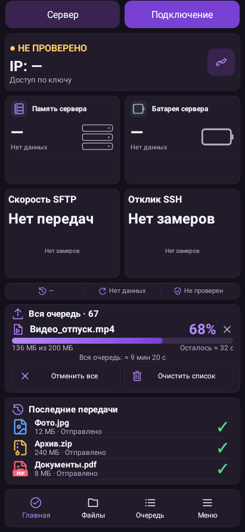
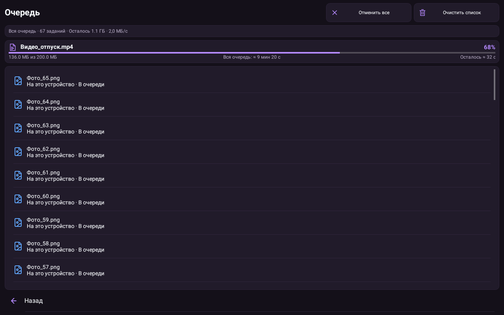
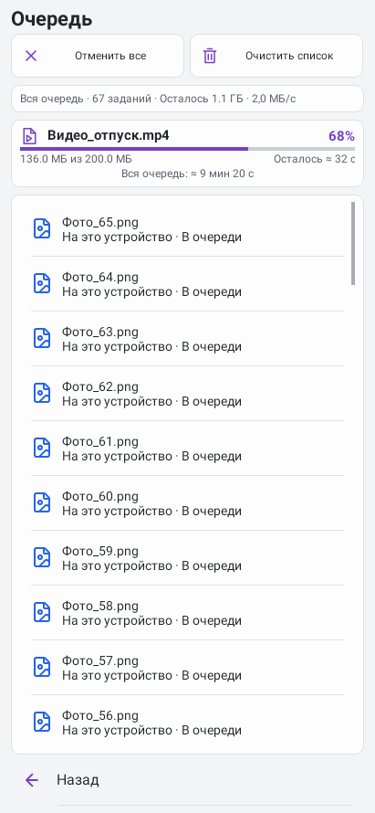

# Android 1.39 — компактная очередь

Автор — **MSS9LN**.

[Скачать APK](../LocalLS-1.39-code61-queue-eta-20261031.apk) · [Проверки](audit.txt) · [SHA-256](SHA256SUMS.txt)

Время всей очереди мелко под прогрессом. «Отменить все» и «Очистить список» работают с подтверждением; исходники и готовые файлы сохраняются. Неизвестный объём не заменяется выдуманным временем.

481 JVM-тестов, 19 Python, lint и подпись проверены. Сертификат Android прежний. Установка поверх1.38 совместима по package/версиям/сертификату; физических устройств здесь нет.

Снимки Android-виджетов с тестовыми данными:

