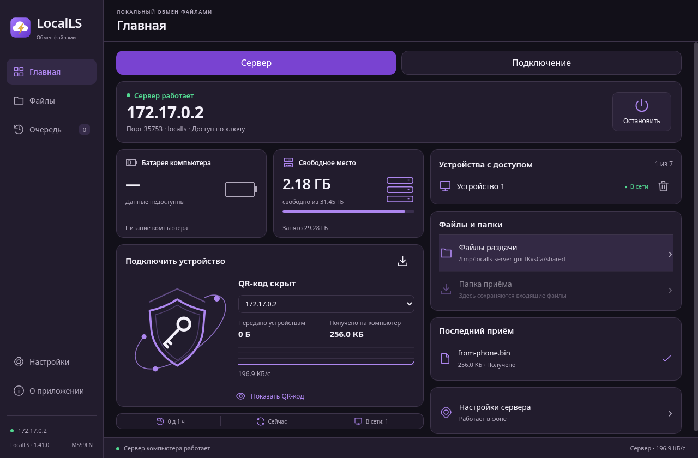
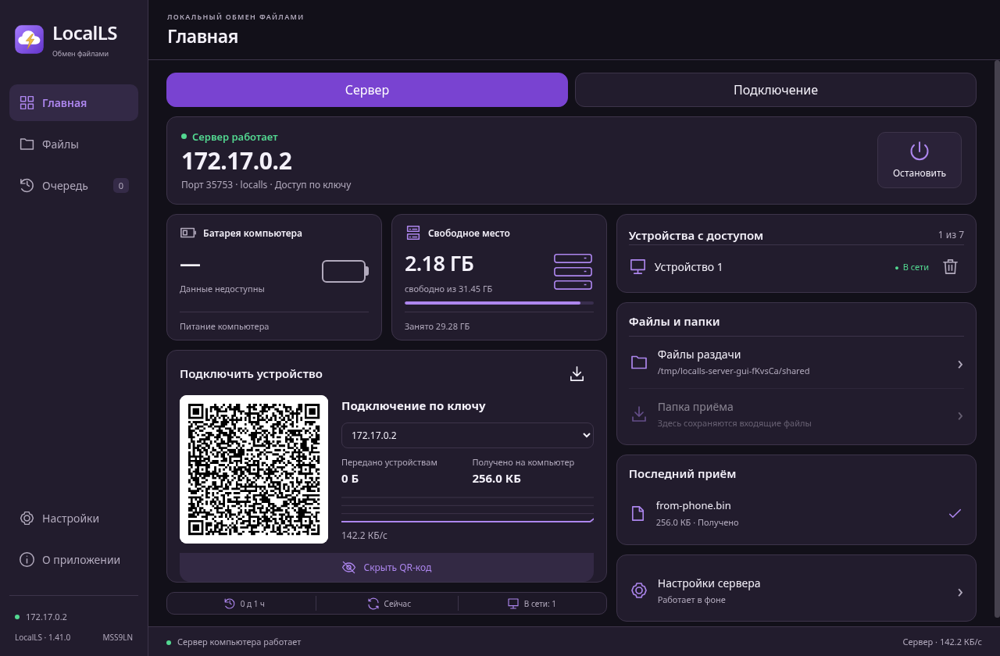
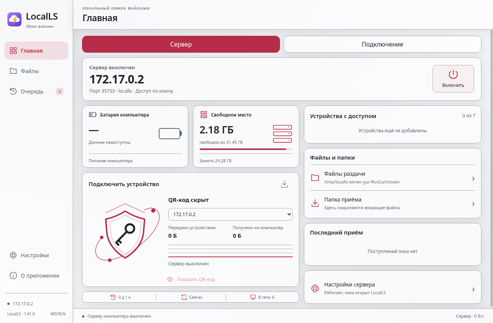
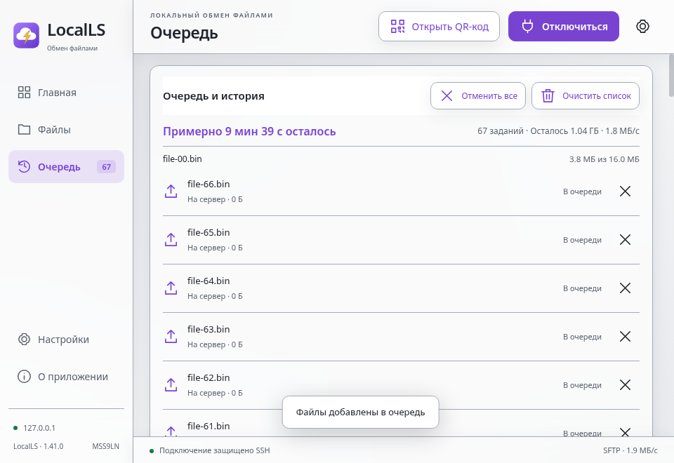

# Android 1.40 и Fedora 1.41

Автор — **MSS9LN**.

[Android APK](../LocalLS-1.40-code62-queue-count-20261102.apk) · [Fedora x86_64 RPM](../LocalLS-1.41.0-Fedora-x86_64-20261102.rpm) · [Проверки](audit.txt) · [SHA-256](SHA256SUMS.txt)

Fedora: клиент и встроенный сервер с QR-кодом, подтверждением устройств и ключами в системной связке. Системный OpenSSH не меняется. [Короткая инструкция](../../linux/README.md).

Установка: скачай RPM и выполни `sudo dnf install ./LocalLS-1.41.0-Fedora-x86_64-20261102.rpm`. RPM пока без подписи издателя.

89 тестов и 8 GUI-сценариев прошли на установленном RPM в Fedora44/X11-контейнере. Проверены QR из PNG/JPEG, передача файлов, очередь, фото/видео/PDF и сохранение ключей. Физические телефоны, GNOME/Wayland/KDE и SELinux-десктоп не проверялись. Матовые панели оформлены внутри окна.

Android: исправлено склонение количества заданий. 3 UI-теста, 18 проб на скомпилированном Java-классе, 19 Python-проверок и lint прошли. Полный предыдущий прогон481 теста заново не запускался. APK подписан прежним сертификатом.

Снимки финального установленного RPM с тестовыми данными:

