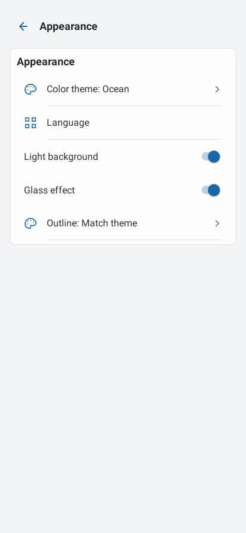
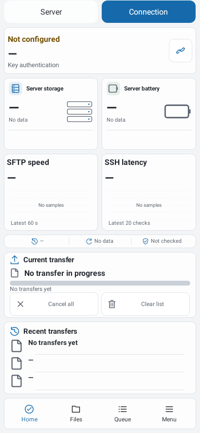
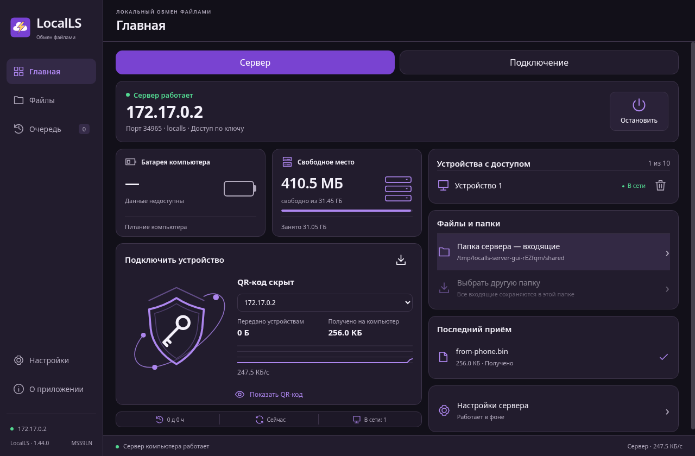
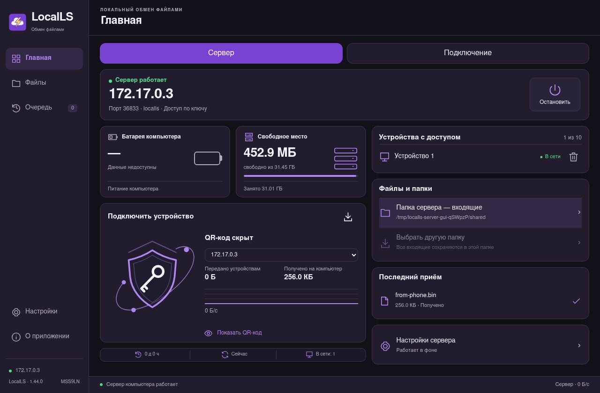

# LocalLS — 10 ноября 2026

Автор **MSS9LN**. Android **1.41/code63**, Windows **1.43**, Fedora/Debian **1.44**.

- Сервер Android восстанавливается после освобождения процесса с прежним SSH-ключом и разрешёнными устройствами. Фоновая очередь поддерживает повторную доставку незавершённых заданий без запуска уже завершённых или отменённых.
- ПК удерживает блокировку автоматического сна всё время работы сервера. Закрытие окна сохраняет сервер в фоне; выход завершает его. Ручной сон/выключение прерывает сеть.
- До **10** разрешённых устройств. В файлах — **Сервер-ПК / Сервер-мобильный**; для старого сервера без сведений о типе — «Сервер».
- Значок на ПК перенесён из Android: одинаковые контуры и цвета, проверены шесть размеров ICO и установленные значки Linux.
- Светлый фон Android выбирается отдельно от цвета. Исправлены контраст и выравнивание подписи переключателя.
- Папка входящих показана полным путём на вкладке сервера. Локальные папки доступны в пределах прав пользователя; Android использует системный выбор папок. SSH-доверие и границы выбранной серверной папки сохранены.
- Русский/English доступны на всех платформах. Проверены телефон/планшет, обе ориентации, крупный шрифт, светлые и тёмные варианты семи палитр.

- [Android 1.41/code63](../LocalLS-1.41-code63-background-language-20261110.apk)
- [Windows 1.43 x64](../LocalLS-1.43-Windows-x64-Setup-unsigned-background-language-20261110.exe)
- [Fedora 1.44 x86_64](../LocalLS-1.44.0-Fedora-x86_64-background-language-20261110.rpm)
- [Debian 13 / 1.44 amd64](../LocalLS-1.44.0-Debian13-amd64-background-language-20261110.deb)

[SHA-256](SHA256SUMS.txt) · [Результаты проверок](completion.json)

Проверки: полный Android **495 JVM +19 Python**, все прежние481 ID и102 ссылки матрицы сохранены; ошибок/пропусков нет. После правки только цвета и отступов переключателя — ещё **17** проверок оформления, включая новую проверку контраста. Это496 уникальных JVM ID, не496 в одном полном прогоне. Debug/release lint без ошибок (104 предупреждения). Windows **100 Node**, Linux **96 Node**. Интерфейс:9 сценариев Windows ASAR, по10 установленного RPM и DEB. Проверены20 реальных минут с закрытым окном и последующая передача64КиБ; текущий Android JVM-сервер и Node-клиент передали8МиБ в обе стороны с побайтовым сравнением. Android также прошёл16 виртуальных минут выключенного экрана с обновлением CPU/Wi-Fi-блокировок и реальной передачей по loopback.

APK подписан прежним сертификатом: `a2230c3032135def93cd5e8224ca3e26ad8e98f294b5e372a33b1e468caa221a`. Проверены ZIP alignment, подпись API24–36 и совместимость обновления с1.40/code62. EXE/RPM/DEB **без подписи издателя**.

Стенды: JVM/native Robolectric и loopback; Fedora44/Debian13 в X11/Openbox. Windows проверялся точным ASAR в Linux Electron. Физический Android Doze, нативные Windows/DWM/DPAPI, Wayland/KDE не проверялись. Непрерывность не заявляется: среда останавливалась; интервал13:43:09–20:37:41UTC отмечен как непроверенный, незавершённые проверки повторены после запуска. Старые окна аудита не возобновлялись. Release HEAD/тег, прежние артефакты, ключи и настройки сохранены.

English: Android1.41, Windows1.43 and Linux1.44 add background recovery/idle inhibition,10 approved devices, authenticated server-type labels, the Android icon, independent light/accent settings, visible incoming-folder paths and Russian/English UI. Local folders follow OS permissions. Install over the previous version to retain keys and settings. Manual suspend interrupts networking. Android retains its signing certificate; PC packages are unsigned. Testing limits and the environment interruption are detailed above and in the JSON report.

