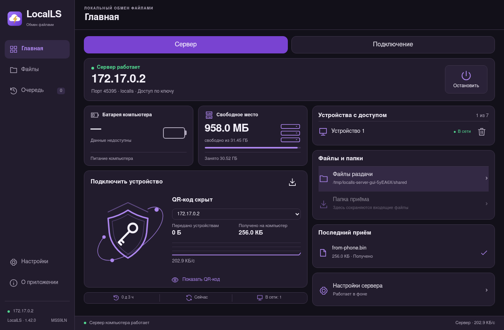
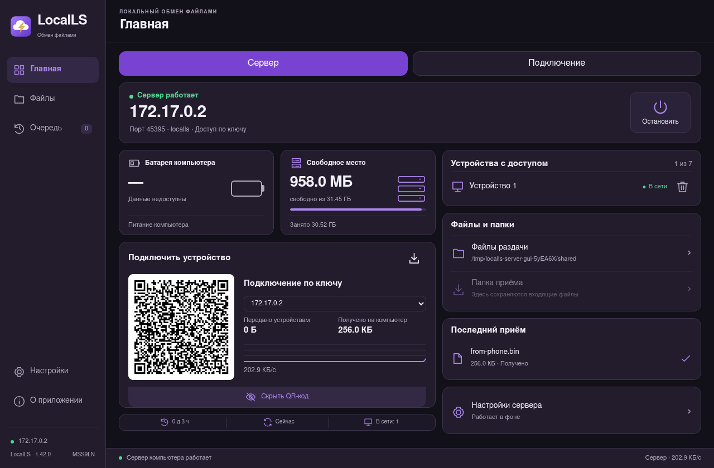
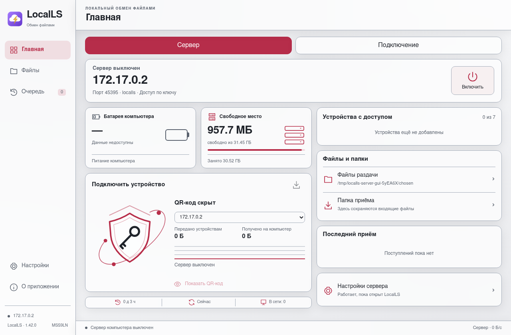

# LocalLS1.42 для Debian13

Автор — **MSS9LN**. Архитектура amd64.

[Скачать DEB](../LocalLS-1.42.0-Debian13-amd64.deb) · [Инструкция](../../linux/DEBIAN.md) · [Проверки](audit.txt) · [SHA-256](SHA256SUMS.txt)

Установка: `sudo apt install ./LocalLS-1.42.0-Debian13-amd64.deb`.

Клиент и встроенный сервер, QR-вход с подтверждением, файлы/очередь/просмотр. Системный OpenSSH не меняется.

91 тест и8 сценариев интерфейса прошли в Debian13 на установленном DEB. Проверены настоящая связка gnome_libsecret, передача4МиБ в обе стороны и сохранение ключей после перезапуска. Тесты не отключались; дефект прав первого кандидата исправлен до публикации.

Пакет пока без подписи издателя. Физический Debian/Wayland/KDE/AppArmor, Debian12,Ubuntu и ARM64 не проверялись. Матовые панели внутри окна.

