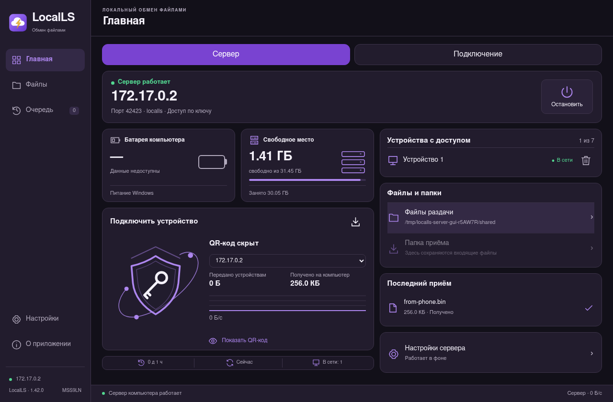
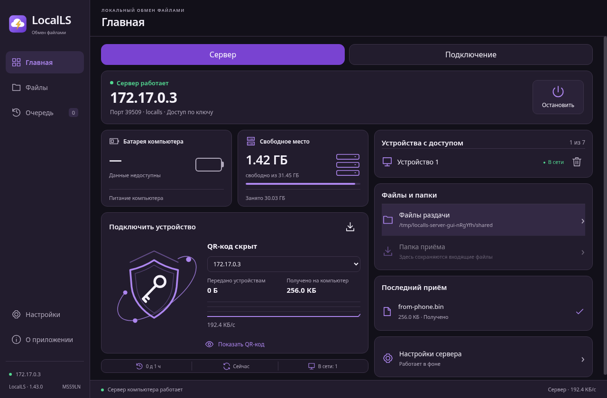

# LocalLS — аудит 5 ноября 2026

Автор — **MSS9LN**. Windows1.42, Fedora/Debian1.43. Android1.40/code62 не менялся.

Исправлены возврат к старой папке после выбора новой и переход к корню диска в Windows.

- [Windows1.42](../LocalLS-1.42-Windows-x64-Setup-unsigned-audit-20261105.exe)
- [Fedora1.43](../LocalLS-1.43.0-Fedora-x86_64-audit-20261105.rpm)
- [Debian1.43](../LocalLS-1.43.0-Debian13-amd64.deb)

[Результаты](audit.txt) · [Время и стадии](completion.json) · [SHA-256](SHA256SUMS.txt)

Каждый полный прогон Android:481 JVM +19Python,102 ссылки матрицы; исходные тесты сохранены. Windows95 Node, Fedora/Debian91 Node;9 сценариев установленного интерфейса Linux и8 сценариев точного Windows ASAR. Проверены20 минут простоя SSH и передача8МиБ в обе стороны с побайтовым сравнением.

Окно09:57:23–11:57:23UTC. Внутри была штатная пауза на воспроизведение, исправления и сборку; непрерывный автоматический прогон не заявляется. Финальная проверка после дедлайна указана в отчёте.

Windows EXE, RPM и DEB пока без подписи издателя. Android подписан прежним ключом. Стенды: JVM/nativeRobolectric и loopback, Fedora44/Debian13 в X11/Openbox, Windows ASAR в LinuxElectron. Физические устройства, Windows/DWM/DPAPI, Wayland/KDE/AppArmor не проверялись.

