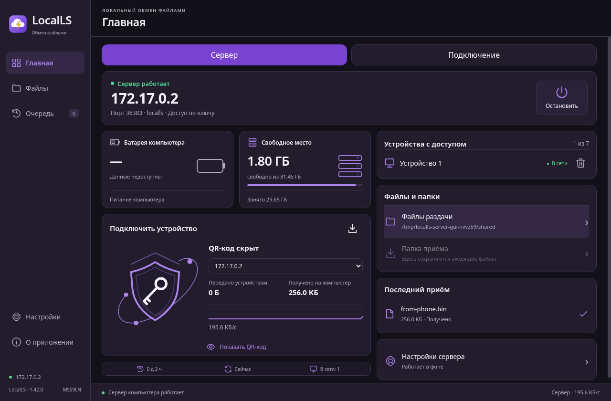
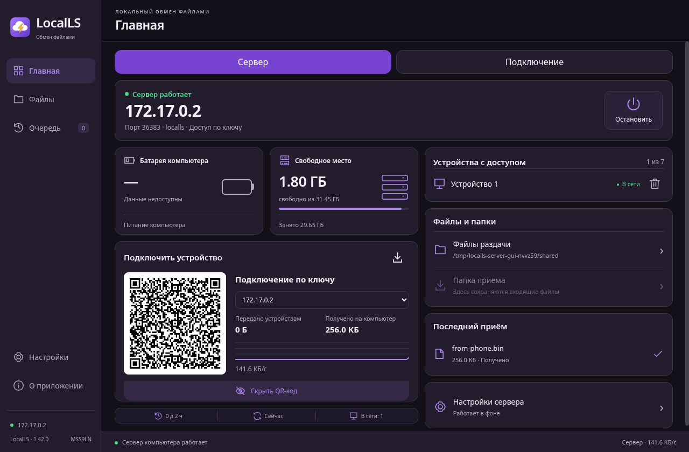
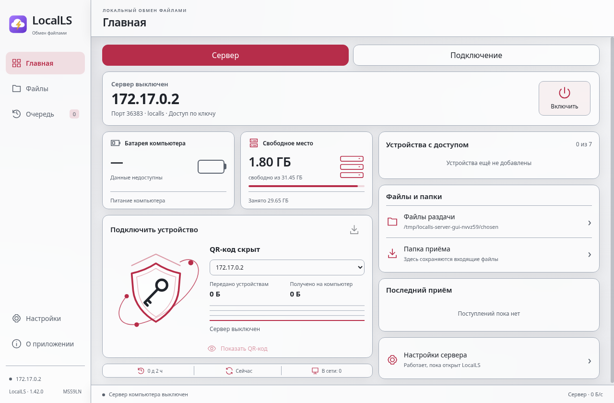
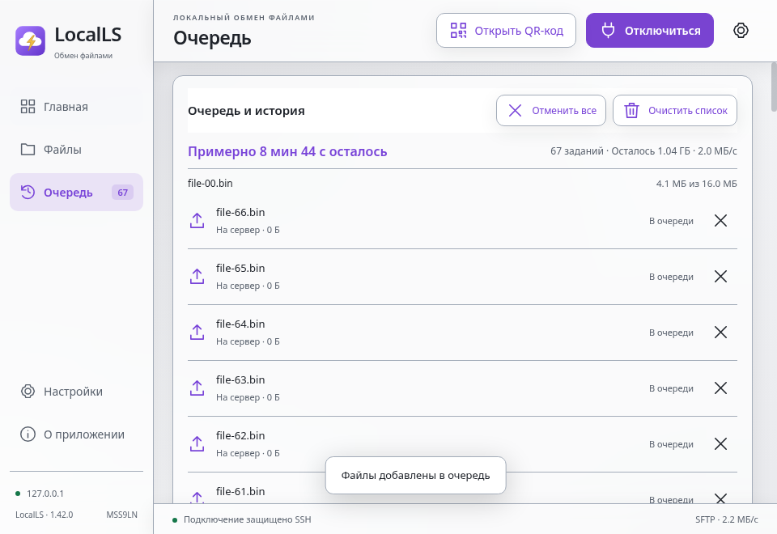

# LocalLS Fedora 1.42 — исправление и аудит

Автор — **MSS9LN**.

[Скачать RPM x86_64](../LocalLS-1.42.0-Fedora-x86_64-audit-20261102.rpm) · [Инструкция](../../linux/README.md) · [Полный отчёт](audit.txt) · [SHA-256](SHA256SUMS.txt)

Исправлено: несовместимые POSIX-имена вроде `CON` и `a:b.txt` больше не срывают открытие общей папки. Обычные файлы рядом видны и скачиваются. Ограничения доступа сохранены; неподдерживаемые файлы остаются на месте.

Fedora44:91 тест и8 сценариев на установленном RPM, включая QR, передачу, очередь, просмотр и системную связку ключей. Android1.40:481 JVM-тест,19 Python и lint. Windows:95 Node-тестов на Linux; Windows не пересобиралась, это не проверка на физической Windows. Все прежние тесты сохранены.

RPM обновляет1.41 и пока не имеет подписи издателя. Android APK прежний, с тем же сертификатом. Физические устройства и GNOME/Wayland/KDE/SELinux-десктоп здесь не проверялись.

