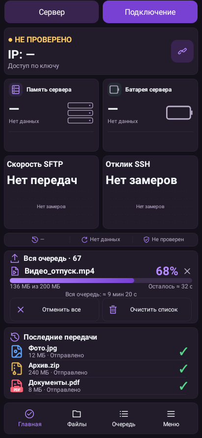
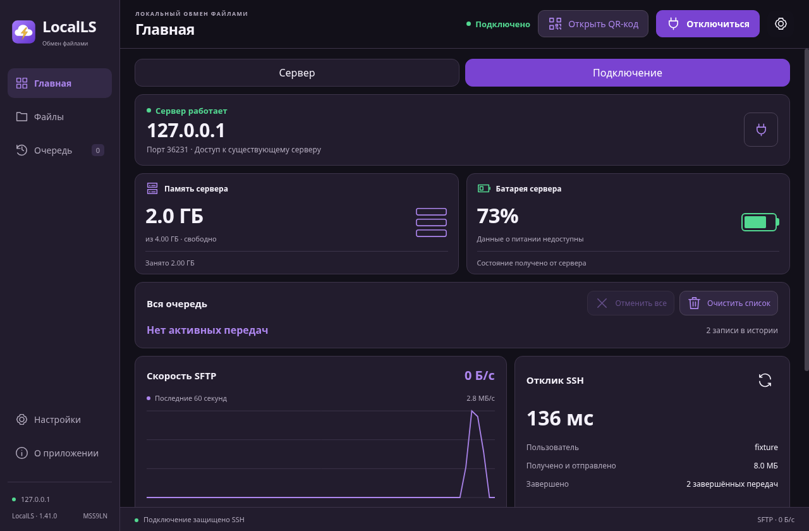
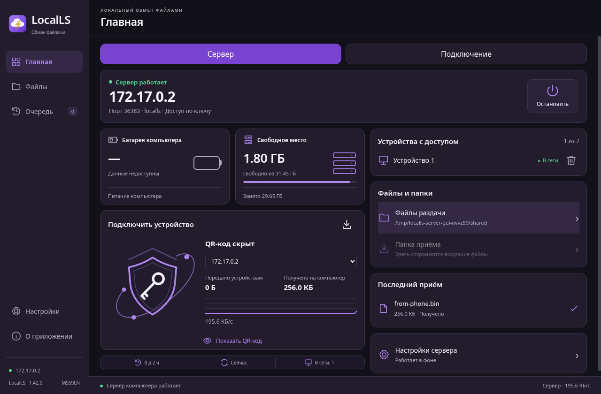

# LocalLS — три платформы

Снимки интерфейса с тестовыми данными. Изображения не перерисованы и не изменены.

Android1.40: свежая отрисовка фактических Android-виджетов nativeRobolectric после полного прогона2026-11-02. Имя старой папки ui-previews не обозначает версию приложения.

Windows1.41: сохранённый снимок точного ASAR установленной сборки в Electron под Linux от2026-10-30. Это не снимок физического Windows-компьютера.

Fedora1.42: снимок установленного финального RPM в Fedora44/X11 от2026-11-02. Это тестовый контейнер, не физический GNOME/Wayland-десктоп.

