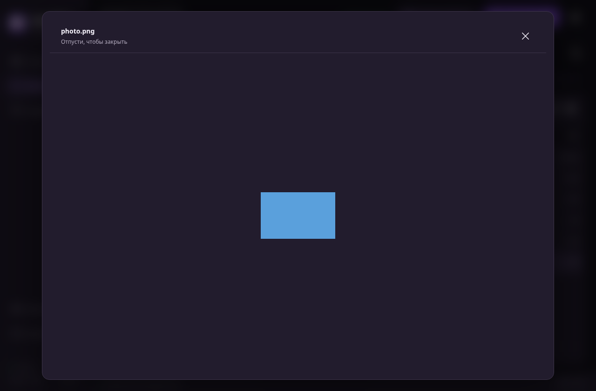
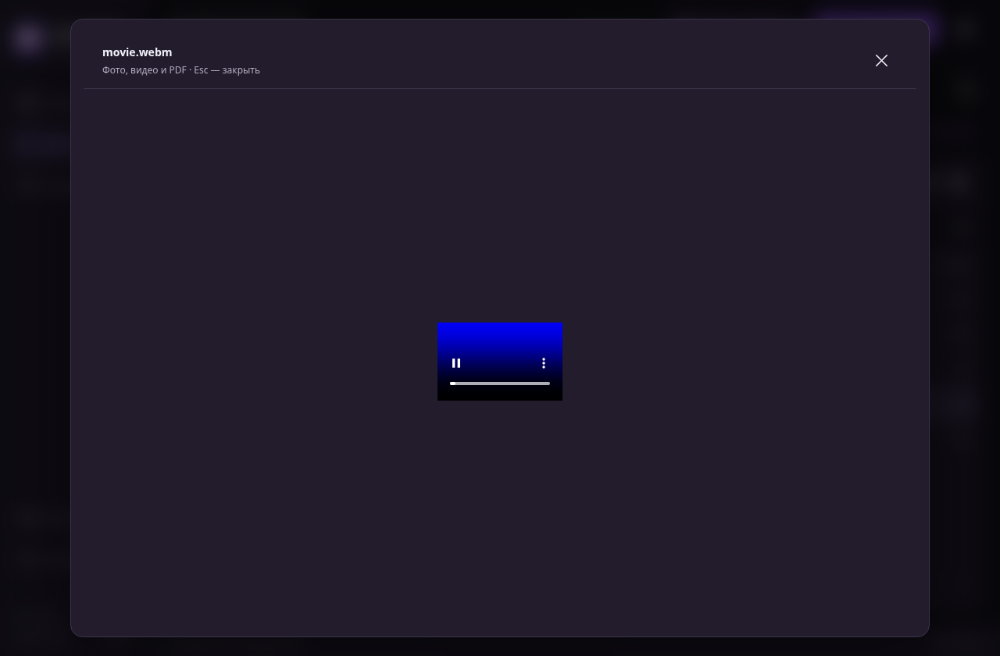
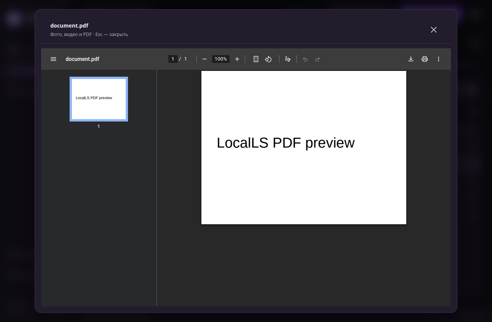
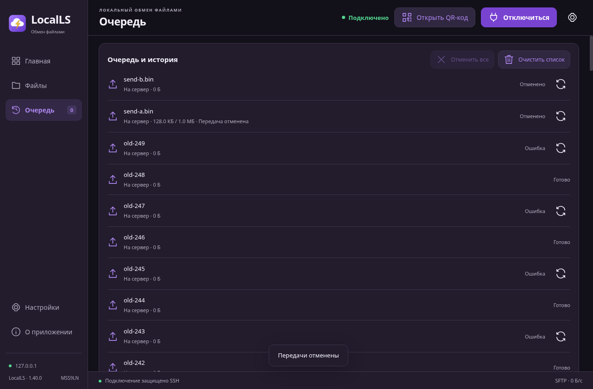
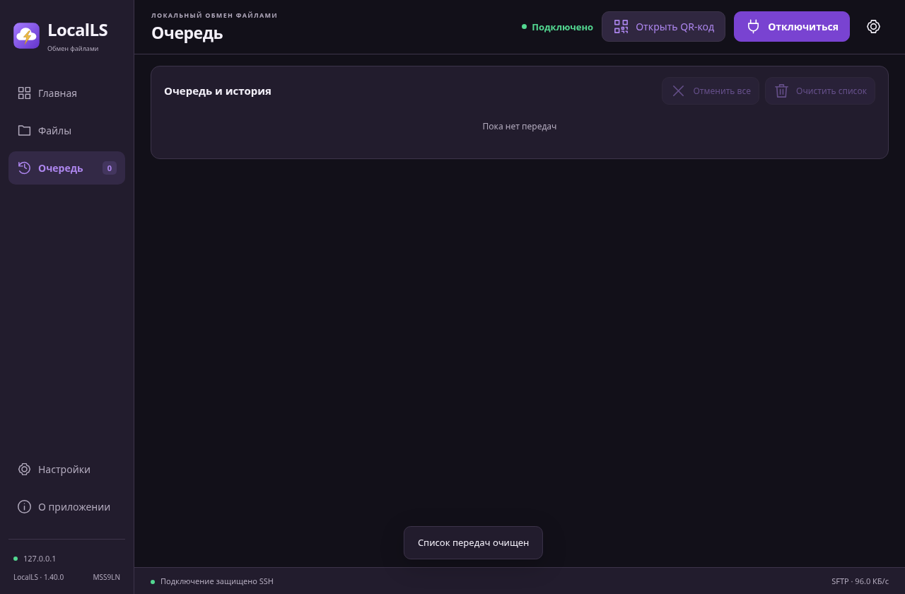

# Windows1.40 — очередь и просмотр файлов

[Скачать EXE](../LocalLS-1.40-Windows-x64-Setup-unsigned-queue-preview-20261030.exe) · [SHA-256](SHA256SUMS.txt) · [Полный отчёт](audit.txt)

- «Отменить все» останавливает передачи. «Очистить список» отменяет незавершённые и убирает всю историю; файлы сохраняются.
- Фото, видео и PDF: удерживай мышь на файле или выбери его и нажми «Просмотр». Для файлов больше128МиБ сначала скачивание.
- 84Node-теста,5SSH/SFTP-сценариев с64МиБ в обе стороны и6сценариев готового интерфейса прошли. Дополнительно проверен Node -> Java серверный код Android. Стенд Linux/Electron/JVM, физические устройства/Windows-установка не проверялись.

**Windows EXE без цифровой подписи. Android1.38 не менялся.**

