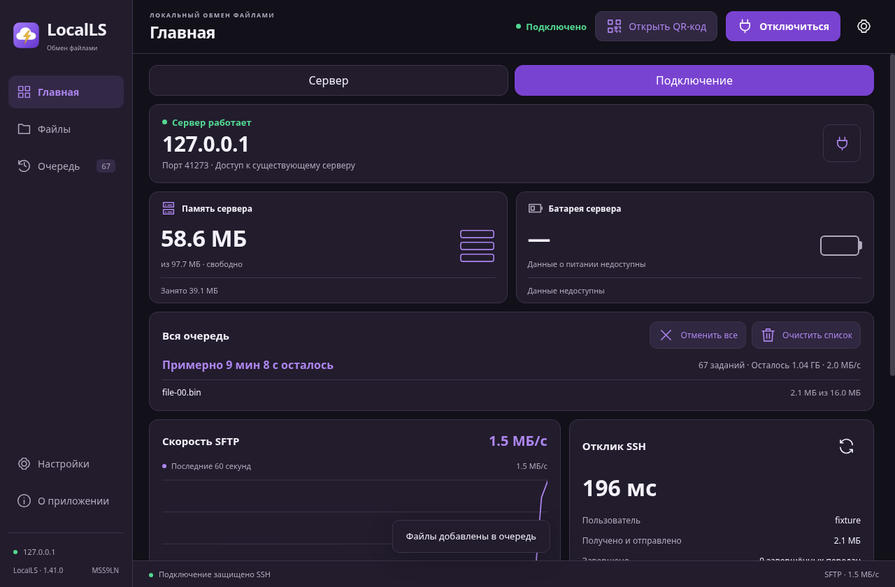
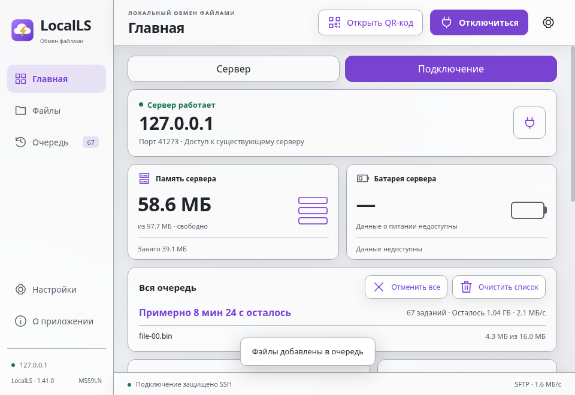
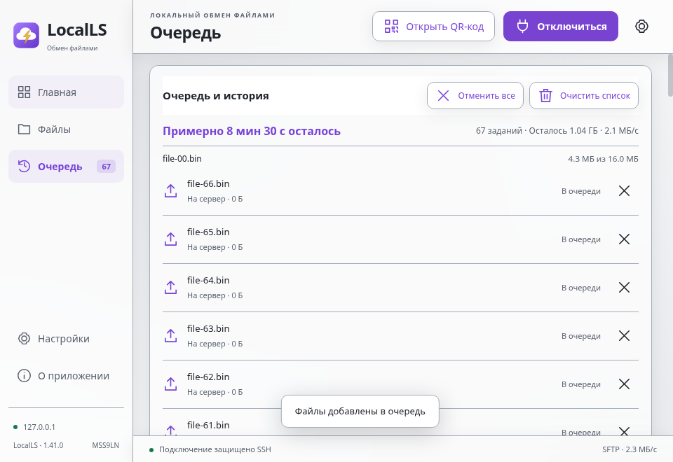
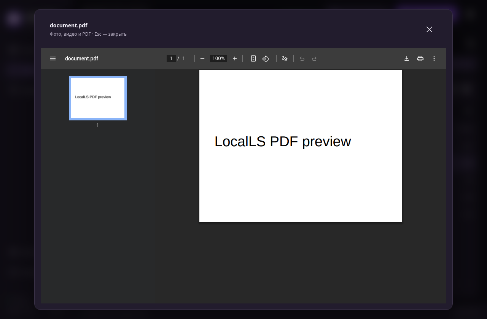

# Windows 1.41 — время всей очереди и SFTP

[Скачать EXE](../LocalLS-1.41-Windows-x64-Setup-unsigned-eta-throughput-20261030.exe) · [SHA-256](SHA256SUMS.txt) · [Отчёт](audit.txt) · [Замер скорости](latency-comparison.json)

- Общее оставшееся время и объём — на главной и в очереди; отмена/очистка всего списка доступны также на главной.
- Передача SFTP: ограниченное окно из восьми блоков, без изменения ключей/шифрования. На модели задержки 20 мс: около 0,97 -> 5,0 МиБ/с. Это не замер физического Wi-Fi и не обещание такого ускорения на каждом устройстве.
- Фото, видео и PDF: удерживай мышь или нажми «Просмотр». Лимит 128 МиБ.
- В «О приложении» — «Версия программы». Автор MSS9LN. Пасхалки нет.

95 Node-тестов, 5 сценариев SSH/SFTP с 64 МиБ в обе стороны, 7 сценариев готового интерфейса и Node -> Java Android с 8 МиБ в каждую сторону прошли. Стенд Linux/Electron/JVM, физические устройства и Windows-установка не проверялись.

**Windows EXE без цифровой подписи. Android 1.38 не менялся.**

Скриншоты ниже — тестовый loopback с контролируемой задержкой ответов, не пользовательский Wi-Fi.

