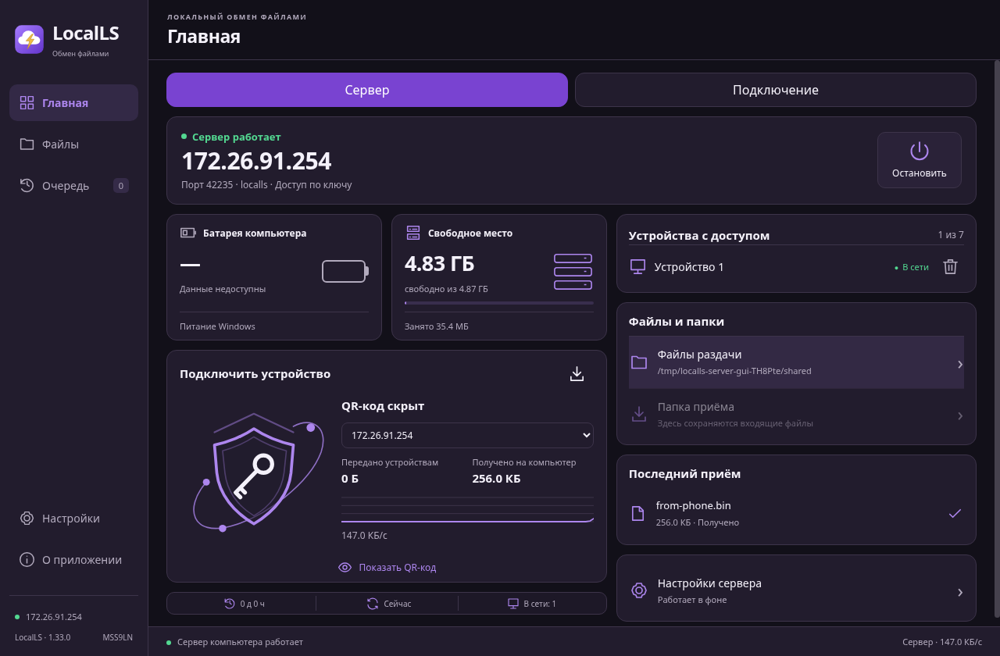

# LocalLS Windows 1.33 — MSS9LN

Клиент и встроенный сервер SSH/SFTP для Windows 10/11 x64. QR-вход с подтверждением, до семи устройств, файлы и папки, очередь, повтор, примерное время передачи, трей. Восемь тем, светлый фон, стекло и светлая обводка.

[Скачать установщик](https://github.com/grigorywork/LocalLS/releases/download/windows-v1.33.0/LocalLS-1.33-Windows-x64-Setup.exe) · [Инструкция](../../desktop/README.md)

Проверено: 47 Node-тестов, 4 проверки версий, Electron GUI клиента/сервера/QR/повреждённого хранилища, реальный SFTP через loopback, вложенные/пустые папки и защита от перезаписи. Проверен запуск из окончательного app.asar. Содержимое установщика извлечено и сверено с исходниками; PE x64, версия и иконки проверены.

**Тестовая сборка: на Windows ещё не запускалась.** GUI проверен на Linux Electron; системное хранилище в QR/серверных тестах заменялось тестовым шифрованием. Установщик без Authenticode-подписи. Установка/удаление и Windows DPAPI на настоящей Windows ещё требуют проверки. Android, Fedora, прежние APK/EXE, release-ветка и Android-тег сохранены.

SHA-256: `5d7869c7a90e01eb8d469969501ef36dfda94a52aa939b033b54a5d9530b11e0`.

